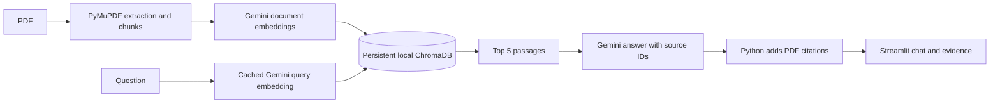

# Pakistan North Tours AI

A small RAG chatbot for a personal 92-page Northern Pakistan travel guide. Ask
about routes, treks, transport, costs, and facilities instead of searching the
PDF manually. Answers include PDF page citations and expandable source passages.

This learning and portfolio project uses Python, PyMuPDF, the official
`google-genai` SDK, Gemini embeddings, local ChromaDB, and Streamlit.

## Architecture



The index contains 49 chunks from 92 pages, approximately 400-697 estimated
tokens per chunk. It uses `gemini-embedding-2`, 3,072 dimensions, and cosine search.
Chat uses `gemini-3.8-flash`. The original preferred model, `gemini-2.5-flash`,
returned an account-access 404; the replacement was explicitly approved.

## Setup

Checked with Python 3.13.7 on Windows. For a fresh local setup:

```powershell
python -m venv .venv
.\.venv\Scripts\Activate.ps1
python -m pip install -r requirements.txt
if (!(Test-Path .env)) { Copy-Item .env.example .env }
```

Keep an existing virtual environment and `.env` when continuing this project.
Configure these variables in `.env`:

```dotenv
GEMINI_API_KEY=your-gemini-api-key
GEMINI_CHAT_MODEL=gemini-3.8-flash
GEMINI_EMBEDDING_MODEL=gemini-embedding-2
```

The key is read locally and never displayed. `.env`, `.venv`, local data, and
Streamlit secrets are ignored by Git. A fresh checkout alone does not include
the source PDF or index. Place the authorized PDF at
`pakistan-north-tours-final.pdf` in the project root.

## Ingestion and retrieval

For a new local index only:

```powershell
python ingest.py
python ingest.py --embed
```

Extraction writes `data/pages.json` and `data/chunks.json` without API calls.
`--embed` reads those saved chunks, persists vectors in `data/chroma`, and skips
already indexed IDs. The app never runs ingestion. Do not regenerate embeddings
when using the existing index. Changing the embedding model requires an
explicitly reviewed rebuild; changing the chat model does not.

```powershell
python rag.py
```

This runs the five retrieval smoke questions without generating answers. It
prints the top three IDs/page ranges and saves the top five full passages to
`data/retrieval_results.json`. Query embeddings are cached locally.

## Run the chatbot

```powershell
python -m streamlit run app.py
```

Open Streamlit's local URL, normally `http://localhost:8501`. Use the example
buttons, inspect source evidence, or clear the conversation. Ask standalone
questions with the destination named. History is displayed but is not used to
rewrite follow-up questions.

Gemini selects evidence IDs for each paragraph. Python validates them and adds
stored page ranges; the model is not asked to invent page numbers. Missing
information receives "I couldn't find that information in the PDF." The app
warns that prices, schedules, and travel conditions may have changed.

Three live Streamlit checks passed: Khunjerab refueling, Islamabad-Skardu
transport, and refusal of tomorrow's Hunza weather. Source evidence and chat reset
were checked. These are smoke checks, not a generation accuracy benchmark.

## Retrieval evaluations

The [reviewed dataset](evals/questions.json) has 25 questions: 10 direct,
5 paraphrased, 5 multi-fact, and 5 unanswerable. All labels are `verified` after
an independent source-consistency review and user approval. The corrected file
includes additional valid Deosai evidence for q04/q17 and required evidence
groups for q16-q20. All gold IDs were checked against the 49 existing chunks.
Questions, reference answers, gold evidence, and rankings are available in
the [evaluation summary](evals/summary.md).

```powershell
python evaluate.py
```

The script evaluates only verified answerable questions, retrieves ten chunks,
and saves `evals/results.csv` and `evals/summary.md`. It reuses cached query
embeddings and never generates answers. Unanswerable questions need a separate
manual refusal review. With no verified labels, it makes no embedding requests.

| Metric | Current actual result |
|---|---|
| Verified answerable questions | 20 |
| Hit@5 | 1.0000, 20/20 |
| MRR@10 | 0.9667 |
| CompleteEvidence@5 | 1.0000, 5/5 multi-fact questions |
| Failed retrieval questions | 0 |

All 20 answerable questions completed without retrieval errors. Nineteen had
gold evidence at rank one; q07, about the hike from Ratti Gali base camp, had its
gold chunk at rank three. There were no Hit@5 misses or incomplete multi-fact
evidence groups. Five unanswerable questions are excluded from these metrics.
These scores measure retrieval on this reviewed set, not chatbot answer accuracy.

Hit@5 checks whether any gold chunk appears in the first five results. MRR@10
averages the reciprocal rank of the first gold chunk in the first ten, with zero
for a miss. For multi-fact questions, neither metric proves that every necessary
chunk was retrieved. CompleteEvidence@5 checks the five multi-fact questions:
at least one top-five chunk must appear in every `required_evidence_groups`
group. IDs within each group are alternatives; every group is required. The
CSV records missing groups as well as rank-ordered IDs, pages, and distances.
The five earlier smoke queries are not formal scores.

## Limitations and deployment status

- The static guide may contain outdated or incorrect information. Its claims
  are not verified against current sources by this app.
- Some chunks cover several destinations or cross page boundaries. Citations
  identify the retrieved range rather than an exact sentence location.
- Lower-ranked passages can be irrelevant. Valid source IDs alone do not prove
  that every generated claim is supported.
- The small reviewed dataset is not a held-out benchmark. Refusal behavior has
  limited smoke coverage; approval of unanswerable labels does not verify refusals.
- Local query caching and session chat are intended for a demo, not concurrent
  production use. Generation requires Gemini API access.

Deployment and a public demo URL are pending. No publication or Streamlit Cloud
deployment has started. Approval is required before publishing the source PDF,
index, or excerpts. Cross-platform loading of a bundled index still needs checking.

See [the project report](docs/PROJECT_REPORT.md) for the implementation process,
recorded results, design choices, and remaining work.
