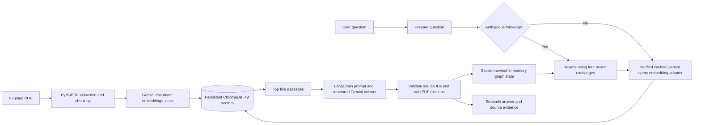
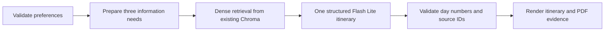
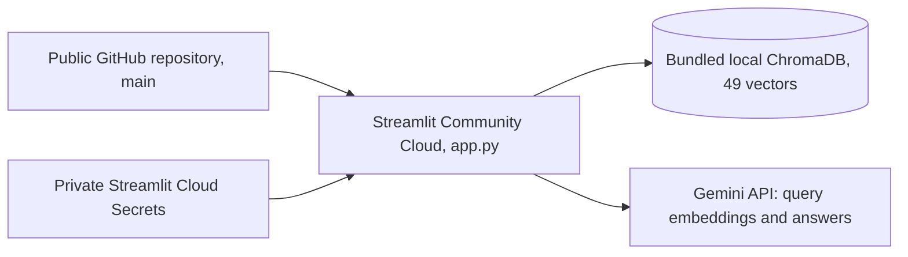

# Pakistan North Tours AI

A document-grounded AI travel assistant built using Retrieval-Augmented Generation (RAG), Gemini, ChromaDB, and Streamlit.

The application retrieves information from a 92-page Northern Pakistan travel guide and generates answers with supporting PDF citations.

**v1.1.0:** conversational RAG and personalized trip planning are on `main` and
the existing Streamlit deployment. See the [GitHub release](https://github.com/awaisarif18/pakistan-north-travel-buddy/releases/tag/v1.1.0)
for the full change list and verification limits. Tag `v1.0.0` preserves the
previous implementation.

## What's New in v1.1.0

The v1.1 release adds LangChain model/retrieval interfaces and a typed
LangGraph conversation workflow with session memory and conditional follow-up
rewriting. Gemini 3.5 Flash Lite handles rewriting, answers, and trip outlines;
Gemini Embedding 2 and all 49 original Chroma vectors remain unchanged.

- Optional development-only LangSmith traces and reviewed 10-question development / 40-question held-out datasets.
- Dense, BM25, and hybrid RRF retrieval, with saved rankings and a frozen comparison. Dense remains the benchmark-selected default.
- Shared generation/embedding safeguards, rolling session quotas, DST-aware Pacific days, and friendly capacity messages. These counters are volatile and bypassable, not durable per-user enforcement.
- Existing Google Forms feedback and tester-consent links, plus a source-cited personalized trip planner with partial-plan handling.

| Held-out method | Hit@1 | Hit@5 | MRR@10 | CompleteEvidence@5 | Median retrieval ms |
|---|---:|---:|---:|---:|---:|
| Dense | 0.9375 | 1.0000 | 0.9688 | 0.9677 | 58.655 |
| BM25 | 0.8750 | 1.0000 | 0.9323 | 0.9355 | 0.839 |
| Hybrid RRF | 0.9375 | 1.0000 | 0.9635 | 0.9677 | 58.479 |

The harder benchmark has 32 answerable held-out questions and 31 eligible
CompleteEvidence cases. Development scores tied across all methods; dense won
the predeclared tie-break before held-out execution. Small samples, saturated
Hit@5, and one-pass cached latency do not establish broad superiority. Detailed
[methods, failures, and experiment links](evals/experiments/hybrid-v11-20261017/summary.md)
remain separate from the preserved v1.0 results.

The planner's final audit narrows local-car transport guidance to an explicit
road-access limitation instead of unverified suitability claims. Day cards
retain source-based estimates. Broader route feasibility still needs human
review; citations validate references, not every claim. Next priorities are
independent varied evaluation cases, stronger feasibility checks, and durable
account-based quotas if the demo grows. Those features are not implemented.

See the [release notes](docs/RELEASE_v1.1.0.md),
[planner review](evals/trip_planner_review.md), and
[technical report](docs/PROJECT_REPORT.md). The release is on `main`;
see the deployment section for the current verification status.

### Post-v1.1.0 maintenance

The maintenance pass preserves repeated planner guidance topics instead of
silently dropping earlier paragraphs. Citations now accompany all retained
guidance. Focused offline checks passed for conversations, quotas, planner
validation, and currency display. A clean Linux Python 3.12 runtime loaded all
49 original vectors without ingestion, the PDF, or `.env`. Synthetic browser
checks covered desktop and 390px layouts. Eight hosted workflows exercised
supported chat, destination switching, follow-ups, refusal, and four trip cases.
The review found overly confident seasonal-access wording; a small prompt
correction passed one focused real-model Skardu check using saved evidence.
Its final wording has not been retested on the hosted app. Hosted 390px visual
capture and a hosted cold restart remain unverified.
See the [post-release verification record](docs/PROJECT_REPORT.md#post-v110-verification-and-fixes).
The published `v1.1.0` tag and frozen evaluation results remain unchanged.

## Live demo and source code

**[Open the live demo](https://pakistan-north-travel-ai.streamlit.app/)** · **[View the source on GitHub](https://github.com/awaisarif18/pakistan-north-travel-buddy)**

## Technology badges


## Application screenshot


## Features

- Processes the 92-page guide with PyMuPDF into 49 text chunks with physical PDF page metadata.
- Uses Gemini Embedding 2 at 3,072 dimensions and persistent ChromaDB cosine search to retrieve the top five passages.
- Generates concise answers with Gemini 3.5 Flash Lite on v1.1. The preserved v1.0 release used Gemini 3.8 Flash. Python validates selected source identifiers and attaches page citations from stored metadata.
- Exposes retrieved passages in expandable source cards and refuses questions unsupported by the supplied evidence.
- Provides a responsive Streamlit chat interface with six example prompts, conversation display, and a reset option.
- On v1.1, adds a source-grounded trip planner and sidebar links for feedback and optional future testing.
- Caches query embeddings to avoid repeat embedding calls for identical questions and configuration.
- Includes a reviewed 25-question retrieval dataset, three retrieval metrics, and a separate recorded answer-quality review.
- Runs publicly on Streamlit Community Cloud using a bundled prebuilt index, without ingestion at startup.

Ask about routes, trekking seasons, transport, fuel stops, costs, and facilities.
For example: "Where should I refuel before traveling to Khunjerab Pass?"
The preserved v1.0 release requires explicit destinations in each question. In
the current v1.1 release, follow-ups can resolve the destination from the last four
exchanges. Answers still use retrieved PDF evidence rather than conversation
history as a source.

## RAG architecture



Chunks contain approximately 400-697 estimated tokens, with paragraph overlap
where practical. `rag.py` checks the indexed embedding model, dimensions, and
retrieval-format version before use. Documents and questions share
`gemini-embedding-2` and 3,072 dimensions, with document/query-specific prefixes.

The model selects source IDs rather than inventing page numbers. The application
validates those IDs and appends page ranges from the retrieved metadata. This
checks citation references, not the truth of every generated statement.

`workflow.py` compiles typed state into this LangGraph workflow:
`START → prepare_question → optional rewrite_question → retrieve_evidence → generate_grounded_answer → validate_citations → END`.
Retrieval uses LangChain `Document` objects and a similarity retriever over the
existing Chroma collection. The embedding adapter delegates to v1.0's exact
query-prefix, dimension, cache-key, and cache-write implementation in `rag.py`.
It blocks document embedding. The original retrieval, ingestion, and evaluator remain the migration reference;
only the default text-generation model in `rag.py` now uses Flash Lite. There are no agents, tools, or loops.
Each Streamlit session owns an `InMemorySaver`, graph, and random thread ID.
Completed graph turns are the sole chat-history source. Reruns read state;
they do not replay prior questions. New conversation replaces the graph and
thread, and server/session loss clears memory. Only stateless clients are cached
across sessions. The original question stays visible, while retrieval and
generation use the resolved standalone query. Generation receives no history.

Run the small controlled memory checks, with no Gemini calls:

```powershell
.\.venv-v1.1\Scripts\python.exe verify_conversation.py
# Optional: upload synthetic development traces, never public-user conversations.
.\.venv-v1.1\Scripts\python.exe verify_conversation.py --trace
```

See the [conversation review](evals/conversation_review.md) for seven scenario
results, live Gemini spot checks, citation checks, and limitations. This does
not run the approved held-out benchmark or change historical retrieval scores.

### Dense, keyword, and hybrid modes

The v1.1 graph accepts any of three LangChain retrievers. Dense retains the
original Chroma/Gemini path. BM25 builds an in-memory keyword index directly
from Chroma's stored passages, so it needs neither the PDF nor `chunks.json`.
Hybrid fuses the top 20 dense and BM25 candidates using equal-weight Reciprocal
Rank Fusion, `score(id) = sum(1 / (60 + rank))`, deduplicated by existing chunk
ID. BM25 uses `rank-bm25==0.2.2`, standard parameters, case-folded alphanumeric
tokens, no stemming or stopword removal, and excludes nonpositive matches.
Fusion ties are broken by chunk ID. Neither method changes source metadata.

Set `RETRIEVAL_MODE=dense`, `bm25`, or `hybrid` in `.env` or Streamlit Secrets
to select the app mode before startup. Dense remains the default, selected on
development results before freezing the held-out comparison. No neural
reranker or separate database is used. The graph and citation validation are
shared across all three modes; the existing UI is preserved.

The [hybrid benchmark report](evals/experiments/hybrid-v11-20261017/summary.md)
contains measured scores, latency, experiment links, paired regressions, and
the frozen settings. Its new exports preserve all historical evaluation files.

| Held-out method | Hit@1 | Hit@5 | MRR@10 | CompleteEvidence@5 | Multi-passage complete@5 |
|---|---:|---:|---:|---:|---:|
| Dense | 0.9375 | 1.0000 | 0.9688 | 0.9677 | 0.9412, 16/17 |
| BM25 | 0.8750 | 1.0000 | 0.9323 | 0.9355 | 0.8824, 15/17 |
| Hybrid RRF | 0.9375 | 1.0000 | 0.9635 | 0.9677 | 0.9412, 16/17 |

Hit/MRR use 32 answerable cases; CompleteEvidence uses 31 with required groups.
Mean group coverage on the 17 two-group cases was 0.9706 for dense/hybrid
and 0.9412 for BM25. Warm-cache median retrieval latency was 58.655 ms,
0.839 ms, and 58.479 ms respectively, from one local sample per query/method.
All methods tied on development accuracy; dense was selected and settings
frozen before the one final held-out comparison. No post-test tuning occurred.
The small single-PDF set cannot establish a confident configuration winner.

## Technology stack

| Component | Technology |
|---|---|
| Runtime | Python 3.12 deployment configuration |
| PDF extraction | PyMuPDF 1.28.2 |
| Embeddings | `gemini-embedding-2`, 3,072 dimensions |
| Vector storage | ChromaDB 1.5.9, persistent cosine index |
| Text generation on v1.1 | `gemini-3.5-flash-lite`, shared by rewriting and answers |
| Gemini client | Official `google-genai` SDK 2.20.0 on this branch; v1.0 retains 1.75.0 |
| LangChain interfaces | langchain-core 1.6.12 |
| Gemini integration | langchain-google-genai 4.4.2 |
| Chroma integration | langchain-chroma 1.1.0 |
| Workflow | langgraph 1.2.16 |
| Transitive tracing dependency | langsmith 0.14.11; optional tracing through environment settings |
| Interface | Streamlit 1.66.0, custom CSS, native chat components |
| Local configuration | python-dotenv 1.2.4 |
| Hosting | GitHub and Streamlit Community Cloud |

The development branch uses LangChain Core and provider integrations directly.
The top-level `langchain` agent package is unnecessary for this workflow and is
not installed. The Gemini integration requires the SDK upgrade; the separate
local v1.1 virtual environment preserves the working v1.0 environment.

Optional LangSmith tracing reads `LANGSMITH_TRACING`, `LANGSMITH_API_KEY`, and
`LANGSMITH_PROJECT` from your private environment. The template defaults to
`LANGSMITH_TRACING=false`; development commands require an explicit `--trace`
or `--langsmith` flag to upload traces/results. Streamlit calls the workflow
with tracing forced off, even if the environment flag is true. Keep real
tracing keys private, like the Gemini key. Production needs no LangSmith API
key or project setting; leave those development credentials out of Cloud Secrets.

## Evaluation methodology and results

The following audited v1.0 results and original evaluation files are preserved.
Migration parity is recorded separately below; these scores were not overwritten.

The curated dataset contains 10 direct factual questions, five paraphrased
questions, five multi-fact questions, and five unanswerable questions. Gold
chunk IDs and physical PDF pages were independently checked against the source
and approved before all 25 labels were marked `verified`. The reviewed labels
include alternative Deosai evidence for q04/q17 and required evidence groups
for q16-q20.

| Metric | Result |
|---|---|
| PDF pages | 92 |
| Document chunks | 49 |
| Evaluation questions | 25 |
| Verified answerable questions | 20 |
| Hit@5 | 1.0000 (20/20) |
| MRR@10 | 0.9667 |
| CompleteEvidence@5 | 1.0000 (5/5) |
| Retrieval errors | 0 |

The baseline evaluator retrieves the top ten chunks using semantic search and
cached query embeddings, independently of answer generation:

- **Hit@5:** fraction of verified answerable questions with at least one gold chunk in ranks 1-5.
- **MRR@10:** mean reciprocal rank of the first gold chunk in ranks 1-10; a miss contributes zero.
- **CompleteEvidence@5:** fraction of the five verified multi-fact questions with at least one top-five chunk from every `required_evidence_groups` group. IDs within a group are alternatives, every group is required, and a shared chunk may satisfy multiple groups where the reviewed labels allow it.

Only the 20 verified answerable questions enter Hit@5 and MRR@10. Complete
evidence coverage is measured separately because a single matching gold chunk
does not establish that all facts were retrieved. Aggregate scores require
successful retrieval for every eligible question; unverified labels are excluded.
The CSV preserves rank-ordered IDs, page ranges, distances, first-gold ranks,
and missing evidence groups.

There were no Hit@5 misses or incomplete multi-fact evidence groups. Nineteen
questions retrieved gold evidence at rank one. q07, about the hike from Ratti
Gali base camp, retrieved its gold chunk at rank three behind passages about
other treks. MRR@10 is therefore `(19 + 1/3) / 20 = 0.9667`.

### Separate answer-quality review

**5/5 supported answers passed** the recorded factual-consistency, completeness,
and citation-support review. **5/5 unanswerable questions were appropriately
refused** without fabricated citations. The ten-response review included a
multi-fact question, eight newly generated answers, and two reused saved outputs.
Evidence was compared directly with the PDF; no LLM judge or evaluation framework
was added.

These are actual observations on a small, curated dataset, not a held-out
benchmark or a guarantee of universal accuracy. Retrieval metrics do not measure
answer correctness. The earlier five retrieval smoke queries are not formal
evaluation scores, and refusal behavior has not been tested broadly or adversarially.

Review the evidence and methodology:

- [Verified questions and gold labels](evals/questions.json)
- [Per-question retrieval rankings and scores](evals/results.csv)
- [Evaluation summary and supporting excerpts](evals/summary.md)
- [Recorded answer-quality review](evals/answer_quality.md)
- [Full development process and technical report](docs/PROJECT_REPORT.md)

### v1.1 migration verification

All 25 verified questions matched the v1.0 top-ten ordering, chunk text, page
metadata, and cosine distances exactly. Maximum distance difference was `0.0`.
The 20 archived answerable-question rankings also matched, and top-five
retriever results matched each baseline prefix. The collection still contains
49 vectors. The deployed index files, original backend, labels, and evaluation
reports remain unchanged. See [per-question parity results](evals/v1_1_parity.csv).

Four fresh LangChain/LangGraph answer checks covered q01, q17, q21, and q25.
The two supported answers matched the PDF, including multi-fact evidence for
Skardu transport and Deosai closure; both unsupported questions refused without
citations. These selected checks do not replace the original ten-answer review.
Graph order, invalid citation rejection, cached embedding request formatting,
and Streamlit startup/submit/reset passed focused checks. No document embeddings
or real query embeddings were generated during verification.

### LangSmith tracing and the approved v1.1 datasets

The private LangSmith dataset `pakistan-north-v1-verified-25` contains the existing
25 verified references. [Its local JSONL export](evals/langsmith_baseline.jsonl)
retains labels, answers, gold IDs/pages, and excerpts. Importing it did not run
retrieval or recalculate the historical scores.

The [50-question reviewed benchmark](evals/questions_v1_1.json) has 40 answerable and
10 unanswerable questions. Review it in the [expandable gold-evidence sheet](evals/review_v1_1.md).
Development has 8 answerable + 2 unanswerable questions; held-out has 32 + 8.
All 50 labels are `verified` after independent review and explicit user approval.
The private LangSmith datasets `north-tours-v1-1-dev` and
`north-tours-v1-1-heldout` contain 10 and 40 examples respectively. Remote
inputs, reference outputs, metadata, and split membership match the approved
local dataset. Gold chunk IDs are disjoint between splits,
but all questions still use the same PDF and share topics with the old benchmark.
Neither import nor evaluation accepts unverified labels. The retrieval-only
comparison is recorded in the hybrid benchmark report above. No new
answer-quality scores have been generated for these 50 questions.

The benchmark is intentionally multi-fact-heavy: 38/40 answerable questions are
`multi_fact`. Of those, 21 have one required evidence group and 17 have two.
The saved benchmark reports aggregate CompleteEvidence@5 and a separate multi-passage
result restricted to questions requiring at least two distinct evidence groups.
One-chunk multi-fact coverage does not demonstrate multi-passage retrieval.
Dense retrieval covers both groups for 16/17 held-out multi-passage questions,
with group coverage of 33/34. See the [saved benchmark](evals/experiments/hybrid-v11-20261017/summary.md)
for the full comparison. The v1.0 scores above remain unchanged.
All 17 two-group cases are held-out after the requested split rebalance. The
development multi-passage subgroup is empty and should be reported as unavailable.

Development commands use the existing `.env` without printing credentials:

```powershell
.\.venv-v1.1\Scripts\python.exe langsmith_eval.py prepare
.\.venv-v1.1\Scripts\python.exe langsmith_eval.py upload --dataset baseline
.\.venv-v1.1\Scripts\python.exe langsmith_eval.py upload --dataset harder --split dev
.\.venv-v1.1\Scripts\python.exe langsmith_eval.py upload --dataset harder --split held_out
.\.venv-v1.1\Scripts\python.exe langsmith_eval.py ask --trace --question "What does the guide say about Patundas access?"
```

`prepare` is local-only. Upload is idempotent and refuses mismatched remote
references instead of overwriting them. `ask --trace` explicitly sends that
development question, retrieved passages, and generated answer to the configured
LangSmith project; it is not used by the public chat interface. Missing tracing
credentials cause a clear configuration error.

For a separately authorized future run, these commands evaluate the development
split locally or create a LangSmith experiment with the same local exports.
Synchronization did not run either benchmark:

```powershell
.\.venv-v1.1\Scripts\python.exe langsmith_eval.py evaluate --dataset harder --split dev --allow-query-embeddings
.\.venv-v1.1\Scripts\python.exe langsmith_eval.py evaluate --dataset harder --split dev --langsmith --allow-query-embeddings
```

`--split held_out` explicitly selects the held-out cases. Keep them out of
tuning until development decisions are frozen. `--answers` additionally opts
into one generation request per question, including negative cases. Without
it, negatives are unscored and do not trigger retrieval. Cached query vectors
are reused; `--allow-query-embeddings` explicitly allows missing query vectors,
never document re-embedding. No LLM judge is implemented or automatically run.

Code-based evaluators report Hit@1, Hit@5, MRR@10 and CompleteEvidence@5 for
eligible verified positives. CompleteEvidence@5 uses reviewed evidence groups;
unanswerable cases are excluded. Any run error withholds aggregate scores.
Answer mode adds structural citation validity and strict fixed-refusal checks.
Answer correctness and groundedness remain unscored until manual PDF review;
valid citation syntax alone is not evidence of semantic support.

In [LangSmith](https://smith.langchain.com/), open **Tracing** and select your
`LANGSMITH_PROJECT` to inspect node, retriever, and model spans. A synthetic trace
named `synthetic-dev-trace-no-gemini` was verified with a mocked Gemini response.
For future experiments, open **Datasets & Experiments**, choose the dataset and
experiment, and inspect per-example scores, actual outputs, references, and traces.
Experiment prefixes default to `v11-<dataset>-<split>-dense-k10-<UTC timestamp>` and record
commit/model/source metadata. CSV and Markdown exports go to
`evals/experiments/<experiment-name>/`; they never overwrite the original files.
LangSmith may append a unique suffix to the experiment prefix; local exports use the prefix.
Manual correctness/groundedness fields and reviewer notes are left blank for review.
See Stage 9 of the [project report](docs/PROJECT_REPORT.md) for formulas, API usage,
privacy checks, and limitations.

## Local installation and usage

### Feedback and early testers on v1.1

**Send Feedback** and **Help Test Future Releases** in the sidebar open the
same [existing Google Form](https://forms.gle/5McdABdSnigwwdNz5) in a new tab.
Set `FEEDBACK_FORM_URL` in `.env` or Streamlit Secrets to configure it.
Links remain available when AI quota is exhausted. The app adds no prefilled
prompts, conversation history, trip details, identifiers, email, or keys.

The public form shows Yes/No tester consent with a privacy notice and a
separate email section for consenting testers. Feedback does not require joining
the tester program. Google Forms and its linked Sheet store responses; the app
has no email database, signup, invitation automation, or LangSmith response
upload. Read-only owner settings inspection confirmed automatic email collection
is off and the one-response restriction requires Google sign-in. The owner chose
to retain that restriction and the required Name field. Yes routes to the email
section; No routes directly to submission. No form was submitted during QA.
The email field's optional setting and both completed submission paths still
need owner verification. General feedback does not require joining the tester
program; the app itself collects no name or email.

### Personalized trip outlines on v1.1

Choose **Plan a Trip** in the sidebar. Enter departure city, region, 1-10 total
travel days, Motorbike/Car/Public Transport, budget style, interests, and an
optional month. Travel days include outward and return journeys. Results show
an overview, day cards, transport/stay/budget/season/safety guidance, missing
information, and expandable PDF evidence. A partial plan is expected when the
guide cannot establish all details. Daily groupings are suggestions, not
confirmed driving schedules, bookings, current prices, or road-opening guarantees.



Dense was selected in the approved development benchmark. The planner makes
three deterministic searches for route/safety, attractions/stays/costs, and
seasonal restrictions. It interleaves the three top-five lists, deduplicates
original IDs, and caps context at 12 passages. Chat retrieval modes and their
rankings are unchanged. The planner needs neither the PDF nor chunks.json at
runtime and never ingests documents.

The existing limiter admits the request before retrieval/generation. One
planner submission consumes the separate one-plan/hour session allowance and
reserves at most one shared generation plus three embedding calls. Actual cache
misses and generation attempts count at the existing boundaries. Reruns render
the saved session output without regenerating it; other sessions have their own
form/output and quotas. No planner conversation history or user database is added.

[Planner development review](evals/trip_planner_review.md) records Hunza motorbike,
Skardu sightseeing, and an unrealistic one-day winter trip. Seven real generation
attempts and nine query embeddings were used, including two prompt corrections
for observed over-refusal, vehicle mismatch, and trek compression. Final records
contain useful partial outlines and an appropriate no-itinerary explanation for
the unrealistic trip. All source IDs validate. These few cases do not establish
broad route feasibility. The release audit replaces broad local-car transport
prose with a clear current-access limitation. The report retains failed drafts
and links to development traces.

```powershell
.\.venv-v1.1\Scripts\python.exe verify_planner.py
```

The real-review script `review_planner.py --trace` is opt-in, uses only controlled
cases in [trip_cases.json](evals/trip_cases.json), and refuses to overwrite saved
outputs. It can consume API quota. Production chat and planner calls explicitly
disable tracing. No held-out benchmark or LLM judge is part of planner testing.

### Flash Lite generation and anonymous usage safeguards on v1.1

The v1.1 application uses
`gemini-3.5-flash-lite` as its only configured text-generation model, through
`GEMINI_CHAT_MODEL`. Rewriting and final answers use that same model and one
shared generation-call budget. The trip planner uses that same model and
budget. Gemini
Embedding 2 and the existing 49 document vectors remain unchanged.

The user verified these Free Tier project limits. Application defaults leave
headroom and count invocation attempts, including failures, rather than messages:

| Model / role | Provider RPM / input TPM / RPD | App calls/minute / Pacific day | App estimated input tokens/minute |
|---|---|---|---|
| `gemini-3.5-flash-lite`, all text generation | 15 / 250,000 / 500 | 10 / 300 shared | 150,000 |
| `gemini-embedding-2`, cache misses | 100 / 30,000 / 1,000 | 30 / 300 separate | 20,000 |

Each browser session gets 3 chat requests and 1 trip plan per rolling
60 minutes, with a 12-second cooldown and 700-character input limit. Reruns do
not double-charge. New conversation preserves usage. A cached singleton allows
2 concurrent workflows and 3 workflow starts per rolling minute. The workflow
ceiling is separate from the actual generation-call budget. Admission reserves
one generation call for a standalone answer, two when conditional rewriting is
needed, and at most one embedding miss. Unused reservations are released;
actual attempts remain counted. Denied admissions run no graph or Gemini calls.

Daily counters use `America/Los_Angeles`, including DST. Minute/session windows
use monotonic time. A reservation survives midnight; each invocation is charged
to the day it starts. Conservative UTF-8 payload byte estimates plus fixed
prompt/schema headroom bound local input-token use without a countTokens API
call. These estimates are not exact provider token measurements. SDK calls make
one attempt; provider 429s return a friendly message with a 60-second process
backoff, without promising when Google will restore quota.

Configure `.env`, or top-level Streamlit Secrets for deployment, and
restart the process. `.env.example` contains the current names and defaults:

| Variable | Default |
|---|---|
| `GEMINI_CHAT_MODEL` | `gemini-3.5-flash-lite`, all text generation |
| `GEMINI_EMBEDDING_MODEL` | `gemini-embedding-2`, unchanged |
| `CHAT_REQUESTS_PER_WINDOW` / `TRIP_REQUESTS_PER_WINDOW` | 3 / 1 |
| `USAGE_WINDOW_SECONDS` / `SUBMISSION_COOLDOWN_SECONDS` | 3600 / 12 |
| `MAX_QUESTION_CHARS` / `MAX_CONCURRENT_WORKFLOWS` | 700 / 2 |
| `WORKFLOWS_PER_MINUTE` | 3 |
| `GENERATION_API_CALLS_PER_MINUTE` / `GENERATION_API_CALLS_PER_DAY` | 10 / 300 |
| `GENERATION_INPUT_TOKENS_PER_MINUTE` | 150000 |
| `EMBEDDING_API_CALLS_PER_MINUTE` / `EMBEDDING_API_CALLS_PER_DAY` | 30 / 300 |
| `EMBEDDING_INPUT_TOKENS_PER_MINUTE` | 20000 |
| `PROVIDER_BACKOFF_SECONDS` | 60 |

For existing local installations, change `GEMINI_CHAT_MODEL` in `.env` to
`gemini-3.5-flash-lite`. The separate `GEMINI_REWRITE_MODEL`, `CHAT_API_*`,
`REWRITE_API_*`, and their old input-token variables are retired. Remove those
old settings and use the unified `GENERATION_*` variables above. There is no
separate planner model setting or automatic fallback to Gemini 3.8 Flash.
The workspace `.env` has been updated without changing credentials.

Dense/hybrid standalone chat makes at most one generation and one uncached
query-embedding call. A follow-up adds one generation for rewriting, so it
consumes up to two calls from the same Flash Lite bucket. Cache hits remove
the embedding call; BM25 needs none. Empty evidence skips answer generation.
The last four exchanges provide bounded rewrite context, while final answers
still use retrieved PDF evidence and validated source IDs. `trip_plan` admission
reserves one generation and at most three embedding calls. Cached embeddings
reduce the actual cost; there is no planner rewrite or generation repair loop.

The [Flash Lite smoke review](evals/answer_quality_flash_lite.md) records three
real answers using the same saved evidence as the earlier 3.8 review. Both
supported answers passed source/citation checks; the live-weather request was
refused. Fuel advice was shorter, with optional details omitted; the multi-fact
answer retained the same substantive facts. This small sample does not prove
model equivalence. Historical evaluation files and scores are unchanged.

Run the focused mocked usage and conversation checks:

```powershell
.\.venv-v1.1\Scripts\python.exe verify_usage.py
.\.venv-v1.1\Scripts\python.exe verify_conversation.py
```

Anonymous limits can be bypassed by browser reload or a new session. All
process counters reset on restart and are independent across processes,
replicas, other apps, and developer CLI tools. They cannot guarantee
project-wide RPM, TPM, or RPD enforcement. No IP addresses or fingerprints are
collected. Keep production tracing disabled. Stronger enforcement later needs
trusted account IDs, durable shared atomic counters, and measured planner
budgets. Authentication and durable storage are not implemented.

Review actual usage in [Google AI Studio](https://aistudio.google.com/rate-limit).
The [rate-limit guide](https://ai.google.dev/gemini-api/docs/rate-limits)
explains model-specific project limits and Pacific daily resets.
[Flash Lite documentation](https://ai.google.dev/gemini-api/docs/models/gemini-3.5-flash-lite)
describes its native structured output support.

For this existing workspace, run v1.1 in its separate environment:

```powershell
git switch main
python -m venv .venv-v1.1
.\.venv-v1.1\Scripts\python.exe -m pip install -r requirements.txt
.\.venv-v1.1\Scripts\python.exe verify_migration.py
.\.venv-v1.1\Scripts\python.exe -m streamlit run app.py
```

Keep an existing `.venv-v1.1` rather than recreating it. This local environment
is excluded through `.git/info/exclude`. `verify_migration.py` requires the
existing local `data/query_embeddings.json` cache for all 25 questions and fails
before making embedding requests if any entry is missing. It tests a copied
index, never the deployed snapshot. Optional `--live` generates at most four
answers and reuses saved migration outputs when code/model/question match;
it makes no new calls on a matching rerun. Manual answer review is still needed.

General setup for a fresh checkout follows. `main` contains v1.1's pinned
requirements. The `v1.0.0` tag retains the historical release and dependencies.

The complete index is included in the repository. The source PDF and extraction
files are not needed to run the chatbot. Python 3.12 matches the deployment
configuration; development also used Python 3.13.7 on Windows.

```bash
git clone https://github.com/awaisarif18/pakistan-north-travel-buddy.git
cd pakistan-north-travel-buddy
python -m venv .venv
```

Activate the environment on Windows PowerShell:

```powershell
.\.venv\Scripts\Activate.ps1
```

Or on macOS/Linux:

```bash
source .venv/bin/activate
```

Install the pinned dependencies and copy `.env.example` to `.env` if it does
not already exist. Keep existing environment files and credentials when continuing
local work.

```bash
python -m pip install -r requirements.txt
```

Configure `.env` privately:

```dotenv
GEMINI_API_KEY=your-gemini-api-key
GEMINI_CHAT_MODEL=gemini-3.5-flash-lite
GEMINI_EMBEDDING_MODEL=gemini-embedding-2
```

Launch the chatbot:

```bash
python -m streamlit run app.py
```

Open the printed local URL, normally `http://localhost:8501`. Use an example
prompt, inspect the source evidence, or reset the conversation. The app warns
that prices, schedules, and travel conditions in the guide may have changed.

### Optional ingestion and evaluation commands

Use the existing index for normal operation. To reproduce extraction locally,
provide an authorized `pakistan-north-tours-final.pdf` in the project root:

```bash
python ingest.py
python ingest.py --embed
```

The first command writes `data/pages.json` and `data/chunks.json` without API
calls. The second reads those chunks, persists vectors, and skips IDs already
stored with matching text and metadata. Do not regenerate the document vectors
for an ordinary checkout or app restart. Changing the embedding configuration
requires a separately reviewed rebuild.

```bash
python rag.py
python evaluate.py
```

`rag.py` runs the five retrieval smoke questions, prints top-three chunk IDs and
pages, and saves top-five passages to `data/retrieval_results.json`.
`evaluate.py` uses the verified labels and existing index, reuses available
query embeddings, and writes `evals/results.csv` and `evals/summary.md` without
generating answers. Missing cached query embeddings require Gemini API calls;
the cache is not published. The saved results can be reviewed without rerunning
either command. Neither command is part of app startup.

## Deployment architecture



The [live application](https://pakistan-north-travel-ai.streamlit.app/) runs on
Streamlit Community Cloud from this public repository's `main` branch, using
`app.py`, the pinned `requirements.txt`, and the Python 3.12 deployment
configuration. The existing theme and `ui.css` ship with the app.

The full `data/chroma/` snapshot contains five files totaling 3,229,860 bytes,
including SQLite and the UUID-named binary-index directory. It stores all 49
document vectors, extracted passages, and page metadata. Publication of this
source-containing index was explicitly approved. The wider `data/` ignore rule
remains; the original PDF, extraction JSON, query cache, `.env`, `.venv`, and
`.streamlit/secrets.toml` are excluded.

Configure the following root-level keys privately in Streamlit Cloud Secrets:

```toml
GEMINI_API_KEY = "your-private-key"
GEMINI_CHAT_MODEL = "gemini-3.5-flash-lite"
GEMINI_EMBEDDING_MODEL = "gemini-embedding-2"
RETRIEVAL_MODE = "dense"
FEEDBACK_FORM_URL = "https://forms.gle/5McdABdSnigwwdNz5"
```

Only `GEMINI_API_KEY` is required. Reuse the existing v1.0 Gemini key; no new
API credential is needed. The other entries above explicitly select defaults.
Paste them at the root of App Settings → Secrets, without a TOML section header,
then Save. Keep `GEMINI_CHAT_MODEL` set to Flash Lite and the indexed embedding
model unchanged. All session/API budgets have the documented defaults in code;
their optional environment names and values appear in the usage table above.
Quoted numeric strings work with `Policy.from_env()` after Streamlit exports
root-level secrets to environment variables. LangSmith production keys are not
required, and public chat/planner tracing is explicitly disabled.

The approved feature commit `48b4adf` was merged with history preserved in
`db3bf81` and pushed to `main`. Streamlit installed the new dependencies on
Python 3.12.15 and restarted. The audit's browser connection stayed on a loading
screen, but owner-provided screenshots confirmed a cited Rakaposhi answer,
destination-aware season follow-up, live-weather refusal, and a partial Kumrat
plan. The screenshots also exposed dollar-sign math rendering and a source-
described motorway route whose current motorbike access was not established.
The focused correction escapes currency only for display and withholds a
motorbike day schedule when generated routing includes motorway access. It
does not invent an alternative route or assert current access rules. These
corrections pass mocked checks; their hosted visual retest and the remaining
quota/link/mobile checks are pending follow-up items. The owner approved
v1.1.0 publication with these verification limits recorded.
No hosted Gemini call was made by the release audit.

The app opens the repository-relative prebuilt index without ingestion or
document embedding at startup. It requires no original PDF, hosted database,
or connection to the development PC. Query caches and session history are
disposable; losing them does not remove the bundled document vectors.

Clean-copy startup and Linux Python 3.12 compatibility checks loaded all 49
vectors without the PDF or temporary extraction files. A hosted cold restart
has not been independently verified. Push intended application changes to
`main` for Streamlit to update the deployment; manage secrets through Cloud
settings and review any replacement index separately. See Streamlit's
[deployment settings](https://docs.streamlit.io/deploy/streamlit-community-cloud/deploy-your-app/deploy)
and [secrets documentation](https://docs.streamlit.io/deploy/streamlit-community-cloud/deploy-your-app/secrets-management).

## Limitations

- The static guide may contain outdated or incorrect travel information. The app does not verify current prices, weather, schedules, availability, or road conditions, and does not book hotels or transport.
- Some chunks span destinations or page boundaries. Citations identify stored page ranges rather than exact sentences, and valid source IDs alone do not prove every claim is supported.
- Lower-ranked passages can be irrelevant. The small curated evaluation set includes earlier smoke questions and related facts, so its scores should not be generalized to all questions.
- The preserved v1.0 release has display-only history. v1.1 uses volatile conversational memory with four-exchange rewrite context; heuristic follow-up detection can miss unusual wording. Name the destination when resolution is unclear. Hybrid retrieval is available; neural reranking is not implemented.
- Query caching and session storage are designed for a demo, not concurrent production workloads. Gemini access and quota are required; Cloud restarts may clear caches and sessions.
- Some CSS uses Streamlit DOM hooks and should be checked when upgrading Streamlit. A hosted cold restart and broad adversarial refusal testing have not been independently verified.

## Future improvements

- Add unseen questions across more regions and expand the manual answer/refusal review.
- Investigate q07's lower-ranked evidence before considering changes to retrieval.
- Refine exact-page citations or chunk boundaries if new evaluation failures justify it.
- Expand conversation and retrieval benchmark coverage before tuning further. Consider reranking only when measured needs justify the added complexity.

The [project report](docs/PROJECT_REPORT.md) preserves the development stages,
recorded problems and solutions, evaluation methodology, and deployment evidence.
