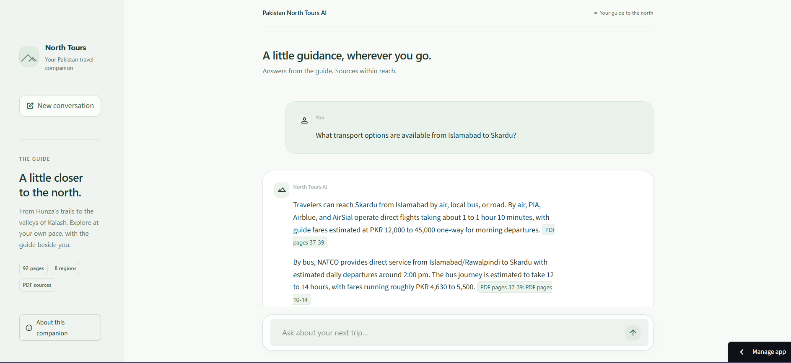
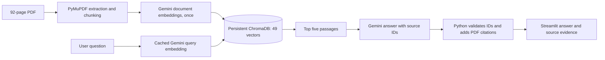
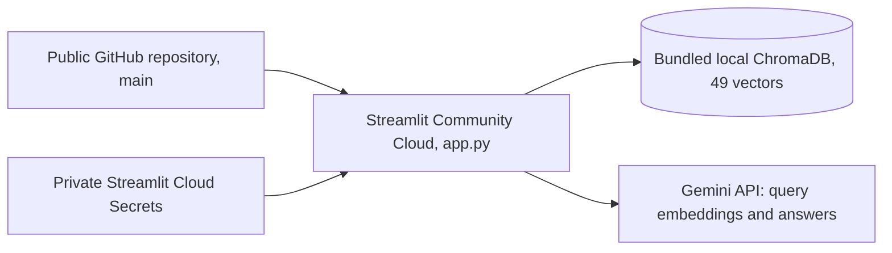

# Pakistan North Tours AI

A document-grounded AI travel assistant built using Retrieval-Augmented Generation (RAG), Gemini, ChromaDB, and Streamlit.

The application retrieves information from a 92-page Northern Pakistan travel guide and generates answers with supporting PDF citations.

## Live demo and source code

**[Open the live demo](https://pakistan-north-travel-ai.streamlit.app/)** · **[View the source on GitHub](https://github.com/awaisarif18/pakistan-north-travel-buddy)**

## Technology badges


## Application screenshot



## Features

- Processes the 92-page guide with PyMuPDF into 49 text chunks with physical PDF page metadata.
- Uses Gemini Embedding 2 at 3,072 dimensions and persistent ChromaDB cosine search to retrieve the top five passages.
- Generates concise answers with Gemini 3.8 Flash. Python validates selected source identifiers and attaches page citations from stored metadata.
- Exposes retrieved passages in expandable source cards and refuses questions unsupported by the supplied evidence.
- Provides a responsive Streamlit chat interface with six example prompts, conversation display, and a reset option.
- Caches query embeddings to avoid repeat embedding calls for identical questions and configuration.
- Includes a reviewed 25-question retrieval dataset, three retrieval metrics, and a separate recorded answer-quality review.
- Runs publicly on Streamlit Community Cloud using a bundled prebuilt index, without ingestion at startup.

Ask about routes, trekking seasons, transport, fuel stops, costs, and facilities.
For example: "Where should I refuel before traveling to Khunjerab Pass?"
Name the destination in each question. Conversation history is displayed but is
not passed into retrieval or answer generation as conversational memory.

## RAG architecture



Chunks contain approximately 400-697 estimated tokens, with paragraph overlap
where practical. `rag.py` checks the indexed embedding model, dimensions, and
retrieval-format version before use. Documents and questions share
`gemini-embedding-2` and 3,072 dimensions, with document/query-specific prefixes.

The model selects source IDs rather than inventing page numbers. The application
validates those IDs and appends page ranges from the retrieved metadata. This
checks citation references, not the truth of every generated statement.

## Technology stack

| Component | Technology |
|---|---|
| Runtime | Python 3.12 deployment configuration |
| PDF extraction | PyMuPDF 1.28.2 |
| Embeddings | `gemini-embedding-2`, 3,072 dimensions |
| Vector storage | ChromaDB 1.5.9, persistent cosine index |
| Answer generation | `gemini-3.8-flash` |
| Gemini client | Official `google-genai` SDK 1.75.0 |
| Interface | Streamlit 1.66.0, custom CSS, native chat components |
| Local configuration | python-dotenv 1.2.4 |
| Hosting | GitHub and Streamlit Community Cloud |

The implementation uses direct SDK calls and simple Python functions, without
LangChain, agents, a separate database server, or additional UI frameworks.

## Evaluation methodology and results

The curated dataset contains 10 direct factual questions, five paraphrased
questions, five multi-fact questions, and five unanswerable questions. Gold
chunk IDs and physical PDF pages were independently checked against the source
and approved before all 25 labels were marked `verified`. The reviewed labels
include alternative Deosai evidence for q04/q17 and required evidence groups
for q16-q20.

| Metric | Result |
|---|---|
| PDF pages | 92 |
| Document chunks | 49 |
| Evaluation questions | 25 |
| Verified answerable questions | 20 |
| Hit@5 | 1.0000 (20/20) |
| MRR@10 | 0.9667 |
| CompleteEvidence@5 | 1.0000 (5/5) |
| Retrieval errors | 0 |

The baseline evaluator retrieves the top ten chunks using semantic search and
cached query embeddings, independently of answer generation:

- **Hit@5:** fraction of verified answerable questions with at least one gold chunk in ranks 1-5.
- **MRR@10:** mean reciprocal rank of the first gold chunk in ranks 1-10; a miss contributes zero.
- **CompleteEvidence@5:** fraction of the five verified multi-fact questions with at least one top-five chunk from every `required_evidence_groups` group. IDs within a group are alternatives, every group is required, and a shared chunk may satisfy multiple groups where the reviewed labels allow it.

Only the 20 verified answerable questions enter Hit@5 and MRR@10. Complete
evidence coverage is measured separately because a single matching gold chunk
does not establish that all facts were retrieved. Aggregate scores require
successful retrieval for every eligible question; unverified labels are excluded.
The CSV preserves rank-ordered IDs, page ranges, distances, first-gold ranks,
and missing evidence groups.

There were no Hit@5 misses or incomplete multi-fact evidence groups. Nineteen
questions retrieved gold evidence at rank one. q07, about the hike from Ratti
Gali base camp, retrieved its gold chunk at rank three behind passages about
other treks. MRR@10 is therefore `(19 + 1/3) / 20 = 0.9667`.

### Separate answer-quality review

**5/5 supported answers passed** the recorded factual-consistency, completeness,
and citation-support review. **5/5 unanswerable questions were appropriately
refused** without fabricated citations. The ten-response review included a
multi-fact question, eight newly generated answers, and two reused saved outputs.
Evidence was compared directly with the PDF; no LLM judge or evaluation framework
was added.

These are actual observations on a small, curated dataset, not a held-out
benchmark or a guarantee of universal accuracy. Retrieval metrics do not measure
answer correctness. The earlier five retrieval smoke queries are not formal
evaluation scores, and refusal behavior has not been tested broadly or adversarially.

Review the evidence and methodology:

- [Verified questions and gold labels](evals/questions.json)
- [Per-question retrieval rankings and scores](evals/results.csv)
- [Evaluation summary and supporting excerpts](evals/summary.md)
- [Recorded answer-quality review](evals/answer_quality.md)
- [Full development process and technical report](docs/PROJECT_REPORT.md)

## Local installation and usage

The complete index is included in the repository. The source PDF and extraction
files are not needed to run the chatbot. Python 3.12 matches the deployment
configuration; development also used Python 3.13.7 on Windows.

```bash
git clone https://github.com/awaisarif18/pakistan-north-travel-buddy.git
cd pakistan-north-travel-buddy
python -m venv .venv
```

Activate the environment on Windows PowerShell:

```powershell
.\.venv\Scripts\Activate.ps1
```

Or on macOS/Linux:

```bash
source .venv/bin/activate
```

Install the pinned dependencies and copy `.env.example` to `.env` if it does
not already exist. Keep existing environment files and credentials when continuing
local work.

```bash
python -m pip install -r requirements.txt
```

Configure `.env` privately:

```dotenv
GEMINI_API_KEY=your-gemini-api-key
GEMINI_CHAT_MODEL=gemini-3.8-flash
GEMINI_EMBEDDING_MODEL=gemini-embedding-2
```

Launch the chatbot:

```bash
python -m streamlit run app.py
```

Open the printed local URL, normally `http://localhost:8501`. Use an example
prompt, inspect the source evidence, or reset the conversation. The app warns
that prices, schedules, and travel conditions in the guide may have changed.

### Optional ingestion and evaluation commands

Use the existing index for normal operation. To reproduce extraction locally,
provide an authorized `pakistan-north-tours-final.pdf` in the project root:

```bash
python ingest.py
python ingest.py --embed
```

The first command writes `data/pages.json` and `data/chunks.json` without API
calls. The second reads those chunks, persists vectors, and skips IDs already
stored with matching text and metadata. Do not regenerate the document vectors
for an ordinary checkout or app restart. Changing the embedding configuration
requires a separately reviewed rebuild.

```bash
python rag.py
python evaluate.py
```

`rag.py` runs the five retrieval smoke questions, prints top-three chunk IDs and
pages, and saves top-five passages to `data/retrieval_results.json`.
`evaluate.py` uses the verified labels and existing index, reuses available
query embeddings, and writes `evals/results.csv` and `evals/summary.md` without
generating answers. Missing cached query embeddings require Gemini API calls;
the cache is not published. The saved results can be reviewed without rerunning
either command. Neither command is part of app startup.

## Deployment architecture



The [live application](https://pakistan-north-travel-ai.streamlit.app/) runs on
Streamlit Community Cloud from this public repository's `main` branch, using
`app.py`, the pinned `requirements.txt`, and the Python 3.12 deployment
configuration. The existing theme and `ui.css` ship with the app.

The full `data/chroma/` snapshot contains five files totaling 3,229,860 bytes,
including SQLite and the UUID-named binary-index directory. It stores all 49
document vectors, extracted passages, and page metadata. Publication of this
source-containing index was explicitly approved. The wider `data/` ignore rule
remains; the original PDF, extraction JSON, query cache, `.env`, `.venv`, and
`.streamlit/secrets.toml` are excluded.

Configure the following root-level keys privately in Streamlit Cloud Secrets:

```toml
GEMINI_API_KEY = "your-private-key"
GEMINI_CHAT_MODEL = "gemini-3.8-flash"
GEMINI_EMBEDDING_MODEL = "gemini-embedding-2"
```

The app opens the repository-relative prebuilt index without ingestion or
document embedding at startup. It requires no original PDF, hosted database,
or connection to the development PC. Query caches and session history are
disposable; losing them does not remove the bundled document vectors.

Clean-copy startup and Linux Python 3.12 compatibility checks loaded all 49
vectors without the PDF or temporary extraction files. A hosted cold restart
has not been independently verified. Push intended application changes to
`main` for Streamlit to update the deployment; manage secrets through Cloud
settings and review any replacement index separately. See Streamlit's
[deployment settings](https://docs.streamlit.io/deploy/streamlit-community-cloud/deploy-your-app/deploy)
and [secrets documentation](https://docs.streamlit.io/deploy/streamlit-community-cloud/deploy-your-app/secrets-management).

## Limitations

- The static guide may contain outdated or incorrect travel information. The app does not verify current prices, weather, schedules, availability, or road conditions, and does not book hotels or transport.
- Some chunks span destinations or page boundaries. Citations identify stored page ranges rather than exact sentences, and valid source IDs alone do not prove every claim is supported.
- Lower-ranked passages can be irrelevant. The small curated evaluation set includes earlier smoke questions and related facts, so its scores should not be generalized to all questions.
- Conversation history is display-only. Ask standalone questions with explicit destinations; conversational memory, hybrid retrieval, and reranking are not implemented.
- Query caching and session storage are designed for a demo, not concurrent production workloads. Gemini access and quota are required; Cloud restarts may clear caches and sessions.
- Some CSS uses Streamlit DOM hooks and should be checked when upgrading Streamlit. A hosted cold restart and broad adversarial refusal testing have not been independently verified.

## Future improvements

- Add unseen questions across more regions and expand the manual answer/refusal review.
- Investigate q07's lower-ranked evidence before considering changes to retrieval.
- Refine exact-page citations or chunk boundaries if new evaluation failures justify it.
- Consider conversational follow-up support, hybrid search, or reranking only when measured needs justify the added complexity.

The [project report](docs/PROJECT_REPORT.md) preserves the development stages,
recorded problems and solutions, evaluation methodology, and deployment evidence.
