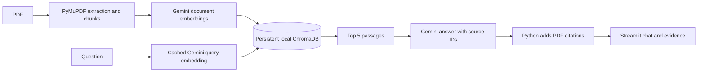

# Pakistan North Tours AI

A small RAG chatbot for a personal 92-page Northern Pakistan travel guide. Ask
about routes, treks, transport, costs, and facilities instead of searching the
PDF manually. Answers include PDF page citations and expandable source passages.

This learning and portfolio project uses Python, PyMuPDF, the official
`google-genai` SDK, Gemini embeddings, local ChromaDB, and Streamlit.

## Architecture



The index contains 49 chunks from 92 pages, approximately 400-697 estimated
tokens per chunk. It uses `gemini-embedding-2`, 3,072 dimensions, and cosine search.
Chat uses `gemini-3.8-flash`. The original preferred model, `gemini-2.5-flash`,
returned an account-access 404; the replacement was explicitly approved.

## Setup

Checked with Python 3.13.7 on Windows. For a fresh local setup:

```powershell
python -m venv .venv
.\.venv\Scripts\Activate.ps1
python -m pip install -r requirements.txt
if (!(Test-Path .env)) { Copy-Item .env.example .env }
```

Keep an existing virtual environment and `.env` when continuing this project.
Configure these variables in `.env`:

```dotenv
GEMINI_API_KEY=your-gemini-api-key
GEMINI_CHAT_MODEL=gemini-3.8-flash
GEMINI_EMBEDDING_MODEL=gemini-embedding-2
```

The key is read locally and never displayed. `.env`, `.venv`, local data, and
Streamlit secrets are ignored by Git. A fresh checkout alone does not include
the source PDF or index. Place the authorized PDF at
`pakistan-north-tours-final.pdf` in the project root.

## Ingestion and retrieval

For a new local index only:

```powershell
python ingest.py
python ingest.py --embed
```

Extraction writes `data/pages.json` and `data/chunks.json` without API calls.
`--embed` reads those saved chunks, persists vectors in `data/chroma`, and skips
already indexed IDs. The app never runs ingestion. Do not regenerate embeddings
when using the existing index. Changing the embedding model requires an
explicitly reviewed rebuild; changing the chat model does not.

```powershell
python rag.py
```

This runs the five retrieval smoke questions without generating answers. It
prints the top three IDs/page ranges and saves the top five full passages to
`data/retrieval_results.json`. Query embeddings are cached locally.

## Run the chatbot

```powershell
python -m streamlit run app.py
```

Open Streamlit's local URL, normally `http://localhost:8501`. Use the example
buttons, inspect source evidence, or clear the conversation. Ask standalone
questions with the destination named. History is displayed but is not used to
rewrite follow-up questions.

The interface uses a light alpine palette, a branded sidebar, six destination
prompts, distinct message surfaces, page-citation badges, and expandable source
cards. The composer uses Streamlit's native pinned input. `ui.css` and
`.streamlit/config.toml` are presentation assets and must ship beside the app.
No UI framework or external font is required. Narrow-screen layouts keep
navigation available and stack the suggestions. Some styling targets Streamlit
DOM hooks, so it should be checked when upgrading the pinned Streamlit version.

Gemini selects evidence IDs for each paragraph. Python validates them and adds
stored page ranges; the model is not asked to invent page numbers. Missing
information receives "I couldn't find that information in the PDF." The app
warns that prices, schedules, and travel conditions may have changed.

Three live Streamlit checks passed: Khunjerab refueling, Islamabad-Skardu
transport, and refusal of tomorrow's Hunza weather. Source evidence and chat reset
were checked. These are smoke checks, not a generation accuracy benchmark.

## Answer quality review

The [manual answer review](evals/answer_quality.md) records ten actual responses,
page citations, source checks, and review statuses. Five supported questions,
including a multi-fact bus/Deosai question, passed checks for factual consistency,
completeness, and citation support against the original PDF. All five negative
questions q21-q25 appropriately refused unsupported information without citations.
Eight answers were generated for this review; matching earlier outputs for q01
and q21 were reused to avoid duplicate calls. No additional LLM judge was used.
These selected examples do not establish general answer accuracy or refusal
reliability. The audited retrieval results were not rerun or changed.

## Retrieval evaluations

The [reviewed dataset](evals/questions.json) has 25 questions: 10 direct,
5 paraphrased, 5 multi-fact, and 5 unanswerable. All labels are `verified` after
an independent source-consistency review and user approval. The corrected file
includes additional valid Deosai evidence for q04/q17 and required evidence
groups for q16-q20. All gold IDs were checked against the 49 existing chunks.
Questions, reference answers, gold evidence, and rankings are available in
the [evaluation summary](evals/summary.md).

```powershell
python evaluate.py
```

The script evaluates only verified answerable questions, retrieves ten chunks,
and saves `evals/results.csv` and `evals/summary.md`. It reuses cached query
embeddings and never generates answers. Unanswerable questions need a separate
manual refusal review. With no verified labels, it makes no embedding requests.

| Metric | Current actual result |
|---|---|
| Verified answerable questions | 20 |
| Hit@5 | 1.0000, 20/20 |
| MRR@10 | 0.9667 |
| CompleteEvidence@5 | 1.0000, 5/5 multi-fact questions |
| Failed retrieval questions | 0 |

All 20 answerable questions completed without retrieval errors. Nineteen had
gold evidence at rank one; q07, about the hike from Ratti Gali base camp, had its
gold chunk at rank three. There were no Hit@5 misses or incomplete multi-fact
evidence groups. Five unanswerable questions are excluded from these metrics.
These scores measure retrieval on this reviewed set, not chatbot answer accuracy.

Hit@5 checks whether any gold chunk appears in the first five results. MRR@10
averages the reciprocal rank of the first gold chunk in the first ten, with zero
for a miss. For multi-fact questions, neither metric proves that every necessary
chunk was retrieved. CompleteEvidence@5 checks the five multi-fact questions:
at least one top-five chunk must appear in every `required_evidence_groups`
group. IDs within each group are alternatives; every group is required. The
CSV records missing groups as well as rank-ordered IDs, pages, and distances.
The five earlier smoke queries are not formal scores.

## Limitations and deployment status

- The static guide may contain outdated or incorrect information. Its claims
  are not verified against current sources by this app.
- Some chunks cover several destinations or cross page boundaries. Citations
  identify the retrieved range rather than an exact sentence location.
- Lower-ranked passages can be irrelevant. Valid source IDs alone do not prove
  that every generated claim is supported.
- The small reviewed dataset is not a held-out benchmark. The five dataset
  negatives refused appropriately in the answer review, with one response per
  case; broader and adversarial refusal behavior has not been evaluated.
- Local query caching and session chat are intended for a demo, not concurrent
  production use. Generation requires Gemini API access.

The source code and evaluation reports are already public in
[awaisarif18/pakistan-north-travel-buddy](https://github.com/awaisarif18/pakistan-north-travel-buddy).
Publication of the source-containing index has been explicitly approved. The
complete index is included in the deployment package. **Live demo URL: pending
hosted verification.**

## Deployment readiness and future process

The pinned requirements installed successfully in an isolated Ubuntu/Linux
Python 3.12.3 environment. A clean Git checkout snapshot plus the copied Windows
Chroma index opened all 49 vectors, passed a self-vector lookup, and rendered
the app with no source PDF, extracted chunk JSON, `.env`, or query cache. A
placeholder root-level Streamlit secret was promoted to the environment and
read by the existing app. No ingestion or Gemini API call was needed for this
readiness check. This verifies local Linux startup, not an actual hosted build.

The simplest package is the entire existing `data/chroma/` directory, about
3.23 MB, including `chroma.sqlite3` and its UUID-named binary-index directory.
Do not copy only the SQLite file. The index itself contains extracted document
text and embeddings, so publication approval was obtained even though the PDF
is omitted. The approved index is explicitly tracked while the broader `data/`
ignore rule remains. A checkout contains everything needed at runtime except
the private Gemini key.

The current deployment inspection confirmed SQLite integrity, 49 vectors of
3,072 dimensions, and collection metadata matching `gemini-embedding-2` and
`search-result-v1`. All document-vector values remain unchanged. A fresh copy
of tracked files plus the full index rendered the current app with `ui.css` and
the existing theme, without the original PDF, extraction JSON, `.env`, or query
cache. Startup made no embedding, generation, or ingestion calls. The five-file
snapshot totals 3,229,860 bytes. No credentials were found in the inspected
tracked files or index. These checks did not rerun retrieval evaluations.

Publication and deployment steps:

1. Use the existing public repository
   `awaisarif18/pakistan-north-travel-buddy`, branch `main`. Do not create another
   repository or change visibility. The runtime code, `ui.css`, theme config,
   and pinned requirements are already tracked. After approval, publish the
   complete prebuilt index at `data/chroma/` with the updated documentation:

   ```bash
   git add -- README.md docs/PROJECT_REPORT.md
   git add -f -- data/chroma/
   git diff --cached --name-only
   git commit -m "Bundle prebuilt Chroma index for Streamlit deployment"
   git push origin main
   ```

   Confirm staging contains only the two documentation files and five inspected
   index files before committing. Keep the current `data/` ignore rule. Do not include
   `.env`, the original PDF, raw extraction JSON, query caches, or local readiness
   artifacts or `.streamlit/secrets.toml`.
2. In Streamlit Community Cloud, create an app from the existing repository,
   branch `main`, with `app.py` as the entrypoint. Select Python 3.12 in Advanced
   settings to match the Linux readiness check. Use the existing root
   `requirements.txt`; no
   Docker, `packages.txt`, custom server settings, or database service is needed
   by the verified local Linux startup. The theme-only Streamlit config belongs
   in the package. Python selection is a Cloud setting, not a change to the theme.
3. Put the following root-level TOML keys in Cloud's Secrets field, supplying
   the actual key privately there. Do not commit a `secrets.toml` containing it:

   ```toml
   GEMINI_API_KEY = "your-private-key"
   GEMINI_CHAT_MODEL = "gemini-3.8-flash"
   GEMINI_EMBEDDING_MODEL = "gemini-embedding-2"
   ```

4. Deploy only after approval, then check one cited answer, one refusal, and a
   restart without ingestion. Cloud runs the Python app, index, and Gemini calls;
   it does not connect to this PC. The local query cache is disposable and can
   disappear on redeploy without affecting the bundled document vectors.

For later application updates, commit only the intended changes and push to
the same `main` branch; Community Cloud updates the app from that branch.
Change secrets in Cloud's app settings. Preserve the prebuilt index when
updating code. Replacing the source-containing database requires a separately
reviewed complete snapshot, not ingestion at startup.

Cloud deployment and the live URL are still unverified. The deployment UI's
[Python selection](https://docs.streamlit.io/deploy/streamlit-community-cloud/deploy-your-app/deploy),
[Linux dependency handling](https://docs.streamlit.io/deploy/streamlit-community-cloud/deploy-your-app/app-dependencies),
and [private secrets settings](https://docs.streamlit.io/deploy/streamlit-community-cloud/deploy-your-app/secrets-management)
are documented by Streamlit. The local readiness archive remains under ignored
`data/readiness/` and is excluded from publication. Only the approved index and
documentation are included in the deployment commit.

See [the project report](docs/PROJECT_REPORT.md) for the implementation process,
recorded results, design choices, and remaining work.
