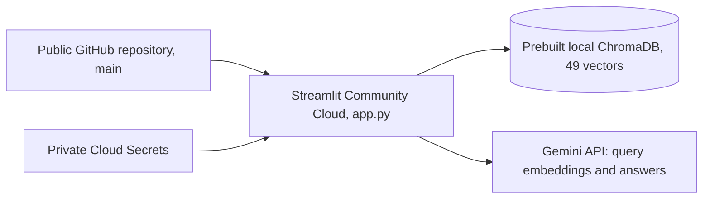

# Pakistan North Tours AI: project report

## Purpose and evidence

Build a small chatbot that answers from a personal travel PDF, exposes its
evidence, and measures retrieval quality. The implementation uses direct SDK
calls and Python functions, without agents, orchestration frameworks, or
separate database services.

This report describes the repository, saved local artifacts, and recorded work
reviewed on 2026-10-17. Costs, billed token totals, exact historical timings, and
complete HTTP logs were not recorded. Commands below reproduce the operations;
they are not a complete terminal transcript.

## Stage 1: environment setup

**Implemented and why.** The folder initially contained the PDF, `.env`,
`.gitignore`, an existing `.venv`, and Git metadata. Python was 3.13.7; the
environment initially reported pip 26.2.1. The existing environment and secret
values were preserved. Packages were installed into `.venv`, then direct
dependencies were pinned to the successfully installed versions:

| Dependency | Version | Purpose |
|---|---|---|
| PyMuPDF | 1.28.2 | PDF text and fare-table extraction |
| chromadb | 1.5.9 | Persistent vector search |
| google-genai | 1.75.0 | Official Gemini SDK |
| streamlit | 1.66.0 | Chat UI |
| python-dotenv | 1.2.4 | Local environment configuration |

**Files and commands.** `requirements.txt`, `.env.example`, `.gitignore`, and
local `.env`. Installation used `.venv\Scripts\python.exe -m pip install -r requirements.txt`.
Imports and `python -m pip check` passed. No dependency installation was repeated
for the chatbot/evaluation milestone. Secrets are read from `.env`, never printed.

**Results and problems.** All required imports worked after installation. No
unresolved environment issue remained. Git ignores the environment, secrets,
PDF, and `data/` artifacts. GitHub publication was not performed by this work.

Structure during the initial implementation milestone:

```text
app.py                     Streamlit chat UI
rag.py                     Embeddings, retrieval, answer generation
ingest.py                  Extraction, chunking, optional embedding
evaluate.py                Verified-label retrieval evaluation
requirements.txt
.env.example               Configuration names, no real credentials
README.md
docs/PROJECT_REPORT.md
evals/questions.json        Draft labels and source excerpts
evals/results.csv           Per-question status and eventual scores
evals/summary.md            Metrics and label-review presentation
pakistan-north-tours-final.pdf    Local source, ignored by Git
data/                      Local artifacts, ignored by Git
```

## Stage 2: PDF processing

**Implemented.** PyMuPDF reads all 92 physical PDF pages. Spans are sorted by
position, whitespace is normalized, and soft hyphens are removed. Font size
helps identify headings; nearby aligned blocks are joined into paragraphs.
`Page.find_tables()` extracts tables as rows with `|` column separators.

Paragraphs are packed with a minimum section-break target of 1,600 characters
and a maximum of 2,800 characters. Within a section, up to 320 trailing characters
of the previous final paragraph are reused, shortened to a word boundary.
Overlap is dropped when necessary to fit the next paragraph; a new section
starts fresh once the accumulated chunk is large enough. Headings stay with
their following paragraph where practical.

Token estimates use four characters per token, not Gemini's tokenizer. IDs
combine a physical page range and content hash. Metadata stores filename,
`page_start`, and `page_end`.

**Why.** Keep related paragraphs and traceable citations using a small local
heuristic. Avoid adding a document framework or tokenizer before evaluating
the baseline.

**Files and command.** `ingest.py`; `python ingest.py` writes `data/pages.json`
and `data/chunks.json` without API calls.

**Actual results.** 92 pages, 49 chunks, approximately 400-697 estimated tokens
per chunk, median 538, and zero reported extraction failures. Checks confirmed
unique IDs, all-page coverage, valid citation ranges, and preservation of saved
paragraphs. Eight representative chunks were compared with source page ranges
across practical guidance and multiple regions.

**Problem and solution.** Raw block ordering scrambled fare-table columns.
Built-in table extraction preserved the row relationships. Some page-break
sentence fragments and multi-destination chunks remain. They were accepted
for baseline retrieval; the configuration was not retuned after inspection.

## Stage 3: embeddings and vector storage

**Implemented and why.** Embeddings turn text into numeric vectors so related
questions and passages can be compared semantically. Each chunk was embedded
separately with `gemini-embedding-2` at 3,072 dimensions. Documents use
`title: Pakistan North Tours | text: ...`; queries use
`task: search result | query: ...`. Both share the model and output dimensions,
using its asymmetric retrieval formatting.

Chroma collection `north_tours` stores IDs, text, vectors, and page metadata
under `data/chroma`, using cosine distance. Collection metadata records model,
dimensions, and retrieval-format version. A mismatch raises an error instead
of mixing incompatible vectors. Explicit embeddings prevent Chroma from using
or downloading a separate default embedding model. A local collection is enough
for one fixed PDF and needs no deployed database service.

**Files and command.** `rag.py`, `ingest.py`, `data/chroma`.
`python ingest.py --embed` reads saved chunks, skips existing matching IDs, and
saves each successful vector immediately so a run can resume. Gemini requests
allow four attempts with backoff for rate limits and temporary server failures.
Ingestion pauses one second between new chunks.

**Actual results and problems.** All 49 vectors were stored with 3,072 values
each. No embedding failure was reported. Reopening reused all 49 with zero
new document embeddings. No rate-limit failure was observed in the recorded
run. Costs and API token consumption are not recorded. The document index
remained unchanged during the chatbot/evaluation milestone.

The [Gemini embedding guide](https://ai.google.dev/gemini-api/docs/embeddings)
documents the retrieval prefixes used here.

## Stage 4: retrieval

**Implemented and why.** Questions use the same embedding model and dimensions
as documents. `data/query_embeddings.json` caches vectors using the question
and embedding configuration as the key. Chroma returns the nearest text, IDs,
metadata, and cosine distances. Lower distance means closer vectors, not a
calibrated probability. Top five are used for chat; evaluation requests ten.
No keyword search, reranking, query rewriting, or refusal distance threshold
has been added, preserving a simple semantic baseline.

**Files and command.** `rag.py`; `python rag.py` runs the five smoke questions.
`data/retrieval_results.json` stores their full top-five passages and was reviewed
rather than overwritten in this milestone.

| Smoke question | Rank 1 chunk | PDF pages | Observation |
|---|---|---|---|
| Khunjerab refueling | `p006-008-4850ae1f4334` | 6-8 | Contains Sost fuel guidance |
| Rakaposhi season | `p020-022-8d8b2710273b` | 20-22 | Contains the trek's season |
| Islamabad-Skardu transport | `p037-039-63413879f3c2` | 37-39 | Contains air, road, and bus options |
| Hunza trekking | `p026-028-3af709bd9d8f` | 26-28 | Other trek passages ranked second and third |
| Babusar fuel | `p006-008-4850ae1f4334` | 6-8 | Contains the Naran/Batakundi fuel gap |

**Results and weaknesses.** Four specific questions retrieved their known
supporting chunk first. Broad Hunza trekking evidence appeared across several
results. Lower ranks included Nanga Parbat for Rakaposhi and medical/drone
material for Babusar. These are observations, not formal accuracy scores.
Repeating cached queries and reopening the index required no new embeddings.

## Stage 5: chatbot

**Implemented.** `app.py` provides example buttons, chat history, clear chat,
a travel-information notice, and expandable evidence for all five passages.
`rag.py` generates answers. Streamlit caches the existing collection and API
client; startup never extracts the PDF or embeds documents.

Gemini receives the question and excerpts as data. The system prompt requires
concise answers from the excerpts, prohibits invented/live details, and requests
abstention when information is absent. A small JSON schema returns paragraphs
with evidence IDs. Page metadata is withheld from generation. Python validates
IDs and adds citations from matching metadata. The UI distinguishes cited
passages from other retrieved evidence. Unsupported answers use a fixed refusal.

**Why.** Page numbers come from stored metadata while Gemini handles natural
language. ID validation does not prove every claim is supported; users can
inspect the passages. History is displayed, but only the latest question is
used for retrieval, avoiding a separate conversation-rewriting step.

**Files and command.** `app.py`, `rag.py`, `.env.example`, and local `.env`.
Run `python -m streamlit run app.py`. No dependencies were added. The [Gemini
structured-output guide](https://ai.google.dev/gemini-api/docs/structured-output)
describes the JSON schema mechanism used for source selection.

**Problem and solution.** Generation with the requested `gemini-2.5-flash`
returned HTTP 404. The API said it was unavailable to new users and recommended
`gemini-3.8-flash`, although the older model remained listed. The user approved
the replacement. Only chat defaults/configuration changed; embeddings stayed
on the original model and all 49 vectors were preserved.

**Actual results.** Streamlit's built-in AppTest exercised the real retrieval
and generation pipeline with three questions, one successful generation per
question after the approved model change. Saved outputs are in
`data/chat_smoke_results.json`:

| Question | Observed behavior |
|---|---|
| Khunjerab refueling | Answered with Sost guidance, citing PDF pages 6-8 |
| Islamabad-Skardu transport | Answered with air/road/bus options, citing pages 37-39 and 10-14 |
| Tomorrow's Hunza weather | Replied that the information was not found in the PDF, with no citations |

Initial rendering, the evidence view, conversation updates, and clear chat passed.
The local Streamlit server also returned HTTP 200 from its health endpoint at
`http://localhost:8501`. The index count remained 49. The two supported queries reused existing query
embeddings; the weather query added one query embedding. These checks are not
a generation-accuracy or general refusal benchmark. The source warning is shown
in the UI even when a generated paragraph uses present tense.

### Final answer quality: manual source review

After the independent retrieval audit, ten selected responses were reviewed
directly against the original PDF and cited chunk metadata. Five answerable
questions cover fuel guidance, Skardu fares, Ratti Gali trekking, Chitrali food,
and a multi-fact Skardu bus/Deosai closure question. All five existing negative
questions q21-q25 are included. The full answers, citations, provenance, and
per-case review notes are in `evals/answer_quality.md`.

Eight new answers used the existing `generate_answer` pipeline and configured
`gemini-3.8-flash` model. Matching saved answers for q01 and q21 were reused
instead of regenerating them. Supported questions reused their audited top-five
passages; four newly tested negative questions used normal chatbot retrieval,
adding four query vectors. No retrieval evaluation was rerun, no document
embedding was regenerated, and no additional LLM judge or framework was used.

| Manual-review observation | Actual result |
|---|---|
| Answerable factual consistency with PDF | 5/5 pass |
| Answerable completeness for requested facts | 5/5 pass |
| Answerable citation support | 5/5 pass |
| Appropriate refusal of q21-q25 | 5/5 pass |
| Observed failures | 0 |

Source checks used physical PDF pages 7, 11, 38, 40, 64, 80-81, and the unresolved
Monday Lake entry on 48-49. The fare answer qualified prices as estimates; the
multi-fact answer included both bus information and the November-May closure.
The Ratti Gali answer used the correct evidence despite its rank-three retrieval.
All negative answers used the fixed "I couldn't find that information in the PDF"
message and supplied no fabricated citations. Page citations match stored ranges
but can be broader than the exact sentence location.

These are assistant-led source-consistency observations, not independent human
sign-off or a general quality guarantee. There were no repeated stochastic or
adversarial tests. The model prompt and working RAG components were left unchanged.
Outdated "Pending user approval" text was removed only from q03/q04/q17 review
notes; their reviewed gold IDs, evidence groups, references, and verified status
were preserved. The audited retrieval CSV and summary were not rewritten.

### Focused UI redesign

The presentation was redesigned in `app.py`, `ui.css`, and a theme-only
`.streamlit/config.toml`. It uses an off-white/pine palette, system fonts,
controlled content width, a branded sidebar, six destination prompts, separate
user/assistant surfaces, citation badges, and source previews with full-passage
disclosures. Cited passages appear first in the evidence view while their
original retrieval rank remains visible. No retrieval order or backend data is
modified. Native Streamlit chat input provides the pinned composer.

The retrieval, generation, Gemini configuration, embeddings, Chroma data, and
evaluation modules were unchanged. UI behavior was checked with saved answers
and mocked resources, including prompt submission, exactly one generation call
per submitted example, two-message rendering, five source disclosures, and chat
reset. Browser checks covered the desktop layout and a 390-pixel narrow screen;
the latter had no horizontal overflow and retained a 16px input. Checked text
colors meet the 4.5:1 contrast target. No Gemini request or evaluation run was
performed for the redesign.

Two visual integration issues were corrected: the toolbar styling initially
hid mobile sidebar access, and the user-bubble margin exceeded the content width.
Sidebar navigation is retained while deployment/menu chrome is hidden. Styling
still depends on some Streamlit DOM hooks and native expander/sidebar behavior;
check it when upgrading Streamlit. The run command is unchanged. Future deployment
packages must include both new presentation files as well as the app and index.

## Stage 6: retrieval evaluation

**Implemented.** `evals/questions.json` has 25 reviewed questions: 10 direct, 5 paraphrased,
5 multi-fact, and 5 unanswerable. Answerable questions cover fuel, Hunza,
Baltistan, Astore, Gilgit/Naltar, Neelum, Swat, Chitral, and Galliyat. Each has
an ID, category, answerability, gold chunk IDs, physical PDF pages, reference
answer, excerpts, and verification status. Initial candidate excerpts were checked
against saved chunks/page text and kept as `needs_review`. The user subsequently
completed an independent source-consistency review against the original PDF and
49 chunks, supplied corrected labels, and approved them. All 25 are now marked
`verified`. The 20 answerable questions are scored; five unanswerable cases are
excluded from the retrieval metrics.

**Why.** Inspectable labels are more credible than inferring accuracy from a few
examples. Exact chunk IDs avoid labeling unrelated passages from the same page.
Alternative evidence is included where identified, such as both the NATCO fare
table and Skardu transport section. Multi-fact questions list the chunks needed
for different facts. The corrected labels add `p008-010-a7bee3da530b` as valid
Deosai-closure evidence for q04 and q17, alongside the original park passage.
The five multi-fact questions, q16-q20, include `required_evidence_groups`.
All gold IDs and group alternatives were validated against the existing index
and chunks before evaluation, without modifying the reviewed evidence.

**Method.** `evaluate.py` retrieves ten chunks for each verified answerable
question using the existing index and query cache. Let `r_i` be the first gold
chunk's rank in those ten results:

- `Hit@5 = sum(1 if r_i <= 5 else 0) / N`.
- `MRR@10 = sum(1 / r_i if a gold chunk appears in the first 10 else 0) / N`.
- `CompleteEvidence@5 = multi-fact questions with every required evidence group represented in the top five / verified multi-fact questions`.

For CompleteEvidence@5, chunk IDs within a required group are alternatives;
at least one must be retrieved. All groups must be represented. The metric
uses only verified multi-fact questions, while the original metrics use all
verified answerable questions. Missing groups and the ten rank-ordered IDs,
page ranges, and cosine distances are saved per question in the CSV.

`N` is the number of verified answerable questions. Unverified and unanswerable
entries are excluded. Both metrics can succeed with only one gold chunk for a
multi-fact question; neither proves complete evidence coverage. API retrieval
errors prevent aggregate reporting until all verified answerable questions
have successful retrieval results.

The script never generates answers. Verified unanswerable cases are marked for
manual chatbot refusal review, since retrieval cannot establish refusal quality.
Reviewed negative cases concern live weather, live bus seats, an undocumented
Wi-Fi password, a direct-train fare, and unresolved Monday Lake coordinates.
Only the weather refusal has a live smoke observation so far.

**Files and command.** `evaluate.py`, `evals/questions.json`, `evals/results.csv`,
and `evals/summary.md`. Run `python evaluate.py`. The completed run saved all
20 answerable questions' actual top-ten IDs, page ranges, cosine distances,
first-gold ranks, and per-question scores. Multi-fact rows also record required
and missing evidence groups. The five unanswerable rows are marked
`unanswerable_manual_review` with no retrieval scores. The summary retains the
questions, reference answers, gold IDs/pages, and source excerpts.

Two answerable query embeddings were already cached; 18 new question vectors
were generated and cached. No document embeddings were regenerated, no database
rebuild occurred, and no chat answers were generated. There were zero retrieval
errors. Fingerprints of all 49 stored document vectors and `data/chunks.json`
matched before and after the run. Aggregate metrics were also recomputed from
the saved CSV without repeating API calls or retrieval.

| Metric | Actual result |
|---|---|
| Verified answerable questions | 20 |
| Hit@5 | 1.0000, 20/20 |
| MRR@10 | 0.9667 |
| Verified multi-fact questions | 5 |
| CompleteEvidence@5 | 1.0000, 5/5 |
| Failed retrieval questions | 0 |

Small in-memory checks passed for first-gold ranks 1, 5, 6, and 10, a missing
gold chunk, and multiple gold IDs. They check the metric formulas, not retrieval
accuracy. The review gate was also checked with API creation disabled: all 25
drafts were skipped without a request. No testing framework or test files were added.

**Failure and ranking analysis.** No answerable question missed gold evidence
in the top five. All five multi-fact questions represented every required group
in their top five. Nineteen questions had a first-gold rank of one. q07, "How do
you reach Ratti Gali Lake from its base camp, and how long is that final leg?",
had gold `p064-065-eeaf0cd09563` at rank three, behind
`p053-054-a26a1670d604` and `p072-074-249d8c96c2fc`. Those earlier results concern
Nanga Parbat and Kandol/Spin Khwar rather than Ratti Gali. This is a ranking
weakness despite passing Hit@5. MRR is therefore `(19 + 1/3) / 20`, or 0.9667.
No missing evidence groups or retrieval API failures require fixes in this run.

**Interpretation.** The dataset includes two earlier smoke questions and related
facts, so it is not a held-out benchmark. Perfect Hit@5 and CompleteEvidence@5
on this small reviewed set do not establish general retrieval accuracy, answer
correctness, or refusal reliability. No chunking changes, reranker, hybrid
search, or other retrieval tuning were introduced. If further work is needed,
inspect q07 and evaluate additional unseen questions before choosing an improvement.
The metric implementation rejects missing/invalid evidence groups rather than
reporting a vacuous perfect score. Small in-memory checks covered alternatives,
missing groups, the top-five cutoff, and shared supporting chunks.

## Stage 7: Deployment and v1.0 Release

**Deployed MVP.** The user deployed the application to Streamlit Community
Cloud after the approved index publication commit `418310c` was pushed to
`main`. The public repository and live application are:

- Repository: [awaisarif18/pakistan-north-travel-buddy](https://github.com/awaisarif18/pakistan-north-travel-buddy).
- Live application: [Pakistan North Tours AI](https://pakistan-north-travel-ai.streamlit.app/).
- Deployment entrypoint: `app.py`; Python runtime configuration: 3.12.

The user supplied the live URL and an actual application screenshot at
`assets/demo.png`. The final portfolio pass uses that screenshot unchanged.
The exact hosted Python patch version and a hosted cold restart have not been
independently verified. The recorded Linux compatibility environment below
was Python 3.12.3. The v1.0 portfolio update changes documentation and adds the
existing screenshot only; a Git tag and GitHub release require separate approval.

The initial readiness work below preceded publication. Explicit approval was
obtained because the complete index contains extracted PDF passages and
embeddings. The approved snapshot was committed to the existing public
repository, without changing visibility. The wider `data/` ignore rule remains;
the tracked index is an explicit exception. The original PDF, extraction JSON,
caches, virtual environment, and real secret files remain excluded.

**Inspection and package choice.** `.gitignore` excludes `*.pdf`, `data/`, `.env`,
`.venv`, and `.streamlit/secrets.toml`. The root `requirements.txt` pins all five
direct dependencies. The UI pass adds a theme-only `.streamlit/config.toml` and
`ui.css`; no custom server configuration is needed. Runtime paths remain relative
to `rag.py`. Its runtime needs the Chroma
collection, not the PDF, extraction JSON, or local query cache. No runtime
ingestion function is called by `app.py`.

The simplest bundle is the complete existing `data/chroma/`: five files totaling
3,229,860 bytes, including `chroma.sqlite3` and the UUID-named binary-index
directory. Copying only the SQLite file is not the verified packaging method.
A local-only archive of a clean Git checkout snapshot plus that full directory
was prepared under ignored `data/readiness/checkout-with-index.zip`, 1,077,241
bytes. It includes no real `.env`, PDF, extraction JSON, or query cache. This
is a readiness artifact, not a published release or a change to Git exclusions.

**Actual Linux checks.** An existing Ubuntu WSL environment was used with an
isolated Python 3.12.3 environment. Its standard venv initially lacked pip;
pip was bootstrapped from the existing bundled pip wheel inside that temporary
environment, without installing system packages or altering the working Windows
environment. The existing pinned requirements installed successfully on Linux:
PyMuPDF 1.28.2, ChromaDB 1.5.9, google-genai 1.75.0, Streamlit 1.66.0, and
python-dotenv 1.2.4. No version changes were needed.

The archive was extracted to a new Linux checkout directory. Checks confirmed:

- The copied collection opened with 49 vectors of 3,072 dimensions.
- Querying with an existing stored vector returned its own chunk, confirming
  the Windows-created binary index was usable in this Linux check. This was
  an index portability check, not a rerun of retrieval evaluation.
- Streamlit's initial app render passed using the copied index, without the
  source PDF, chunk JSON, `.env`, or query cache.
- A placeholder-only root `GEMINI_API_KEY` in a local test `secrets.toml` reached
  `os.environ` through Streamlit's normal secrets parsing and satisfied the
  existing client configuration. No real key was copied into the bundle.
- Readiness startup made zero embedding or generation API calls and did not
  invoke ingestion or rebuild the document database. Only the copied index
  was opened. The source collection was left unchanged.

The machine-readable local check outcome is `data/readiness/linux_result.json`.
These results establish Linux startup and package compatibility in the tested
environment. They do not claim a successful managed Cloud build, resource-limit
test, public URL, or hosted Gemini request. No additional service or infrastructure
was provisioned. Runtime paths and secrets do not require a connection to the
original PC once the approved files are present on the server.
The earlier Linux snapshot predates the UI redesign. A subsequent clean-copy
startup check below includes the current `ui.css` and `.streamlit/config.toml`.

**Pre-publication repository and snapshot inspection.** Local `main` and remote `main`
both pointed to `d735d7c57f143d99b6931eb09e1b8231e4c3bf12`. Origin is
`https://github.com/awaisarif18/pakistan-north-travel-buddy.git`. The working tree
was clean and nothing was staged before preparation. Only the report and README
needed changes in that preparation; runtime code, models, dependency pins,
theme, and ignore rules were preserved.

The index opens with exactly 49 vectors and matches the existing embedding
configuration: `gemini-embedding-2`, 3,072 dimensions, `search-result-v1`.
The stored document-vector fingerprint still matches the previously recorded
value. SQLite `PRAGMA integrity_check` returned `ok`; no WAL or SHM sidecars were
present. Opening Chroma updated SQLite bookkeeping, so the snapshot was copied
after that process exited. No document vectors were changed or regenerated.
The complete five-file package is:

| Path under `data/chroma/` | Bytes |
|---|---:|
| `chroma.sqlite3` | 1,986,560 |
| `1cc615b6-9f77-44e6-a5ed-717d089c2764/data_level0.bin` | 1,242,800 |
| `1cc615b6-9f77-44e6-a5ed-717d089c2764/header.bin` | 100 |
| `1cc615b6-9f77-44e6-a5ed-717d089c2764/length.bin` | 400 |
| `1cc615b6-9f77-44e6-a5ed-717d089c2764/link_lists.bin` | 0 |
| Total | 3,229,860 |

A new copy of `git archive HEAD` plus those exact index files passed current
Streamlit initial rendering with all 49 vectors and both UI assets present.
It had no original PDF, extraction JSON, `.env`, or query cache. A placeholder
environment key was used, and guarded embedding, generation, and ingestion
functions were never called. This check ran in the existing Windows environment;
the separate Linux Python 3.12 check above remains the compatibility evidence.
Local check details and file hashes are saved under ignored
`data/readiness/deployment_inspection.json`.

The 16 tracked files and five index files were scanned for the configured API
key and common credential signatures, with no findings. The PDF, extraction
files, query cache, readiness artifacts, virtual environment, and secret files
were excluded from the publication proposal. No files had been staged at that
inspection. Existing retrieval scores remain Hit@5 1.0000, MRR@10 0.9667, and CompleteEvidence@5
1.0000; no retrieval evaluation or Gemini request was repeated.

**Publication and deployed architecture.** After explicit approval, only the
five inspected index files and two documentation files were staged, checked,
committed, and pushed to `origin main` in `418310c`. The index totals 3,229,860
bytes and contains all 49 vectors. Repository-relative runtime paths do not
require the PDF or extraction artifacts. The user then imported the repository
into Streamlit Community Cloud and supplied the live URL above.



The deployment configuration uses Python 3.12 and the existing pinned root
`requirements.txt`. The theme-only `.streamlit/config.toml` and `ui.css` ship
with the app. Root-level `GEMINI_API_KEY`, `GEMINI_CHAT_MODEL`, and
`GEMINI_EMBEDDING_MODEL` are configured privately through Streamlit Cloud
Secrets. Root-level secrets reach the environment read by the existing client;
that behavior was checked with a placeholder during readiness testing. No real
key belongs in the repository or a committed `secrets.toml`.

The configured models remain `gemini-embedding-2` and `gemini-3.8-flash`.
`app.py` opens the bundled index without invoking ingestion or document
embedding. Server-side execution does not depend on the development PC being
online. The query cache and session history are disposable. If they disappear,
new questions can require new query embeddings and conversations reset, but
the committed document index remains available. The clean-copy and Linux tests
establish this packaging behavior; no independent hosted cold-restart test is
claimed.

**Updates and deployment limitations.** Intended application changes committed
and pushed to the same `main` branch reach the connected Streamlit deployment.
Manage secrets in Cloud app settings, preserve the prebuilt index across code
updates, and review any replacement source-containing snapshot separately.
The demo depends on Gemini access, quota, and hosting availability. Its local
query cache and session state are not durable multi-user storage. Resource
limits, sustained concurrency, exact hosted runtime patch version, and hosted
cold restarts were not independently measured. No Docker, CI/CD, external
database, or additional infrastructure was introduced.

Streamlit's official documentation describes [Python selection and deployment](https://docs.streamlit.io/deploy/streamlit-community-cloud/deploy-your-app/deploy),
[Linux dependencies](https://docs.streamlit.io/deploy/streamlit-community-cloud/deploy-your-app/app-dependencies),
and [private secrets](https://docs.streamlit.io/deploy/streamlit-community-cloud/deploy-your-app/secrets-management).

### Current v1.0 feature inventory

| Area | Implemented behavior |
|---|---|
| PDF processing | PyMuPDF extraction of 92 physical pages into 49 chunks, with page metadata and approximately 400-697 estimated tokens per chunk |
| Embeddings | Gemini Embedding 2, 3,072 dimensions, shared indexed/query configuration with document/query-specific prefixes |
| Storage and retrieval | Persistent ChromaDB cosine index, top-five semantic retrieval, configuration validation, query-embedding caching |
| Answers and citations | Gemini 3.8 Flash, source-ID validation, page citations derived from metadata, unsupported-question refusal, outdated-travel-information warning |
| Evidence | Expandable source cards, excerpt previews, page ranges, full passages, and original retrieval ranks |
| Interface | Responsive Streamlit chat, custom CSS/theme, six example prompts, displayed conversation history, reset action |
| Retrieval evaluation | 25 verified questions, 20 answerable, five multi-fact evidence groups, five unanswerable; saved per-question top-ten rankings |
| Recorded results | Hit@5 1.0000, MRR@10 0.9667, CompleteEvidence@5 1.0000, zero retrieval errors |
| Answer-quality review | 5/5 supported answers passed factual/completeness/citation review; 5/5 unanswerable cases refused |
| Deployment | Public GitHub main branch, Streamlit Community Cloud, bundled 49-vector index, private Cloud Secrets |

Conversation history is display-only, not model memory. Live weather, booking,
hybrid search, and reranking are not implemented. Citation-ID validation is
not an automated factual verifier. Stages 5 and 6 retain the full answer and
retrieval methodology, including sample limitations and q07's rank-three result.

### Portfolio presentation and release

The README presents the live links, technology badges, unchanged real screenshot,
features, architecture, metrics, setup commands, deployment, limitations, and
future improvements. It links directly to the approved labels, per-question
rankings, evaluation summary, answer review, and this report. Existing evaluation
artifacts and stored vectors are unchanged by the portfolio pass.

A cookie-aware HTTP check reached the supplied live URL with status 200 and
received the Streamlit HTML shell. This establishes URL reachability, not a
new hosted answer-generation or cold-restart test. No Gemini evaluation calls
were made during this documentation task.

Suggested GitHub About settings, without changing them during this task:

- Description: "An evaluated RAG chatbot for Northern Pakistan travel information, powered by Gemini, ChromaDB, and Streamlit."
- Topics: `rag`, `python`, `streamlit`, `gemini`, `chromadb`, `generative-ai`, `ai-chatbot`, `retrieval-augmented-generation`.
- Website: `https://pakistan-north-travel-ai.streamlit.app/`.

GitHub CLI is available and authenticated; repository metadata can be updated
if requested. The proposed release uses Git tag `v1.0.0` and GitHub release title
`v1.0.0 — Initial RAG MVP`. Neither is created without explicit approval.
