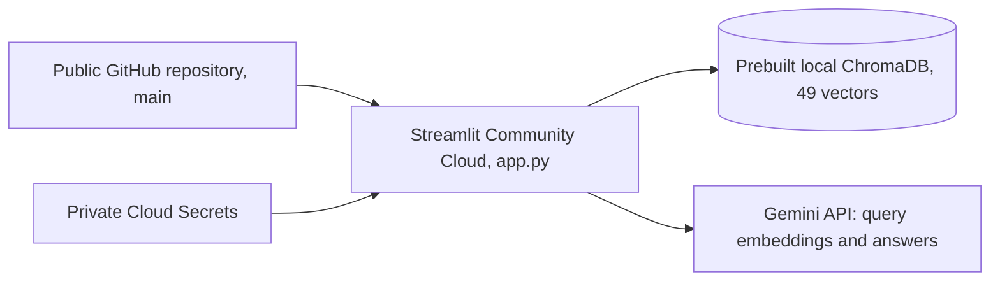
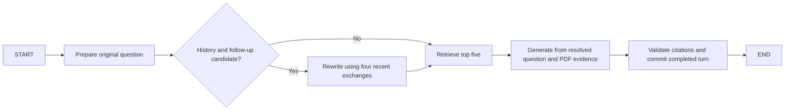

# Pakistan North Tours AI: project report

## Purpose and evidence

Build a small chatbot that answers from a personal travel PDF, exposes its
evidence, and measures retrieval quality. The original v1.0 implementation used
direct SDK calls and Python functions. The released v1.1 implementation uses
LangChain and LangGraph, with the same local Chroma index and no separate
database service or autonomous agents.

This report describes the repository, saved local artifacts, and recorded work
reviewed across the recorded milestones. Costs, billed token totals, exact historical timings, and
complete HTTP logs were not recorded. Commands below reproduce the operations;
they are not a complete terminal transcript.

Stages 1-7 describe the released v1.0 implementation. Stages 8-17 record the
v1.1 migration, development, deployment, and release. Statements about pending
work in those stages describe their status at that time. The final maintenance
section records verification and fixes after the published v1.1.0 baseline.

## Stage 1: environment setup

**Implemented and why.** The folder initially contained the PDF, `.env`,
`.gitignore`, an existing `.venv`, and Git metadata. Python was 3.13.7; the
environment initially reported pip 26.2.1. The existing environment and secret
values were preserved. Packages were installed into `.venv`, then direct
dependencies were pinned to the successfully installed versions:

| Dependency | Version | Purpose |
|---|---|---|
| PyMuPDF | 1.28.2 | PDF text and fare-table extraction |
| chromadb | 1.5.9 | Persistent vector search |
| google-genai | 1.75.0 | Official Gemini SDK |
| streamlit | 1.66.0 | Chat UI |
| python-dotenv | 1.2.4 | Local environment configuration |

**Files and commands.** `requirements.txt`, `.env.example`, `.gitignore`, and
local `.env`. Installation used `.venv\Scripts\python.exe -m pip install -r requirements.txt`.
Imports and `python -m pip check` passed. No dependency installation was repeated
for the chatbot/evaluation milestone. Secrets are read from `.env`, never printed.

**Results and problems.** All required imports worked after installation. No
unresolved environment issue remained. Git ignores the environment, secrets,
PDF, and `data/` artifacts. GitHub publication was not performed by this work.

Structure during the initial implementation milestone:

```text
app.py                     Streamlit chat UI
rag.py                     Embeddings, retrieval, answer generation
ingest.py                  Extraction, chunking, optional embedding
evaluate.py                Verified-label retrieval evaluation
requirements.txt
.env.example               Configuration names, no real credentials
README.md
docs/PROJECT_REPORT.md
evals/questions.json        Draft labels and source excerpts
evals/results.csv           Per-question status and eventual scores
evals/summary.md            Metrics and label-review presentation
pakistan-north-tours-final.pdf    Local source, ignored by Git
data/                      Local artifacts, ignored by Git
```

## Stage 2: PDF processing

**Implemented.** PyMuPDF reads all 92 physical PDF pages. Spans are sorted by
position, whitespace is normalized, and soft hyphens are removed. Font size
helps identify headings; nearby aligned blocks are joined into paragraphs.
`Page.find_tables()` extracts tables as rows with `|` column separators.

Paragraphs are packed with a minimum section-break target of 1,600 characters
and a maximum of 2,800 characters. Within a section, up to 320 trailing characters
of the previous final paragraph are reused, shortened to a word boundary.
Overlap is dropped when necessary to fit the next paragraph; a new section
starts fresh once the accumulated chunk is large enough. Headings stay with
their following paragraph where practical.

Token estimates use four characters per token, not Gemini's tokenizer. IDs
combine a physical page range and content hash. Metadata stores filename,
`page_start`, and `page_end`.

**Why.** Keep related paragraphs and traceable citations using a small local
heuristic. Avoid adding a document framework or tokenizer before evaluating
the baseline.

**Files and command.** `ingest.py`; `python ingest.py` writes `data/pages.json`
and `data/chunks.json` without API calls.

**Actual results.** 92 pages, 49 chunks, approximately 400-697 estimated tokens
per chunk, median 538, and zero reported extraction failures. Checks confirmed
unique IDs, all-page coverage, valid citation ranges, and preservation of saved
paragraphs. Eight representative chunks were compared with source page ranges
across practical guidance and multiple regions.

**Problem and solution.** Raw block ordering scrambled fare-table columns.
Built-in table extraction preserved the row relationships. Some page-break
sentence fragments and multi-destination chunks remain. They were accepted
for baseline retrieval; the configuration was not retuned after inspection.

## Stage 3: embeddings and vector storage

**Implemented and why.** Embeddings turn text into numeric vectors so related
questions and passages can be compared semantically. Each chunk was embedded
separately with `gemini-embedding-2` at 3,072 dimensions. Documents use
`title: Pakistan North Tours | text: ...`; queries use
`task: search result | query: ...`. Both share the model and output dimensions,
using its asymmetric retrieval formatting.

Chroma collection `north_tours` stores IDs, text, vectors, and page metadata
under `data/chroma`, using cosine distance. Collection metadata records model,
dimensions, and retrieval-format version. A mismatch raises an error instead
of mixing incompatible vectors. Explicit embeddings prevent Chroma from using
or downloading a separate default embedding model. A local collection is enough
for one fixed PDF and needs no deployed database service.

**Files and command.** `rag.py`, `ingest.py`, `data/chroma`.
`python ingest.py --embed` reads saved chunks, skips existing matching IDs, and
saves each successful vector immediately so a run can resume. Gemini requests
allow four attempts with backoff for rate limits and temporary server failures.
Ingestion pauses one second between new chunks.

**Actual results and problems.** All 49 vectors were stored with 3,072 values
each. No embedding failure was reported. Reopening reused all 49 with zero
new document embeddings. No rate-limit failure was observed in the recorded
run. Costs and API token consumption are not recorded. The document index
remained unchanged during the chatbot/evaluation milestone.

The [Gemini embedding guide](https://ai.google.dev/gemini-api/docs/embeddings)
documents the retrieval prefixes used here.

## Stage 4: retrieval

**Implemented and why.** Questions use the same embedding model and dimensions
as documents. `data/query_embeddings.json` caches vectors using the question
and embedding configuration as the key. Chroma returns the nearest text, IDs,
metadata, and cosine distances. Lower distance means closer vectors, not a
calibrated probability. Top five are used for chat; evaluation requests ten.
No keyword search, reranking, query rewriting, or refusal distance threshold
has been added, preserving a simple semantic baseline.

**Files and command.** `rag.py`; `python rag.py` runs the five smoke questions.
`data/retrieval_results.json` stores their full top-five passages and was reviewed
rather than overwritten in this milestone.

| Smoke question | Rank 1 chunk | PDF pages | Observation |
|---|---|---|---|
| Khunjerab refueling | `p006-008-4850ae1f4334` | 6-8 | Contains Sost fuel guidance |
| Rakaposhi season | `p020-022-8d8b2710273b` | 20-22 | Contains the trek's season |
| Islamabad-Skardu transport | `p037-039-63413879f3c2` | 37-39 | Contains air, road, and bus options |
| Hunza trekking | `p026-028-3af709bd9d8f` | 26-28 | Other trek passages ranked second and third |
| Babusar fuel | `p006-008-4850ae1f4334` | 6-8 | Contains the Naran/Batakundi fuel gap |

**Results and weaknesses.** Four specific questions retrieved their known
supporting chunk first. Broad Hunza trekking evidence appeared across several
results. Lower ranks included Nanga Parbat for Rakaposhi and medical/drone
material for Babusar. These are observations, not formal accuracy scores.
Repeating cached queries and reopening the index required no new embeddings.

## Stage 5: chatbot

**Implemented.** `app.py` provides example buttons, chat history, clear chat,
a travel-information notice, and expandable evidence for all five passages.
`rag.py` generates answers. Streamlit caches the existing collection and API
client; startup never extracts the PDF or embeds documents.

Gemini receives the question and excerpts as data. The system prompt requires
concise answers from the excerpts, prohibits invented/live details, and requests
abstention when information is absent. A small JSON schema returns paragraphs
with evidence IDs. Page metadata is withheld from generation. Python validates
IDs and adds citations from matching metadata. The UI distinguishes cited
passages from other retrieved evidence. Unsupported answers use a fixed refusal.

**Why.** Page numbers come from stored metadata while Gemini handles natural
language. ID validation does not prove every claim is supported; users can
inspect the passages. History is displayed, but only the latest question is
used for retrieval, avoiding a separate conversation-rewriting step.

**Files and command.** `app.py`, `rag.py`, `.env.example`, and local `.env`.
Run `python -m streamlit run app.py`. No dependencies were added. The [Gemini
structured-output guide](https://ai.google.dev/gemini-api/docs/structured-output)
describes the JSON schema mechanism used for source selection.

**Problem and solution.** Generation with the requested `gemini-2.5-flash`
returned HTTP 404. The API said it was unavailable to new users and recommended
`gemini-3.8-flash`, although the older model remained listed. The user approved
the replacement. Only chat defaults/configuration changed; embeddings stayed
on the original model and all 49 vectors were preserved.

**Actual results.** Streamlit's built-in AppTest exercised the real retrieval
and generation pipeline with three questions, one successful generation per
question after the approved model change. Saved outputs are in
`data/chat_smoke_results.json`:

| Question | Observed behavior |
|---|---|
| Khunjerab refueling | Answered with Sost guidance, citing PDF pages 6-8 |
| Islamabad-Skardu transport | Answered with air/road/bus options, citing pages 37-39 and 10-14 |
| Tomorrow's Hunza weather | Replied that the information was not found in the PDF, with no citations |

Initial rendering, the evidence view, conversation updates, and clear chat passed.
The local Streamlit server also returned HTTP 200 from its health endpoint at
`http://localhost:8501`. The index count remained 49. The two supported queries reused existing query
embeddings; the weather query added one query embedding. These checks are not
a generation-accuracy or general refusal benchmark. The source warning is shown
in the UI even when a generated paragraph uses present tense.

### Final answer quality: manual source review

After the independent retrieval audit, ten selected responses were reviewed
directly against the original PDF and cited chunk metadata. Five answerable
questions cover fuel guidance, Skardu fares, Ratti Gali trekking, Chitrali food,
and a multi-fact Skardu bus/Deosai closure question. All five existing negative
questions q21-q25 are included. The full answers, citations, provenance, and
per-case review notes are in `evals/answer_quality.md`.

Eight new answers used the existing `generate_answer` pipeline and configured
`gemini-3.8-flash` model. Matching saved answers for q01 and q21 were reused
instead of regenerating them. Supported questions reused their audited top-five
passages; four newly tested negative questions used normal chatbot retrieval,
adding four query vectors. No retrieval evaluation was rerun, no document
embedding was regenerated, and no additional LLM judge or framework was used.

| Manual-review observation | Actual result |
|---|---|
| Answerable factual consistency with PDF | 5/5 pass |
| Answerable completeness for requested facts | 5/5 pass |
| Answerable citation support | 5/5 pass |
| Appropriate refusal of q21-q25 | 5/5 pass |
| Observed failures | 0 |

Source checks used physical PDF pages 7, 11, 38, 40, 64, 80-81, and the unresolved
Monday Lake entry on 48-49. The fare answer qualified prices as estimates; the
multi-fact answer included both bus information and the November-May closure.
The Ratti Gali answer used the correct evidence despite its rank-three retrieval.
All negative answers used the fixed "I couldn't find that information in the PDF"
message and supplied no fabricated citations. Page citations match stored ranges
but can be broader than the exact sentence location.

These are assistant-led source-consistency observations, not independent human
sign-off or a general quality guarantee. There were no repeated stochastic or
adversarial tests. The model prompt and working RAG components were left unchanged.
Outdated "Pending user approval" text was removed only from q03/q04/q17 review
notes; their reviewed gold IDs, evidence groups, references, and verified status
were preserved. The audited retrieval CSV and summary were not rewritten.

### Focused UI redesign

The presentation was redesigned in `app.py`, `ui.css`, and a theme-only
`.streamlit/config.toml`. It uses an off-white/pine palette, system fonts,
controlled content width, a branded sidebar, six destination prompts, separate
user/assistant surfaces, citation badges, and source previews with full-passage
disclosures. Cited passages appear first in the evidence view while their
original retrieval rank remains visible. No retrieval order or backend data is
modified. Native Streamlit chat input provides the pinned composer.

The retrieval, generation, Gemini configuration, embeddings, Chroma data, and
evaluation modules were unchanged. UI behavior was checked with saved answers
and mocked resources, including prompt submission, exactly one generation call
per submitted example, two-message rendering, five source disclosures, and chat
reset. Browser checks covered the desktop layout and a 390-pixel narrow screen;
the latter had no horizontal overflow and retained a 16px input. Checked text
colors meet the 4.5:1 contrast target. No Gemini request or evaluation run was
performed for the redesign.

Two visual integration issues were corrected: the toolbar styling initially
hid mobile sidebar access, and the user-bubble margin exceeded the content width.
Sidebar navigation is retained while deployment/menu chrome is hidden. Styling
still depends on some Streamlit DOM hooks and native expander/sidebar behavior;
check it when upgrading Streamlit. The run command is unchanged. Future deployment
packages must include both new presentation files as well as the app and index.

## Stage 6: retrieval evaluation

**Implemented.** `evals/questions.json` has 25 reviewed questions: 10 direct, 5 paraphrased,
5 multi-fact, and 5 unanswerable. Answerable questions cover fuel, Hunza,
Baltistan, Astore, Gilgit/Naltar, Neelum, Swat, Chitral, and Galliyat. Each has
an ID, category, answerability, gold chunk IDs, physical PDF pages, reference
answer, excerpts, and verification status. Initial candidate excerpts were checked
against saved chunks/page text and kept as `needs_review`. The user subsequently
completed an independent source-consistency review against the original PDF and
49 chunks, supplied corrected labels, and approved them. All 25 are now marked
`verified`. The 20 answerable questions are scored; five unanswerable cases are
excluded from the retrieval metrics.

**Why.** Inspectable labels are more credible than inferring accuracy from a few
examples. Exact chunk IDs avoid labeling unrelated passages from the same page.
Alternative evidence is included where identified, such as both the NATCO fare
table and Skardu transport section. Multi-fact questions list the chunks needed
for different facts. The corrected labels add `p008-010-a7bee3da530b` as valid
Deosai-closure evidence for q04 and q17, alongside the original park passage.
The five multi-fact questions, q16-q20, include `required_evidence_groups`.
All gold IDs and group alternatives were validated against the existing index
and chunks before evaluation, without modifying the reviewed evidence.

**Method.** `evaluate.py` retrieves ten chunks for each verified answerable
question using the existing index and query cache. Let `r_i` be the first gold
chunk's rank in those ten results:

- `Hit@5 = sum(1 if r_i <= 5 else 0) / N`.
- `MRR@10 = sum(1 / r_i if a gold chunk appears in the first 10 else 0) / N`.
- `CompleteEvidence@5 = multi-fact questions with every required evidence group represented in the top five / verified multi-fact questions`.

For CompleteEvidence@5, chunk IDs within a required group are alternatives;
at least one must be retrieved. All groups must be represented. The metric
uses only verified multi-fact questions, while the original metrics use all
verified answerable questions. Missing groups and the ten rank-ordered IDs,
page ranges, and cosine distances are saved per question in the CSV.

`N` is the number of verified answerable questions. Unverified and unanswerable
entries are excluded. Both metrics can succeed with only one gold chunk for a
multi-fact question; neither proves complete evidence coverage. API retrieval
errors prevent aggregate reporting until all verified answerable questions
have successful retrieval results.

The script never generates answers. Verified unanswerable cases are marked for
manual chatbot refusal review, since retrieval cannot establish refusal quality.
Reviewed negative cases concern live weather, live bus seats, an undocumented
Wi-Fi password, a direct-train fare, and unresolved Monday Lake coordinates.
Only the weather refusal has a live smoke observation so far.

**Files and command.** `evaluate.py`, `evals/questions.json`, `evals/results.csv`,
and `evals/summary.md`. Run `python evaluate.py`. The completed run saved all
20 answerable questions' actual top-ten IDs, page ranges, cosine distances,
first-gold ranks, and per-question scores. Multi-fact rows also record required
and missing evidence groups. The five unanswerable rows are marked
`unanswerable_manual_review` with no retrieval scores. The summary retains the
questions, reference answers, gold IDs/pages, and source excerpts.

Two answerable query embeddings were already cached; 18 new question vectors
were generated and cached. No document embeddings were regenerated, no database
rebuild occurred, and no chat answers were generated. There were zero retrieval
errors. Fingerprints of all 49 stored document vectors and `data/chunks.json`
matched before and after the run. Aggregate metrics were also recomputed from
the saved CSV without repeating API calls or retrieval.

| Metric | Actual result |
|---|---|
| Verified answerable questions | 20 |
| Hit@5 | 1.0000, 20/20 |
| MRR@10 | 0.9667 |
| Verified multi-fact questions | 5 |
| CompleteEvidence@5 | 1.0000, 5/5 |
| Failed retrieval questions | 0 |

Small in-memory checks passed for first-gold ranks 1, 5, 6, and 10, a missing
gold chunk, and multiple gold IDs. They check the metric formulas, not retrieval
accuracy. The review gate was also checked with API creation disabled: all 25
drafts were skipped without a request. No testing framework or test files were added.

**Failure and ranking analysis.** No answerable question missed gold evidence
in the top five. All five multi-fact questions represented every required group
in their top five. Nineteen questions had a first-gold rank of one. q07, "How do
you reach Ratti Gali Lake from its base camp, and how long is that final leg?",
had gold `p064-065-eeaf0cd09563` at rank three, behind
`p053-054-a26a1670d604` and `p072-074-249d8c96c2fc`. Those earlier results concern
Nanga Parbat and Kandol/Spin Khwar rather than Ratti Gali. This is a ranking
weakness despite passing Hit@5. MRR is therefore `(19 + 1/3) / 20`, or 0.9667.
No missing evidence groups or retrieval API failures require fixes in this run.

**Interpretation.** The dataset includes two earlier smoke questions and related
facts, so it is not a held-out benchmark. Perfect Hit@5 and CompleteEvidence@5
on this small reviewed set do not establish general retrieval accuracy, answer
correctness, or refusal reliability. No chunking changes, reranker, hybrid
search, or other retrieval tuning were introduced. If further work is needed,
inspect q07 and evaluate additional unseen questions before choosing an improvement.
The metric implementation rejects missing/invalid evidence groups rather than
reporting a vacuous perfect score. Small in-memory checks covered alternatives,
missing groups, the top-five cutoff, and shared supporting chunks.

## Stage 7: Deployment and v1.0 Release

**Deployed MVP.** The user deployed the application to Streamlit Community
Cloud after the approved index publication commit `418310c` was pushed to
`main`. The public repository and live application are:

- Repository: [awaisarif18/pakistan-north-travel-buddy](https://github.com/awaisarif18/pakistan-north-travel-buddy).
- Live application: [Pakistan North Tours AI](https://pakistan-north-travel-ai.streamlit.app/).
- Deployment entrypoint: `app.py`; Python runtime configuration: 3.12.

The user supplied the live URL and an actual application screenshot at
`assets/demo.png`. The final portfolio pass uses that screenshot unchanged.
The exact hosted Python patch version and a hosted cold restart have not been
independently verified. The recorded Linux compatibility environment below
was Python 3.12.3. The v1.0 portfolio update changes documentation and adds the
existing screenshot only; a Git tag and GitHub release require separate approval.

The initial readiness work below preceded publication. Explicit approval was
obtained because the complete index contains extracted PDF passages and
embeddings. The approved snapshot was committed to the existing public
repository, without changing visibility. The wider `data/` ignore rule remains;
the tracked index is an explicit exception. The original PDF, extraction JSON,
caches, virtual environment, and real secret files remain excluded.

**Inspection and package choice.** `.gitignore` excludes `*.pdf`, `data/`, `.env`,
`.venv`, and `.streamlit/secrets.toml`. The root `requirements.txt` pins all five
direct dependencies. The UI pass adds a theme-only `.streamlit/config.toml` and
`ui.css`; no custom server configuration is needed. Runtime paths remain relative
to `rag.py`. Its runtime needs the Chroma
collection, not the PDF, extraction JSON, or local query cache. No runtime
ingestion function is called by `app.py`.

The simplest bundle is the complete existing `data/chroma/`: five files totaling
3,229,860 bytes, including `chroma.sqlite3` and the UUID-named binary-index
directory. Copying only the SQLite file is not the verified packaging method.
A local-only archive of a clean Git checkout snapshot plus that full directory
was prepared under ignored `data/readiness/checkout-with-index.zip`, 1,077,241
bytes. It includes no real `.env`, PDF, extraction JSON, or query cache. This
is a readiness artifact, not a published release or a change to Git exclusions.

**Actual Linux checks.** An existing Ubuntu WSL environment was used with an
isolated Python 3.12.3 environment. Its standard venv initially lacked pip;
pip was bootstrapped from the existing bundled pip wheel inside that temporary
environment, without installing system packages or altering the working Windows
environment. The existing pinned requirements installed successfully on Linux:
PyMuPDF 1.28.2, ChromaDB 1.5.9, google-genai 1.75.0, Streamlit 1.66.0, and
python-dotenv 1.2.4. No version changes were needed.

The archive was extracted to a new Linux checkout directory. Checks confirmed:

- The copied collection opened with 49 vectors of 3,072 dimensions.
- Querying with an existing stored vector returned its own chunk, confirming
  the Windows-created binary index was usable in this Linux check. This was
  an index portability check, not a rerun of retrieval evaluation.
- Streamlit's initial app render passed using the copied index, without the
  source PDF, chunk JSON, `.env`, or query cache.
- A placeholder-only root `GEMINI_API_KEY` in a local test `secrets.toml` reached
  `os.environ` through Streamlit's normal secrets parsing and satisfied the
  existing client configuration. No real key was copied into the bundle.
- Readiness startup made zero embedding or generation API calls and did not
  invoke ingestion or rebuild the document database. Only the copied index
  was opened. The source collection was left unchanged.

The machine-readable local check outcome is `data/readiness/linux_result.json`.
These results establish Linux startup and package compatibility in the tested
environment. They do not claim a successful managed Cloud build, resource-limit
test, public URL, or hosted Gemini request. No additional service or infrastructure
was provisioned. Runtime paths and secrets do not require a connection to the
original PC once the approved files are present on the server.
The earlier Linux snapshot predates the UI redesign. A subsequent clean-copy
startup check below includes the current `ui.css` and `.streamlit/config.toml`.

**Pre-publication repository and snapshot inspection.** Local `main` and remote `main`
both pointed to `d735d7c57f143d99b6931eb09e1b8231e4c3bf12`. Origin is
`https://github.com/awaisarif18/pakistan-north-travel-buddy.git`. The working tree
was clean and nothing was staged before preparation. Only the report and README
needed changes in that preparation; runtime code, models, dependency pins,
theme, and ignore rules were preserved.

The index opens with exactly 49 vectors and matches the existing embedding
configuration: `gemini-embedding-2`, 3,072 dimensions, `search-result-v1`.
The stored document-vector fingerprint still matches the previously recorded
value. SQLite `PRAGMA integrity_check` returned `ok`; no WAL or SHM sidecars were
present. Opening Chroma updated SQLite bookkeeping, so the snapshot was copied
after that process exited. No document vectors were changed or regenerated.
The complete five-file package is:

| Path under `data/chroma/` | Bytes |
|---|---:|
| `chroma.sqlite3` | 1,986,560 |
| `1cc615b6-9f77-44e6-a5ed-717d089c2764/data_level0.bin` | 1,242,800 |
| `1cc615b6-9f77-44e6-a5ed-717d089c2764/header.bin` | 100 |
| `1cc615b6-9f77-44e6-a5ed-717d089c2764/length.bin` | 400 |
| `1cc615b6-9f77-44e6-a5ed-717d089c2764/link_lists.bin` | 0 |
| Total | 3,229,860 |

A new copy of `git archive HEAD` plus those exact index files passed current
Streamlit initial rendering with all 49 vectors and both UI assets present.
It had no original PDF, extraction JSON, `.env`, or query cache. A placeholder
environment key was used, and guarded embedding, generation, and ingestion
functions were never called. This check ran in the existing Windows environment;
the separate Linux Python 3.12 check above remains the compatibility evidence.
Local check details and file hashes are saved under ignored
`data/readiness/deployment_inspection.json`.

The 16 tracked files and five index files were scanned for the configured API
key and common credential signatures, with no findings. The PDF, extraction
files, query cache, readiness artifacts, virtual environment, and secret files
were excluded from the publication proposal. No files had been staged at that
inspection. Existing retrieval scores remain Hit@5 1.0000, MRR@10 0.9667, and CompleteEvidence@5
1.0000; no retrieval evaluation or Gemini request was repeated.

**Publication and deployed architecture.** After explicit approval, only the
five inspected index files and two documentation files were staged, checked,
committed, and pushed to `origin main` in `418310c`. The index totals 3,229,860
bytes and contains all 49 vectors. Repository-relative runtime paths do not
require the PDF or extraction artifacts. The user then imported the repository
into Streamlit Community Cloud and supplied the live URL above.



The deployment configuration uses Python 3.12 and the existing pinned root
`requirements.txt`. The theme-only `.streamlit/config.toml` and `ui.css` ship
with the app. Root-level `GEMINI_API_KEY`, `GEMINI_CHAT_MODEL`, and
`GEMINI_EMBEDDING_MODEL` are configured privately through Streamlit Cloud
Secrets. Root-level secrets reach the environment read by the existing client;
that behavior was checked with a placeholder during readiness testing. No real
key belongs in the repository or a committed `secrets.toml`.

The configured models remain `gemini-embedding-2` and `gemini-3.8-flash`.
`app.py` opens the bundled index without invoking ingestion or document
embedding. Server-side execution does not depend on the development PC being
online. The query cache and session history are disposable. If they disappear,
new questions can require new query embeddings and conversations reset, but
the committed document index remains available. The clean-copy and Linux tests
establish this packaging behavior; no independent hosted cold-restart test is
claimed.

**Updates and deployment limitations.** Intended application changes committed
and pushed to the same `main` branch reach the connected Streamlit deployment.
Manage secrets in Cloud app settings, preserve the prebuilt index across code
updates, and review any replacement source-containing snapshot separately.
The demo depends on Gemini access, quota, and hosting availability. Its local
query cache and session state are not durable multi-user storage. Resource
limits, sustained concurrency, exact hosted runtime patch version, and hosted
cold restarts were not independently measured. No Docker, CI/CD, external
database, or additional infrastructure was introduced.

Streamlit's official documentation describes [Python selection and deployment](https://docs.streamlit.io/deploy/streamlit-community-cloud/deploy-your-app/deploy),
[Linux dependencies](https://docs.streamlit.io/deploy/streamlit-community-cloud/deploy-your-app/app-dependencies),
and [private secrets](https://docs.streamlit.io/deploy/streamlit-community-cloud/deploy-your-app/secrets-management).

### Current v1.0 feature inventory

| Area | Implemented behavior |
|---|---|
| PDF processing | PyMuPDF extraction of 92 physical pages into 49 chunks, with page metadata and approximately 400-697 estimated tokens per chunk |
| Embeddings | Gemini Embedding 2, 3,072 dimensions, shared indexed/query configuration with document/query-specific prefixes |
| Storage and retrieval | Persistent ChromaDB cosine index, top-five semantic retrieval, configuration validation, query-embedding caching |
| Answers and citations | Gemini 3.8 Flash, source-ID validation, page citations derived from metadata, unsupported-question refusal, outdated-travel-information warning |
| Evidence | Expandable source cards, excerpt previews, page ranges, full passages, and original retrieval ranks |
| Interface | Responsive Streamlit chat, custom CSS/theme, six example prompts, displayed conversation history, reset action |
| Retrieval evaluation | 25 verified questions, 20 answerable, five multi-fact evidence groups, five unanswerable; saved per-question top-ten rankings |
| Recorded results | Hit@5 1.0000, MRR@10 0.9667, CompleteEvidence@5 1.0000, zero retrieval errors |
| Answer-quality review | 5/5 supported answers passed factual/completeness/citation review; 5/5 unanswerable cases refused |
| Deployment | Public GitHub main branch, Streamlit Community Cloud, bundled 49-vector index, private Cloud Secrets |

Conversation history is display-only, not model memory. Live weather, booking,
hybrid search, and reranking are not implemented. Citation-ID validation is
not an automated factual verifier. Stages 5 and 6 retain the full answer and
retrieval methodology, including sample limitations and q07's rank-three result.

### Portfolio presentation and release

The README presents the live links, technology badges, unchanged real screenshot,
features, architecture, metrics, setup commands, deployment, limitations, and
future improvements. It links directly to the approved labels, per-question
rankings, evaluation summary, answer review, and this report. Existing evaluation
artifacts and stored vectors are unchanged by the portfolio pass.

A cookie-aware HTTP check reached the supplied live URL with status 200 and
received the Streamlit HTML shell. This establishes URL reachability, not a
new hosted answer-generation or cold-restart test. No Gemini evaluation calls
were made during this documentation task.

Suggested GitHub About settings, without changing them during this task:

- Description: "An evaluated RAG chatbot for Northern Pakistan travel information, powered by Gemini, ChromaDB, and Streamlit."
- Topics: `rag`, `python`, `streamlit`, `gemini`, `chromadb`, `generative-ai`, `ai-chatbot`, `retrieval-augmented-generation`.
- Website: `https://pakistan-north-travel-ai.streamlit.app/`.

GitHub CLI is available and authenticated; repository metadata can be updated
if requested. The proposed release uses Git tag `v1.0.0` and GitHub release title
`v1.0.0 — Initial RAG MVP`. Neither is created without explicit approval.


## Stage 8: v1.1 LangChain and LangGraph migration

**Scope and release protection.** Work is isolated on `feature/v1.1-langgraph`.
Stable local `main`, remote `main`, and the peeled `v1.0.0` tag all pointed to
`cc7096c388165566b9cf16799839b8ff442c2e0b` before migration. The original
`rag.py`, `ingest.py`, `evaluate.py`, audited labels/results, and deployed Chroma
files are unchanged. No deployment or push to `main` was performed.

The initial Python environment was 3.13.7, with ChromaDB 1.5.9,
google-genai 1.75.0, Streamlit 1.66.0, and Pydantic 2.14.1. No LangChain or
LangGraph packages were present. A separate `.venv-v1.1` preserves that working
v1.0 environment; its local ignore entry is in `.git/info/exclude`.

**Dependencies and compatibility.** Versions were checked against PyPI package
metadata and official integration documentation, installed in the isolated
Windows Python 3.13.7 environment, and passed `python -m pip check`.

| Dependency | Tested v1.1 version |
|---|---|
| PyMuPDF | 1.28.2, unchanged |
| chromadb | 1.5.9, unchanged |
| google-genai | 2.20.0 |
| streamlit | 1.66.0, unchanged |
| python-dotenv | 1.2.4, unchanged |
| langchain-core | 1.6.12 |
| langchain-google-genai | 4.4.2 |
| langchain-chroma | 1.1.0 |
| langgraph | 1.2.16 |
| langsmith | 0.14.11 |

The current Gemini integration requires google-genai >=2.20.0, so v1.0's 1.75.0
pin could not be retained on this branch. Models remain `gemini-embedding-2`
and `gemini-3.8-flash`. The top-level `langchain` package is omitted because
its agent factories are not used. Core and the provider packages supply the
needed abstractions. LangSmith is a required transitive dependency of Core.
No service or credential was created by the migration. During the final checks,
user-supplied local settings enabled `LANGSMITH_TRACING` with a key and project;
the concurrent `.env.example` additions contain placeholders and were preserved.
Tracing is optional and is not needed for the graph to answer questions. No
such settings were deployed to the v1.0 app.
The earlier Linux Python 3.12 readiness check belongs to v1.0. This migration
was tested on Windows Python 3.13.7 and has not been redeployed or separately
validated in a new Linux/Cloud environment.

**Architecture.** `workflow.py` introduces one small typed `StateGraph`:


The state carries the original question, LangChain `Document` objects, source
matches, structured answer payload, and validated final answer. Preparation
rejects blank questions without trimming valid input, preserving cache-key
semantics. A LangChain Chroma similarity retriever returns the top five existing
chunks. `VerifiedEmbeddings.embed_query` delegates to the untouched v1.0 query
cache and embedding code. It preserves the exact `task: search result | query:`
prefix, 3,072 dimensions, model, SHA-256 cache key, and atomic cache writes.
`embed_documents` rejects calls so this query-only adapter cannot regenerate
stored vectors. Ingestion retains v1.0's document prefix and implementation.

A `ChatPromptTemplate` and `ChatGoogleGenerativeAI.with_structured_output` use
native JSON schema with the retrieved source IDs as the allowed enum. The
grounding instruction was checked against v1.0 and is identical; temperature
0.2 and the 1,800-token output limit are preserved. Validation delegates to
v1.0's unchanged `format_answer`, so physical page citations still come from
retrieved metadata rather than model-generated page numbers. The Streamlit
integration only changes its resource factory and invocation; the UI/CSS are
preserved. No tools, autonomous loops, graph persistence, memory, or new database
were introduced.

**Verification and results.** Before installing migration packages, the stable
SDK 1.75.0 implementation saved top-ten results for all 25 verified questions,
using existing cached query vectors and an index copy. `verify_migration.py`
compares the migrated retriever with that snapshot when present, the retained
v1.0 retrieval function, and the 20 answerable rankings already in the audited
CSV. Each verification run uses another copied database and blocks real
embedding calls. The original index is not opened for migration tests.

| Check | Actual result |
|---|---|
| Existing collection size | 49 vectors |
| Ordered top-ten rankings matching v1.0 | 25/25 |
| Top-five retriever prefixes matching v1.0 | 25/25 |
| Archived answerable rankings matching | 20/20 |
| Chunk IDs, text, and page metadata | Identical |
| Maximum cosine-distance difference | 0.0 |
| Original index file hashes | Unchanged |
| Original labels/evaluation/backend hashes | Unchanged |
| Real query/document embedding calls | 0/0 |
| Supported live answers reviewed | 2/2 pass |
| Unsupported live questions reviewed | 2/2 appropriate refusal |

The fingerprint of sorted IDs, text, metadata, and vectors matched between the
stable snapshot and migration: `394c832e5e8bee68fa9f85fca85d97421081139d29838e162be5fe30e2c21dc6`.
Per-question ordered IDs and distances are saved separately in
[`evals/v1_1_parity.csv`](../evals/v1_1_parity.csv). Original Hit@5 1.0000,
MRR@10 0.9667, and CompleteEvidence@5 1.0000 remain the audited v1.0 scores;
no original evaluation file was overwritten. q07's rank-three gold remains
rank three. No ranking difference required investigation or a retrieval change.

Focused checks also covered exact embedding request formatting and cache reuse,
blocked document embedding, the four graph nodes in order, blank questions,
unknown/missing citation IDs, empty supported answers, and a no-evidence refusal
without generation. The actual LangChain JSON parser accepted the expected
structured response fixture. Streamlit initial rendering, submission through
the graph, five source passages, PDF citations, reset, and a single generation
across reruns passed an AppTest check with a mocked model. That UI check made
no Gemini API calls. Local machine-readable artifacts remain under ignored
`data/v1.1-checks/`.

### Live answer spot checks

Four fresh generation requests used the actual migrated graph and existing
cached query vectors. The two supported answers were compared with the original
PDF and approved evidence; the two negatives matched their approved labels.
No additional LLM judge was used. These four observations do not establish
general generation equivalence or answer accuracy.

#### q01: Where should I refuel before traveling to Khunjerab Pass?

> You should fill up completely in Sost, which is the last Pakistani town before the Khunjerab border and the final place with reliable fuel before the pass. There is no fuel whatsoever on the roughly 75 to 90 km one-way stretch between Sost and Khunjerab Pass. [PDF pages 6-8]
>
> Earlier along the route, it is also advised to fill up in Karimabad or Aliabad before continuing up-valley toward Sost and Khunjerab, as Passu has limited refueling options. [PDF pages 6-8]

Review: **pass**. Original PDF page 7 confirms Sost, the fuel-free 75-90 km leg, and earlier Karimabad/Aliabad guidance.

#### q17: How can I reach Skardu from Islamabad by public bus, and when does Deosai close to vehicles?

> To reach Skardu from Islamabad by public bus, NATCO operates direct daily departures around 2:00 pm. The journey takes an estimated 12 to 14 hours, with fares ranging from approximately PKR 4,630 to 5,500 depending on the bus class. [PDF pages 37-39; PDF pages 10-14]
>
> Deosai National Park closes to vehicles roughly from November to May because of snow. [PDF pages 39-40]

Review: **pass**. Original PDF pages 11 and 38 confirm NATCO, fares, daily departure and duration; page 40 confirms the November-May vehicle closure.

#### q21: What will the weather in Hunza be tomorrow?

> I couldn't find that information in the PDF.

Review: **pass**. Correctly refuses live weather, absent from the static guide, without citations.

#### q25: What are the exact GPS coordinates of Monday Lake?

> I couldn't find that information in the PDF.

Review: **pass**. Correctly refuses unresolved Monday Lake coordinates, matching the approved negative label, without citations.

**Problems and decisions.** The necessary SDK major-version upgrade was
isolated from v1.0, and the official embedding wrapper was avoided because it
would bypass the verified cache/prefix contract. The small adapter preserved
retrieval exactly. The SDK emitted a non-fatal automatic-function-calling
advisory during generation; no tools were supplied or called, and the workflow
contains no tool loop. There were no retrieval parity failures or live answer
failures. No document re-embedding was needed.

**Files and commands.** New `workflow.py`, `verify_migration.py`, and
`evals/v1_1_parity.csv`; modified `app.py`, `requirements.txt`, README, and this
report. The existing backend and evaluation remain available as reference.

```powershell
.\.venv-v1.1\Scripts\python.exe -m pip install -r requirements.txt
.\.venv-v1.1\Scripts\python.exe verify_migration.py
.\.venv-v1.1\Scripts\python.exe verify_migration.py --live
.\.venv-v1.1\Scripts\python.exe -m streamlit run app.py
```

The offline parity command requires the existing local query cache for all 25
verified questions. It fails before any paid embedding request if that cache
is missing. `--live` explicitly opts into up to four answer calls, saving each
result immediately and reusing matching saved outputs; changed code/model or
question text requires review rather than silent reuse. Manual source review
statuses are stored with those outputs. No deployment is part of this milestone.

Sources used for integration behavior: [LangChain Gemini integration](https://docs.langchain.com/oss/python/integrations/chat/google_generative_ai),
[Chroma integration](https://docs.langchain.com/oss/python/integrations/vectorstores/chroma),
and [LangGraph typed graph API](https://docs.langchain.com/oss/python/langgraph/graph-api).


## Stage 9: optional LangSmith tracing and the next benchmark

**Scope.** Development work remains on `feature/v1.1-langgraph`. The v1.0
25-question labels, per-question rankings, summary, and answer-quality review
are unchanged. No historical scores were recalculated, no document embeddings
were regenerated, no new benchmark was executed, and nothing was deployed.
The existing LangSmith 0.14.11 dependency was reused without adding packages.

### Development tracing and public-chat privacy

`workflow.run_question` wraps graph invocation in LangSmith `tracing_context`.
Tracing requires an explicit development opt-in, plus private
`LANGSMITH_API_KEY` and `LANGSMITH_PROJECT`. The template now defaults
`LANGSMITH_TRACING=false`. The existing private `.env` was preserved.
`app.py` calls `run_question(..., trace=False)`, which overrides an ambient
true tracing setting for the full graph and nested LangChain calls. Public
Streamlit requests therefore do not automatically become LangSmith traces.
CLI `ask --trace` and `evaluate --trace/--langsmith` deliberately opt in for
specified development questions or dataset cases. Missing credentials fail
clearly before a traced request. Existing experiment parents keep their own
project context; standalone development traces use `LANGSMITH_PROJECT`.

One synthetic trace, `synthetic-dev-trace-no-gemini`, was uploaded to the
configured development project and read back. Its ten-span tree contains the
root graph, four graph nodes, synthetic retriever, chain, prompt, Gemini
wrapper, and JSON parser. The model response was mocked; no real Gemini
request or public-user conversation was involved. A local callback collector
alone did not expose the full native LangGraph hierarchy, so the server-side
tree was inspected rather than assuming the callback view was complete.

A separate privacy check invoked the actual graph with a synthetic retriever
and mocked Gemini response while `LANGSMITH_TRACING=true`. Context checks
inside retrieval and generation confirmed tracing was false, and intercepted
LangSmith upload methods were never called. Credentials were not printed or
embedded in dataset exports. This verifies the development integration and
frontend policy; it is not a deployment of these changes to the live v1.0 app.

### Dataset creation and review gate

`eval_data.py` converts the existing verified labels into LangSmith examples:
question as input; reference answer, answerability, source IDs, physical pages,
excerpts, evidence groups, and verification status as reference outputs.
Metadata includes question ID, split, and a semantic JSON source hash, which
is stable across file line endings. The local export is
`evals/langsmith_baseline.jsonl`. All 25 verified examples were imported into
the private workspace dataset `pakistan-north-v1-verified-25`. This imports
references, not scores, and does not run the old benchmark. The dataset was
not made publicly shareable.

Uploads use stable per-dataset UUIDs and check existing references. Matching
examples are reused; differing dataset hashes, reference outputs, or unexpected
examples are rejected rather than overwritten. Unverified labels are rejected
before network/client creation. Future label changes need a newly reviewed,
versioned dataset instead of rewriting an existing reference snapshot.

The new `evals/questions_v1_1.json` contains 50 new question texts, with no exact
question duplicates from the old set:

| Split | Answerable | Unanswerable | Total |
|---|---:|---:|---:|
| Development | 8 | 2 | 10 |
| Held-out | 32 | 8 | 40 |
| Total | 40 | 10 | 50 |

At initial preparation, all 50 statuses were `needs_review`. Positive cases cover practical planning
and all eight regional groupings, with difficult paraphrases, named routes,
confusing aliases, multi-fact requests, and multiple passages. Negative cases
include live tunnel/flight/jeep-seat/network/landslide requests, future festival
dates, undocumented Takhto depth, unresolved Sheerin Maidon identity, a live
fuel price, and booking confirmation. The set is intended to be harder;
empirical difficulty has not yet been measured.

Each positive records the reference answer, gold chunk IDs, exact physical
supporting pages, source excerpts, and required evidence groups where needed.
Quotes were selected from the existing chunks and matched to page paragraphs
in the saved 92-page extraction. Text matching is a consistency check, not
independent source approval. The expandable `evals/review_v1_1.md` presents
all 50 cases and evidence for manual review. Neither draft labels nor draft
reference answers were imported as verified ground truth.

Development and held-out gold chunk IDs are disjoint. All cases still share
one PDF and may overlap in facts with the old benchmark, so this is question-
and evidence-partitioned evaluation rather than an unseen-document benchmark.
Freeze development choices before explicitly running the held-out split.

The final-review revision moved h01, h02, h05, h06, h07, and h08 to held-out,
and h19, h21, h27, h32, h34, and h39 to development. Development retains h03,
h04, h09, and h10. Counts remain 8+2 and 32+8, and gold chunk sets remain
disjoint. Question text, reference answers, gold chunk IDs, and evidence groups
were preserved. All 50 labels stayed `needs_review` pending final approval at that stage.

The independent audit reported 96 matching excerpts before this revision.
Expanded verbatim passages now include h01's yearly drone limit on pages 3-4,
h02's complete jeep-driver/guide arrangement on pages 16-17, and h06's recording
purpose on pages 15-16. An additional Sogha location/access excerpt on page 42
complements h21's existing page 43 evidence, bringing the total to 97 excerpts.
Evidence and gold-page lists include those physical page boundaries. Local
consistency checks do not replace final approval of the revised labels.

This dataset is intentionally multi-fact-heavy: 38/40 answerable questions are
`multi_fact`. Of these, 21 require one evidence group and 17 require two.
Retain aggregate CompleteEvidence@5 over eligible verified questions, and plan
a separate multi-passage CompleteEvidence@5 result restricted to questions
requiring at least two distinct evidence groups, currently 17 cases. Report
each denominator and split separately when evaluated. A one-group multi-fact
success demonstrates coverage within a passage, not multi-passage retrieval.
No new metric was calculated or evaluator changed during this dataset revision.
Historical v1.0 results remain unchanged.

All 17 two-group cases are held-out after the requested rebalance. The
development multi-passage subgroup has no cases, so report it as unavailable
rather than zero or a passing result. Do not use held-out results to tune the
development workflow.

Final local checks confirmed 50 unique IDs and question texts, 40 answerable
and 10 unanswerable cases, all 97 verbatim chunk excerpts with exact physical
page coverage, valid source IDs and evidence groups, and the requested split.
The eight PDF pages supporting the four revised records also matched the saved
extraction when read directly from the original PDF. At that revision, all labels
remained `needs_review`; reference answers, gold IDs, and required groups were unchanged.
Protected v1.0 artifacts and the current index files retained their pre-review
hashes. No benchmark, Gemini request, LangSmith import, push, or deployment
was performed during this revision.

### Deterministic evaluators and manual answer review

`eval_metrics.py` provides LangSmith-compatible code evaluators:

- Hit@1: one if the first retrieved chunk is gold, otherwise zero.
- Hit@5: one if any gold chunk is in ranks 1-5, otherwise zero.
- MRR@10: reciprocal rank of the first gold chunk in ranks 1-10; zero for a miss.
- CompleteEvidence@5: one if every reviewed required evidence group has at least
  one top-five match. IDs within a group are alternatives. Its denominator is
  the verified answerable questions with nonempty required groups, not every
  question in the dataset.

Aggregate retrieval metrics average eligible per-question values. Unverified
and unanswerable cases are excluded. Missing or invalid multi-fact evidence
groups raise errors. Duplicate retrieved IDs are rejected. `None` means
excluded/unavailable, never a successful answer or a retrieval miss. Any run
error withholds aggregates rather than inflating scores over successful cases.

The separate optional answer mode adds structural citation-ID/page-label
validity and a strict fixed-refusal-contract check for verified negatives.
Citation validity does not prove claim support. Correctness and groundedness
remain unscored pending manual comparison with reference answers, source
excerpts, the original PDF, and retrieved passages. No string-equality proxy is
reported as semantic correctness, and no LLM judge is implemented.

CSV exports include full actual outputs/evidence, gold evidence, per-question
scores, errors, and blank semantic-review fields with `needs_review` status.
Reviewers can fill correctness, groundedness, reviewer notes, and review status
in a copy of the CSV or add manual feedback in LangSmith. Human scores should
remain separate from deterministic structural checks. The ten recorded v1.0
answer reviews and four migration spot checks remain historical observations.

### Running and inspecting future experiments

```powershell
.\.venv-v1.1\Scripts\python.exe langsmith_eval.py prepare
.\.venv-v1.1\Scripts\python.exe langsmith_eval.py upload --dataset baseline
.\.venv-v1.1\Scripts\python.exe langsmith_eval.py ask --trace --question "What does the guide say about Patundas access?"
```

`prepare` is local-only. `upload` sends verified references only and is
idempotent. `ask --trace` sends the selected development question and trace to
LangSmith and can make a Gemini query-embedding and generation request; it was
not run with a real Gemini model during this preparation milestone.

The user subsequently approved all corrected labels, which are now `verified`.
The gate still checks every selected case before upload or evaluation. Separate
stable datasets preserve the approved development and held-out partitions:

```powershell
.\.venv-v1.1\Scripts\python.exe langsmith_eval.py upload --dataset harder --split dev
.\.venv-v1.1\Scripts\python.exe langsmith_eval.py upload --dataset harder --split held_out
```

The default is the development split. `--split held_out` is an explicit later
choice. `--answers` opts into one generation request per selected question;
without it, negative cases require later answer review and are not retrieved.
The target runs once per case, sequentially. LangSmith and local CSV/Markdown
exports use those same recorded outputs rather than repeating generation.
Answer mode separately records the real top-five chat evidence and top-ten
retrieval ranking, flagging any prefix difference rather than hiding it.

Experiment prefixes default to `v11-<dataset>-<split>-dense-k10-<UTC timestamp>`;
`--experiment` accepts a custom simple name. Metadata records Git commit,
models, split, semantic dataset hash, uncached-query count before the run, and
whether generation is enabled. Local artifacts go to
`evals/experiments/<name>/results.csv` and `summary.md`; existing directories
and original evaluation files are never overwritten. In LangSmith,
the service may append a unique suffix to the prefix; local export folders use
the requested prefix. For LangSmith experiments,
the `--langsmith` flag opts into upload. In the UI, open Datasets & Experiments,
select the named dataset and experiment, compare per-example feedback, and
open its run trace. For standalone development tracing, open Tracing and the
project named by `LANGSMITH_PROJECT`, then expand nodes, retriever, and model.

### API usage, verification, and limitations

Preparation made zero real Gemini requests: no query/document embeddings,
answer generations, or LLM judges. LangSmith requests created/verified the old
reference dataset and ingested/read a synthetic trace. Exact LangSmith request
counts, billing, and elapsed costs were not recorded.

Future retrieval-only runs need at most one new cached query vector per
uncached answerable question: up to eight for development or 32 for held-out.
With `--answers`, negatives are also queried, so those ceilings become 10 or 40,
plus up to 10 or 40 logical generation requests respectively. SDK retries can
add HTTP attempts; no claim about billed token totals is made. Cached query
vectors are reused, and missing query embeddings require explicit
`--allow-query-embeddings`. The document index is reused unchanged. LangSmith
workspace quotas/billing are separate; no automatic LLM/UI judge was configured.

Focused synthetic checks passed metric rank boundaries 1/5/6/10/11, alternate
and missing evidence groups, draft/negative/error exclusion, citation-page
mismatches, strict refusal, unset semantic scores, LangSmith evaluator function
signatures, CSV/Markdown export, split/source integrity, and approval gates
before network access. Original benchmark hashes still match. Local verification
records are under ignored `data/langsmith-preparation/`.

Held-out access is a documented workflow discipline, not an access-control
system. Approved labels can still contain errors. Structural citation
and exact refusal checks are narrow proxies; broader answer quality remains
manual. No new harder-set scores are available, and no public-user conversation
was uploaded. The approval and synchronization milestone is recorded below.

### Approved split synchronization

Following explicit user approval, validation passed for all 50 unique questions,
40 answerable and 10 unanswerable, all 97 exact source excerpts and physical
pages, existing gold IDs, evidence groups, and disjoint split gold sets. Only
verification statuses and approval notes changed in the reviewed JSON; all
questions, reference answers, splits, gold IDs, pages, and groups were preserved.
All 50 labels are now `verified`, and the review Markdown was regenerated.

| Private LangSmith dataset | Split | Answerable | Unanswerable | Examples | Status |
|---|---|---:|---:|---:|---|
| `north-tours-v1-1-dev` | `dev` | 8 | 2 | 10 | Verified, synchronized |
| `north-tours-v1-1-heldout` | `held_out` | 32 | 8 | 40 | Verified, synchronized |

The uploader uses stable per-example UUIDs derived from dataset ID and question
ID. It refuses mismatched references or unexpected examples, reuses matching
examples, and reads back every saved input, reference output, and required
metadata field. Remote native split membership was also checked. Both datasets
matched the approved local snapshot exactly; synchronization errors: zero.
Category, reference answer, gold IDs, source pages/excerpts, evidence groups,
verification status, split, and source hash are retained.

The historical 25-example LangSmith dataset had identical fingerprints before
and after synchronization. Local v1.0 artifacts and scores remained unchanged.
Synchronization ran with tracing explicitly disabled and did not invoke the
retriever, Gemini, answer generation, or either benchmark. No held-out tuning,
push, or deployment occurred. No credentials were logged, and public-chat
tracing remains disabled. This milestone ends with dataset synchronization;
conversation-memory work has not started.

Official references: [LangSmith tracing control](https://docs.langchain.com/langsmith/trace-without-env-vars),
[dataset management](https://docs.langchain.com/langsmith/manage-datasets-programmatically),
and [code evaluator/experiment interfaces](https://docs.langchain.com/langsmith/evaluate-llm-application).

## Stage 10: session-scoped conversational memory

### Implementation and architecture

`workflow.py` now stores completed conversation turns in typed LangGraph state.
An optional `InMemorySaver` enables thread-level memory. Single-turn callers
that omit the checkpointer retain the earlier stateless path and exact query
string behavior. The updated graph is:



The follow-up gate detects pronouns, nearby/there references, and short
season/accommodation/cost questions. Only candidates with existing history
invoke the same configured Gemini model for structured query rewriting.
The rewriter is instructed to retain standalone questions unchanged, follow
the latest explicit destination, preserve live-data qualifiers, and add no
travel facts. It receives at most four completed exchanges, with each assistant
answer truncated to 1,200 characters. The existing embedding adapter queries
using the resolved string; document prefixes, dimensions, index, similarity,
and cache semantics are unchanged. Original user wording remains in the UI.

Generation receives the resolved question and fresh retrieved PDF excerpts,
never the chat history as factual evidence. The existing `rag.format_answer`
still validates sources and attaches page metadata. A completed turn is added
only after citation validation succeeds; lists are replaced rather than
replaying old messages into a reducer. Failed turns do not appear as completed
history and recovery does not duplicate them.

`app.py` now caches only stateless retriever/model clients. Each Streamlit
session owns its graph, in-memory saver, and random UUID thread ID in one
session-state entry. The graph's completed turns are the sole history used
for both rendering and rewrite context. A rerun only reads this state unless
there is a new submission. New conversation replaces both saver and thread.
This avoids global shared memory and a competing Streamlit message list while
preserving the existing visual layout, evidence cards, stylesheet, and theme.

Files changed: `workflow.py`, `app.py`, `verify_conversation.py`, `README.md`,
this report, and `evals/conversation_review.md`. Dependencies, models, original
retrieval/evaluation code, approved labels, and document embeddings are unchanged.

### Verification and actual observations

The lightweight `verify_conversation.py` script uses deterministic retrieval
and model fixtures with the actual graph and Streamlit AppTest:

```powershell
.\.venv-v1.1\Scripts\python.exe verify_conversation.py
.\.venv-v1.1\Scripts\python.exe verify_conversation.py --trace
```

All seven scenarios passed: destination resolution, accommodation, cost,
switching to Skardu, reset, an unrelated standalone question, and two-session
separation. Additional checks passed original-question display, zero extra
calls/turns on a plain rerun, four-exchange context bounding, original citation
validation, refusal behavior, citation-failure recovery, and explicit public
tracing opt-out even when ambient tracing is enabled. No Gemini calls were
used for these controlled/AppTest checks. The development trace helper was
corrected to use the installed SDK's `Client.flush()` and `RunTree.get_url()`.

A separate live dialogue used a copied Chroma index and copied query cache,
without changing original artifacts. Five grounded answers completed:
Rakaposhi overview, season, accommodation, accommodation cost, and Skardu
overview. All five passed the recorded manual source-support review and
structural citation checks. The first three follow-ups resolved to Rakaposhi;
the explicit Skardu question remained unchanged. On the next season follow-up,
Gemini raised `GoogleRateLimitError` in the rewrite node. Further live calls
were stopped, so the post-switch follow-up, unrelated turn, second session,
reset, and unsupported live-weather request were not completed live. Their
controlled results remain separate from the partial live check.

The live trace contains eight successful model spans and one failed rewrite
span. Five query embeddings were added only to the isolated test cache;
document embeddings were never generated. Original index/cache/benchmark
hashes were preserved, and the copied collection still had 49 vectors with
the original logical fingerprint. The full results, live questions/answers,
source IDs, and two private LangSmith trace links are in
[`evals/conversation_review.md`](../evals/conversation_review.md). No held-out
benchmark, tuning, push, or deployment occurred.

### Limits

Memory is volatile and is lost when the session or server restarts. Follow-up
detection is heuristic; rewrite quality is model-dependent and limited to four
recent exchanges. A rewrite adds a model call and can encounter rate limits.
Full displayed history and checkpoint snapshots accumulate in RAM until reset;
no persistent user store or long-term memory was introduced. Citation checks
verify references, not universal factual correctness. Live follow-up testing
is incomplete after the observed rate limit. The live v1.0 deployment remains
unchanged until a separately authorized release.

References: [LangGraph in-memory/thread state](https://docs.langchain.com/oss/python/langgraph/add-memory)
and [Streamlit Session State](https://docs.streamlit.io/develop/api-reference/caching-and-state/st.session_state).

## Stage 11: dense, BM25, and hybrid retrieval comparison

### Implemented methods

`workflow.open_retriever(k, mode)` supports `dense`, `bm25`, and `hybrid`.
The default dense path retains the original Chroma similarity retriever and
verified Gemini embedding adapter. `retrieval.py` adds a LangChain BM25
retriever over the 49 passages returned by the persistent Chroma collection.
It needs neither extraction JSON nor the PDF at runtime. The only new
dependency is `rank-bm25==0.2.2`, verified with `pip check` in the existing
v1.1 environment.

BM25Okapi uses k1=1.5, b=0.75, epsilon=0.25, case-folded Unicode
alphanumeric tokens, no stemming or stopwords, and positive-score matches.
Hybrid performs equal-weight Reciprocal Rank Fusion on the top 20 candidates
from each method, using `sum(1/(60+rank))` and existing chunk IDs for
deduplication. Score ties use chunk ID. Documents retain their exact original
IDs, text, and page metadata. The app reads `RETRIEVAL_MODE`, with dense as
the default, before creating its session-owned graph. UI, memory, grounded
generation, and citation validation remain shared and intact.

### Protocol and freeze

`benchmark_retrieval.py` and `hybrid_report.py` compare the same approved
queries/references for all methods. Development used only
`north-tours-v1-1-dev`: 8 answerable and 2 unanswerable questions. One
standard BM25/RRF configuration was tried; no parameter sweep was performed.
The predeclared default-selection order was CompleteEvidence@5, Hit@5, MRR@10,
Hit@1, with exact ties favoring dense, then hybrid, then BM25. All methods
tied at 1.0000 on dev Hit@1/5 and MRR, and 1.0000 on the 7 eligible complete
evidence cases. No dev case required two evidence groups.

Each retriever receives the exact approved question text, with no conversation
history or query rewriting during the benchmark. Generation is excluded.

Dense was therefore selected before the final held-out comparison. The
`frozen_settings.json` manifest records the parameters, source/code hashes,
selection rule, and timestamp. The later exclusive `held_out_started.json`
guard prevents a repeated final run within this benchmark group. Exactly one
held-out comparison of the three methods used `north-tours-v1-1-heldout`.
No code or retrieval-setting changes followed its results.

Recorded commands, in order:

```powershell
.\.venv-v1.1\Scripts\python.exe benchmark_retrieval.py dev --group hybrid-v11-20261017
.\.venv-v1.1\Scripts\python.exe benchmark_retrieval.py freeze --group hybrid-v11-20261017
.\.venv-v1.1\Scripts\python.exe benchmark_retrieval.py held_out --group hybrid-v11-20261017
```

### Actual results and regressions

| Held-out method | Hit@1 | Hit@5 | MRR@10 | CompleteEvidence@5 | Multi-passage group coverage@5 | Multi-passage complete@5 |
|---|---:|---:|---:|---:|---:|---:|
| Dense | 0.9375 | 1.0000 | 0.9688 | 0.9677 | 0.9706 | 0.9412 |
| BM25 | 0.8750 | 1.0000 | 0.9323 | 0.9355 | 0.9412 | 0.8824 |
| Hybrid | 0.9375 | 1.0000 | 0.9635 | 0.9677 | 0.9706 | 0.9412 |

Hit/MRR use 32 answerable held-out cases. CompleteEvidence@5 uses 31
questions with required groups. Multi-passage metrics use only the 17
questions requiring two groups: group coverage averages the fraction covered;
complete coverage requires both. Dense/hybrid cover 33/34 groups and complete
16/17 cases; BM25 covers 32/34 groups and completes 15/17. The eight negative
held-out questions retain actual rankings/latency but have no retrieval
accuracy or refusal scores. There were zero retrieval errors.

On h08, BM25 and hybrid improve the first gold from dense rank 2 to rank 1.
On h20, BM25 moves Gondogoro evidence to rank 6 and fails complete top-five
coverage; fusion recovers it at rank 4 but places the first gold at rank 3.
On h36, every method misses one required group in the top five: dense finds
it at rank 6, hybrid at rank 9, and BM25 below the top ten. BM25 also demotes
the first gold on h17 and h36 by putting the broad closing correction-summary
chunk first. This is post-test analysis only; no correction or tuning followed.

The [full benchmark report](../evals/experiments/hybrid-v11-20261017/summary.md)
links all six LangSmith experiments and contains the full per-query regression
analysis, paired CSVs, per-method CSV/Markdown exports, and original ranked IDs
with physical-page metadata. New artifacts never overwrite old evaluations.

LangSmith server read-back matched all 150 target rankings and page metadata
to local outputs. Its feedback storage rounds h20's reciprocal rank to 0.3333;
BM25/hybrid MRR aggregates differ from full-precision local values by about
0.00000104, while all reported four-decimal values agree. No score or ranking
was changed to conceal that storage precision difference.

### Latency, preservation, and limits

Median warm-cache held-out invocation latency was 58.655 ms for dense,
0.839 ms for BM25, and 58.479 ms for hybrid. Means were 60.660, 0.872,
and 60.305 ms respectively. Measurement includes cache reads and retrieval,
but excludes startup, query-vector preparation, trace upload, and parity
checks. One sequential sample per question/method was recorded locally;
these are not cloud benchmarks. Dense/hybrid timing differences are noise.

Fifty missing query vectors were generated once and then reused. There were
no document-embedding, generation, or LLM-judge calls. The original index was
never opened by benchmark operations, which used a private copy. All 50 dense
top-ten rankings, source texts, and metadata exactly matched preserved
`rag.retrieve` outputs on the same new queries and embeddings. Its collection
still has 49 vectors and the original logical fingerprint. Historical v1.0
scores were not rerun or overwritten; their different questions/denominators
make direct score comparisons invalid.

Focused checks passed RRF arithmetic/deduplication, tokenization, evidence
coverage eligibility, BM25 loading without extraction files or a Gemini key,
all three retrievers in the existing graph, top-five/top-ten prefix consistency,
and page citation validation. The seven controlled conversational-memory and
Streamlit rerun/session checks also passed, without Gemini calls.

Dense remains the development-frozen default recommendation. The dataset
still cannot distinguish configurations confidently: only 8 answerable dev
cases, no multi-passage dev cases, 32 answerable held-out cases, one PDF, and
related earlier facts. Hit@5 saturates for every method; one two-group case
changes multi-passage completeness by about 5.88 percentage points. No claim
of statistical significance is made. BM25 remains useful as a fast lexical
option, and hybrid is available for comparison. Future tuning needs a new
independent test set. No push or deployment occurred.

## Stage 12: anonymous usage limits and Gemini protection

Historical stage record. The later single-model configuration in Stage 13 supersedes this stage's separate answer/rewrite model and budget settings.

### Policy and admission

`usage_limits.py` separates policy, per-session timestamp records, shared
process counters, and model-call reservations. Streamlit stores one usage
record independently of its conversation thread. Defaults are 3 chat requests
and 1 future trip-planning request per rolling 3,600 seconds, 12 seconds
between admissions, and a 700-character question limit. Monotonic time drives
session and minute windows. Expired timestamps are pruned. New conversation
clears conversation and pending input but preserves quota state and subject ID.

An input callback creates a submission UUID once. The main rerun consumes it
once, and admitted IDs remain recorded for the rolling window. Example prompts
use the same admission path. Invalid input, exhausted session quota, cooldown,
concurrency, or known API-call shortage reject before LangGraph runs. Denials
consume no admission quota or API calls. Admitted failures count because they
may already have consumed provider capacity.

One `st.cache_resource` singleton owns an `RLock` and allows 2 simultaneous
workflows plus 3 workflow starts per rolling minute. Before admission, it
atomically reserves one answer call, one rewrite only when the existing
follow-up gate requires it, and at most one dense/hybrid embedding miss.
BM25 reserves no embeddings. Unused reservations are released in `finally`;
actual attempts, including failures, remain counted. Stale worker contexts
cannot spend a released reservation. This is best-effort process-local
admission, not a platform-wide or per-person quota system.

### Verified provider quotas and application budgets

The initial local inspection could not access authenticated AI Studio quotas,
so the first implementation left shared minute budgets unconfigured. The user
subsequently inspected the actual Free Tier project and supplied the following
values on 2026-10-17. These replace the pending configuration state; they are
user-verified project values, not generic published defaults.

| Model | Provider RPM | Provider input TPM | Provider RPD | App calls/minute | App calls/Pacific day | App estimated input tokens/minute |
|---|---|---|---|---|---|---|
| `gemini-3.8-flash` | 5 | 250,000 | 20 | 3 | 12 | 150,000 |
| `gemini-3.5-flash-lite` | 15 | 250,000 | 500 | 6 | 60 | 100,000 |
| `gemini-embedding-2` | 100 | 30,000 | 1,000 | 30 | 300 | 20,000 |

The 3.8 answer budget is the user's recommended conservative setting. Rewrite
and embedding budgets leave additional headroom below their verified quotas.
The separate 3-workflow/minute ceiling is an admission choice, not a claim
that a workflow equals a Gemini request. All defaults have environment-variable
overrides in `.env.example` and README. Cached resources require a process
restart after configuration changes. No key, project identifier, or private
quota-page screenshot is stored in documentation.

Daily accounting converts injected UTC wall-clock time to
`ZoneInfo("America/Los_Angeles")` and compares calendar dates. This handles
23-hour spring and 25-hour autumn days without a fixed UTC offset. The pinned
`tzdata==2026.5` package, already present locally, supplies IANA timezone data
on Windows and systems without timezone files. Daily actual-call counters
reset on a new Pacific date; outstanding reservations remain reserved. Calls
are charged when they start, including workflows spanning midnight.

Minute and daily limits are independent for answer generation, rewriting,
and embeddings. A rolling input-token guard uses UTF-8 serialized payload
byte counts, plus 4,096 for chat prompt/schema headroom or 256 for embeddings.
These conservative local estimates are not exact Gemini token counts. They
avoid a countTokens API request and block oversized minute totals before the
corresponding invocation. Other clients, provider tokenizer differences,
capacity changes, or a process restart can still lead to provider 429s.

### Approved Flash Lite rewrite routing

After the user authorized trying Flash Lite and implementing it if successful,
one native structured-output call was made to `gemini-3.5-flash-lite` through
the installed LangChain integration. Tracing was explicitly disabled. Given
a recent exchange about Rakaposhi Base Camp, the input
`What's the best season?` produced:

> What's the best season to visit Rakaposhi Base Camp?

The JSON contained the required `standalone_query` field and preserved the
destination and intent. The SDK warned that sampling settings are ignored for
this model, so its constructor omits an explicit temperature. No additional
live model test, generation evaluation, or held-out benchmark was run.
The local record is `data/usage-checks/lite_smoke.json`.

`GEMINI_REWRITE_MODEL` now defaults to `gemini-3.5-flash-lite`. The public app
caches separate stateless answer/rewrite clients and passes both into the
session-owned LangGraph. Conditional rewriting uses Flash Lite with a
300-token output limit. Gemini 3.8 Flash still generates answers with the
existing 1,800-token limit, prompt, retrieval evidence, and citation validator.
No automatic fallback is implemented. Selecting the answer model for rewrites
shares its answer-call bucket rather than evading that model's allowance.
Other model overrides require revisiting the corresponding configured budgets.

This conserves the 3.8 daily allowance on follow-ups: a successful dense or
hybrid standalone turn needs at most one 3.8 answer and one embedding miss.
An ambiguous follow-up adds one separate Flash Lite call, not another 3.8 call.
BM25 needs no embeddings. Cache hits remove the embedding invocation; empty
evidence skips answer generation. These are invocation upper bounds, not
measured token costs. One successful smoke rewrite does not establish broad
rewrite accuracy or constitute a retrieval benchmark.

### Gemini call-site audit and safe failures

| Call path | Protection |
|---|---|
| `workflow.py` conditional rewrite | `invoke_chat(..., kind="rewrite")`; separate Flash Lite minute/day/input budgets. If configured to the answer model, uses the answer bucket. |
| Grounded generation | One `invoke_chat` answer attempt against 3.8 minute/day/input budgets; skipped with no evidence. |
| `VerifiedEmbeddings` through the original query cache | Protected `embed_content` boundary counts only cache misses against embedding-specific budgets. Original prefix, model, dimensions, cache keys, and ranking remain unchanged. |
| Legacy SDK, ingestion, evaluation, and benchmark CLIs | Explicit developer operations outside anonymous frontend admission; not run for these checks. They do not share the public process counters. |

`gemini_protection.py` applies embedding `HttpRetryOptions(attempts=1)`.
Both LangChain models use `max_retries=1`, which the installed integration maps
to one SDK attempt. Zero would select SDK default retries. No retry, judge,
or repair loop was introduced. The context-scoped reservation propagates to
LangGraph nodes and is verified with mocked SDK boundaries.

HTTP 429 and wrapped `RESOURCE_EXHAUSTED` errors produce a fixed friendly
message and 60-second process backoff. Raw exceptions, keys, project IDs, and
sensitive diagnostics do not appear in the UI. Backoff does not promise a
provider reset. Session quota, local daily allowance, cooldown, and busy
messages distinguish the actual limit category. Already consumed calls are
never refunded after a later workflow step fails.

An embedding-cache lock serializes public query-cache reads, misses, and
writes, preventing duplicate identical misses and temporary-file races.
`rag.py` remains unchanged. Rewrite context stays at four exchanges; previous
questions/resolved queries are bounded by the input limit, assistant snippets
by 1,200 characters, and resolved queries are length-checked before retrieval.
Public chat always sets `trace=False`, independently of local development
tracing configuration. No public-user conversation upload was added.

The planner is not implemented and makes zero calls. Its separate one-request
session allowance is ready; future admissions must explicitly declare bounded
per-model call budgets rather than assume one plan equals one API call.

### Focused verification

Run the following without credentials or real Gemini requests in the checks:

```powershell
.\.venv-v1.1\Scripts\python.exe verify_usage.py
.\.venv-v1.1\Scripts\python.exe verify_conversation.py
```

`verify_usage.py` includes fake clocks, mocked SDKs, Streamlit AppTest,
concurrent threads, and `verify_quota_windows.py`. All checks passed. The only
real Gemini call in this update was the separately authorized Flash Lite
smoke rewrite; the test suite itself made zero real Gemini calls.

| Check | Recorded result |
|---|---|
| Session quota | Three admitted; fourth blocked; sliding expiry permits new requests. |
| Cooldown/input | Rapid submissions and 701-character inputs blocked before workflow execution. |
| Session separation | Independent subject IDs and counters. |
| Shared concurrency | Twenty simultaneous workflows admitted two and blocked eighteen. |
| Rerun/reset | No duplicate graph call or quota charge; clear retains subject and allowance. |
| Admission rejection | Zero fake model calls, including known API shortage. |
| Provider 429 | One mocked SDK attempt, friendly message, backoff, cleanup, no diagnostic exposure. |
| API-call races | Twenty concurrent attempts admit exactly five against synthetic five-call minute/day caps. |
| Future planner quota | One admitted, second blocked; chat allowance remains three. |
| Separate model calls | Three controlled turns consume three answer, one rewrite, and two cached-query-miss embedding attempts. |
| Daily actual calls | Twelve one-answer workflows accepted, thirteenth answer blocked. Unused reservations consume no daily calls. |
| Model independence | Exhausted answer budget still permits rewrite and embedding attempts; their own budgets independently block excess. |
| Input-token accounting | Over-budget synthetic inputs block before SDK calls; minute expiry restores capacity. |
| Pacific daily reset | Spring day lasts 23 hours, autumn day 25; DST transitions within a day do not reset counts. |
| Midnight workflow | Reservation survives rollover and prevents another caller consuming its capacity. |
| Conversation/citations | All seven controlled conversation scenarios and Streamlit integration passed. |

Additional checks cover duplicate IDs, expired minute windows, missing required
configuration, explicit workflow-budget exhaustion, cleanup on failures,
stale-context rejection, unchanged 3,072-dimensional embedding prefix and
cache semantics, and one-attempt SDK options. Dependency consistency passed.
No document vectors, old/new gold labels, retrieval rankings, saved benchmark
results, theme, or existing deployment were changed by this update.

Files involved: `usage_limits.py`, `gemini_protection.py`, `workflow.py`,
`app.py`, `verify_usage.py`, `verify_quota_windows.py`, `verify_conversation.py`,
`.env.example`, `requirements.txt`, README, and this report. Detailed local
results are under ignored `data/usage-checks/`.

### Limits and future accounts

Browser reload or a new session bypasses anonymous session quotas. Process
restart clears minute/day usage counters, and different processes or replicas
have independent counters. The current day allowance therefore cannot
guarantee a project-wide daily cap, even though its reset date aligns with
Google's quota day. Explicit CLI tools, other apps, and external API clients
can consume capacity outside this limiter. No IP or browser fingerprint is
collected. This is not protection against all automated abuse.

Future stronger enforcement requires authenticated subjects, durable shared
atomic counters, separate account/plan allowances, measured planner budgets,
and provider usage/spend monitoring. None of that infrastructure is added now.
To review actual quotas, sign into AI Studio, select the project owning the
key, and inspect RPM, input TPM, RPD, and current usage for each configured
model. Keep credentials and project details private. Revisit budgets when the
provider tier or model changes. No commit, push, deployment, full benchmark,
or document-embedding call occurred in this milestone.

References: [Gemini project scope and Pacific resets](https://ai.google.dev/gemini-api/docs/rate-limits),
[Flash Lite structured output support](https://ai.google.dev/gemini-api/docs/models/gemini-3.5-flash-lite),
[Gemini troubleshooting](https://ai.google.dev/gemini-api/docs/troubleshooting),
and [Streamlit shared cached resources](https://docs.streamlit.io/develop/api-reference/caching-and-state/st.cache_resource).

## Stage 13: one Flash Lite text model and shared generation budget

### Configuration and implementation

The user approved Gemini 3.5 Flash Lite for all text generation after verifying
its project Free Tier limits of 15 RPM, 250,000 input TPM, and 500 RPD.
`GEMINI_CHAT_MODEL=gemini-3.5-flash-lite` is now the sole text-model setting.
Both LangChain clients use it, retaining separate 300-token rewrite and
1,800-token answer output limits. The local `.env` model setting was updated;
credentials were not changed or printed. The default in `rag.py` also changed
by one line. Its embedding, retrieval, cache, and citation logic are unchanged.

`GEMINI_REWRITE_MODEL` and the old separate `CHAT_API_*` / `REWRITE_API_*`
budgets are retired. There is no automatic Gemini 3.8 fallback. Future planning
must use `chat_model()` and the same configured text model, with a bounded
`generation` reservation. No planner, separate planner model, or new framework
was introduced.

| Shared application setting | Default |
|---|---|
| `GENERATION_API_CALLS_PER_MINUTE` | 10, actual rewrite/answer/future-plan attempts together |
| `GENERATION_API_CALLS_PER_DAY` | 300, same shared bucket |
| `GENERATION_INPUT_TOKENS_PER_MINUTE` | 150000, conservative payload estimate |
| `EMBEDDING_API_CALLS_PER_MINUTE` / `EMBEDDING_API_CALLS_PER_DAY` | 30 / 300, unchanged separate bucket |
| `EMBEDDING_INPUT_TOKENS_PER_MINUTE` | 20000, unchanged |

Session policy remains 3 chats and 1 future plan per rolling hour, 12-second
cooldown, 700-character questions, 2 concurrent workflows, and 3 workflow starts
per rolling minute. Workflow starts and actual API calls remain different
counters. Standalone admission reserves one generation; an ambiguous follow-up
reserves two from the same bucket. Dense/hybrid retrieval reserves at most one
embedding miss. BM25 reserves none. Cache hits and skipped stages return unused
reservations, while actual attempts, including failures, consume capacity.

`invoke_chat` always guards the `generation` bucket, so a rewrite cannot use
an independent allowance. Future planning uses that same boundary. The planner
admission interface accepts `api_budget={"generation": N, "embedding": M}`;
it cannot silently assume a plan costs one call. No planner call is made now.

Pacific calendar-day accounting, DST handling, token-estimate protection,
thread-safe reservations, session isolation, rerun deduplication, one-attempt
SDK calls, friendly 429 handling, and 60-second process backoff remain intact.
Provider-side quotas are model-specific within the project. The local counters
remain best effort: restarts reset them, replicas and developer CLIs do not
share them, and browser reload can bypass session allowances. Exact project-wide
enforcement would need durable shared counters and trusted user identities.

### Mocked regression results

Both commands passed, with zero real Gemini calls or LangSmith uploads:

```powershell
.\.venv-v1.1\Scripts\python.exe verify_usage.py
.\.venv-v1.1\Scripts\python.exe verify_conversation.py
```

The usage script passed session limits/expiry, cooldown/input length, separate
sessions, concurrency, reruns, reset preservation, denied-request zero-call
behavior, one-attempt 429 handling for answers and rewrites, and reservation
cleanup. The original configurable eight-request/ninth-blocked case also passes.
Three controlled chat turns now consume four shared generation attempts and
two embedding cache misses, demonstrating that follow-up rewriting is counted.

Quota-window checks accept 10 actual generation attempts then block the 11th
within a minute, accept 300 attempts then block the 301st in a Pacific day,
release unused reservations without charging daily calls, and independently
enforce embedding budgets. A synthetic chat plus future planner consumes the
same generation allowance. Concurrent daily calls, midnight reservations,
and 23/25-hour DST days pass. All seven controlled conversation scenarios,
existing citation rejection checks, refusal behavior, production trace opt-out,
and Streamlit integration pass. Tests do not rerun retrieval benchmarks.

### Three-question real answer-quality smoke test

[Recorded answers and manual comparisons](../evals/answer_quality_flash_lite.md)
cover q01 fuel advice, q17 multi-fact Skardu/Deosai travel, and q21 unsupported
live weather. The existing LangGraph generation and citation-validation nodes
ran against the same audited top-five passages as the earlier Gemini 3.8 review.
Passages and metadata were loaded from a temporary copy of the existing Chroma
snapshot, which opened with 49 vectors. Replaying those rankings isolates the
model change and avoids new embedding calls. No live retrieval ranking or
benchmark was recomputed. Each case used a fresh conversation, so the smoke
required no rewrite calls.

| Actual observation | Result |
|---|---|
| Supported factual answers | 2/2 passed source review |
| Requested-fact completeness | 2/2 passed |
| Citation support and IDs | 2/2 passed |
| Unsupported live-weather request | 1/1 appropriately refused, no citations |
| Flash Lite generation attempts | 3 |
| Gemini 3.8 attempts | 0 |
| Query/document embedding attempts | 0 / 0 |
| LangSmith benchmark/evaluation calls | 0 |

The coding assistant checked original physical PDF pages 7, 11, 38, and 40
using PyMuPDF and compared source IDs with stored metadata. No LLM judge was
used. The fuel answer retained Sost as the necessary complete-fill stop and
no fuel on the round trip. It omitted the optional 75-90 km distance and
Karimabad/Aliabad guidance included by 3.8. The multi-fact answer retained
NATCO, daily roughly 2 pm departures, estimated PKR 4,630-5,500 fares,
12-14 hours, and November-May Deosai vehicle closure with the same supporting
source chunks. The weather refusal was identical to the saved 3.8 output.

No substantive regression was observed on these three cases. This small,
single-run sample is insufficient to establish broad quality equivalence.
No latency/cost comparison was measured. The prior 10-case 3.8 answer review,
old/new gold labels, and all retrieval benchmark exports remain unchanged.
The earlier single Flash Lite rewrite smoke belongs to Stage 12; this stage
consumed exactly three additional real generation attempts.

The one-off smoke process saved all three results before Windows prevented
cleanup of an open Chroma file in its temporary copy. A subsequent explicit
delete was rejected by automatic approval review with "blocked by policy".
A partial temporary snapshot remains under the OS temporary directory, outside
the repository. This did not affect the original index or saved answers, and
no API call was repeated. The application itself has no new temporary-index
dependency.

### Files and completion state

Updated `rag.py`, `workflow.py`, `app.py`, `usage_limits.py`,
`gemini_protection.py`, `verify_usage.py`, `verify_quota_windows.py`,
`verify_conversation.py`, `.env.example`, local ignored `.env`, README, and
this report. Added `evals/answer_quality_flash_lite.md`; raw responses and
preservation checks remain under ignored `data/usage-checks/`.
No dependencies were added for this model switch. The pre-existing pinned
`tzdata` still supplies Pacific timezone data.

The work remains local on `feature/v1.1-langgraph`. No commit, push,
deployment, document embedding, or full LangSmith benchmark was performed.
The deployed v1.0 app remains unchanged. Future deployment must explicitly
set `GEMINI_CHAT_MODEL` and the unified `GENERATION_*` configuration in
Streamlit Secrets, then restart to recreate cached clients and counters.

## Stage 14: feedback, early testers, and personalized trip planning

### Existing components retained

Work continued on `feature/v1.1-langgraph` from commit `b8f1d53`. The model,
retrieval algorithms, 49 document vectors, embedding prefixes/dimensions/cache,
old/new gold labels, historical retrieval scores, and existing usage limiter
were retained. No dependencies, authentication, email database, booking API,
or separate service was added. The deployed v1.0 and `main` were not changed.

### Feedback and early tester entry points

The sidebar now contains Send Feedback and Help Test Future Releases. Both
native Streamlit link buttons use the exact existing responder URL
`https://forms.gle/5McdABdSnigwwdNz5`. `FEEDBACK_FORM_URL` can override it via
`.env` or future Streamlit Secrets. The app appends no history, questions,
preferences, email, identifiers, or keys. Feedback links remain accessible
when chat/planner session quotas or shared generation capacity are exhausted.
No automatic form submission or email action was implemented.

The short form URL was unavailable through the web-reading tool, but a
read-only HTTP request followed it to the Google Forms responder page with
HTTP 200. Public form metadata includes explicit Yes/No consent, the tester
privacy notice, a Yes route to a separate Email Collection section, a No route
to submit, and an email field marked optional. The form also currently requires
a Name field for general feedback. The application itself collects neither
name nor email. No response was submitted during verification.

Public metadata is not an admin-settings audit. The owner should manually
confirm automatic email collection is disabled, sign-in is not required,
No submits without email, Yes displays the email section, and invitations use
only explicit opt-ins. Google Forms and its linked Sheet own response storage.
There is no newsletter, email database, signup, or mailing automation, and no
tester response/email integration with LangSmith.

### Planner workflow and UI

A sidebar Chat / Plan a Trip selector preserves the existing chat UI and makes
the new form directly accessible. The form asks departure city and region,
1-10 total days, transport, budget style, interests, and optional month. City
and region fields are limited to 80 characters; days and options are validated;
at least one listed interest is required. Total days include outward and return
travel. Results remain in the requesting Streamlit session across reruns.

`planner.py` defines typed trip state and this bounded LangGraph:


The frontend renders overview, day cards, transport, accommodation, budget,
season/safety guidance, limitations, and the existing expandable source cards.
The existing travel-information warning remains visible. No tools or loops
were added. The compiled planner is stateless without a checkpointer; it does
not share conversations or outputs across users. A failed new submission
leaves the last successful outline visibly labelled by its destination.

The frozen development benchmark selected dense retrieval. The planner reuses
`workflow.open_retriever(mode="dense")` with three deterministic queries for
route/road/fuel, attractions/stays/costs, and seasonal restrictions. Each returns
five passages with original IDs. Interleaving the three lists gives each need
representation; deduplication and a 12-passage cap bound context. This is not a
change to per-query similarity rankings or the chat retrieval modes. Text comes
from persisted Chroma, not the PDF/chunks file at runtime.

One existing Gemini 3.5 Flash Lite client produces native structured output.
It uses the existing 1,800-token answer limit and one-attempt retry settings.
There is no LLM query preparation, planner rewrite, or automatic repair call.
The output schema has complete/partial/unsupported status, cited overview,
numbered days, topical guidance, and limitations. Python rejects unknown source
IDs, invalid/consecutive day numbering, excess days, and empty day activities;
it derives citations through the existing metadata-based formatter. Missing
guidance or incomplete day coverage yields a partial plan. No evidence skips
generation and explains the missing support.

The planner instruction allows suggested schedules assembled from documented
places and durations. It explicitly preserves recommended multi-day trek
lengths, does not assume a 4x4 upgrade for a Car preference, and avoids current
access/weather/booking claims. These rules reduce observed errors but do not
constitute a deterministic geography or feasibility solver.

### Existing quota integration

Preferences are validated before admission. The UI then uses the existing
`trip_plan` action and explicitly reserves `generation: 1, embedding: 3` before
retrieval or model work. Each actual Gemini invocation passes through the
existing shared boundary hooks. Cached queries and unused generation slots are
released without charge. One form submission consumes one planner request;
reruns display the stored output without replaying it. Clearing chat does not
reset either quota, and sessions have independent records.

The policy remains 3 chats and 1 plan per rolling hour, 12-second cooldown,
700-character chat input, 2 concurrent workflows, and 3 starts/minute. Generation
has one shared Flash Lite bucket of 10 attempts/minute and 300/Pacific day;
embeddings remain separate at 30/minute and 300/Pacific day. DST-aware Pacific
resets, conservative input estimates, 429 messages, and process backoff remain
unchanged. These are volatile process-local safeguards, bypassable by browser
session replacement and reset by process restart, not guaranteed project-wide
or unique-user quotas.

### Executed verification and observed corrections

[Controlled cases](../evals/trip_cases.json) cover Gilgit-Hunza motorbike/nature/
trekking, local Skardu car/sightseeing, and a one-day Islamabad-Hunza winter
motorbike trip. The [planner review](../evals/trip_planner_review.md) preserves
actual outputs, source checks, caveats, API usage, and private development trace
links. The coding assistant compared final responses with original physical PDF
pages and retrieved source metadata. No LLM judge was used.

The initial Hunza output over-refused despite useful source facts; the initial
Skardu output assumed a 4x4 excursion under Car preference. Planner instructions
were corrected to allow grounded composition and preserve transport preference.
A second Hunza draft compressed the guide's three-day Rakaposhi trek into two
and overstated seasonal accessibility. An additional focused Hunza recheck,
after explicit trek-duration/season instructions, allocated two days up and
one down with outward/return riding separately. All failed drafts remain
recorded. Retrieval algorithms, queries, embeddings, and rankings were not tuned.

| Actual check | Result |
|---|---|
| Feedback/tester links | Both exact configurable URL, no user-data prefill; HTTP 200 verified. |
| Hunza motorbike | Final useful partial outline, three trek days, source-supported stays/fuel/season guidance; timings and total costs remain uncertain. |
| Skardu sightseeing | Revised useful partial outline with citations; no assumed Deosai jeep day. Some extra Islamabad transport prose remains irrelevant to the chosen origin. |
| Unrealistic trip | No invented day itinerary; source-supported travel-time/season explanation. |
| Citation references | IDs exist in retrieved evidence, pages derived from stored metadata; invalid IDs rejected in mocks. |
| Planner quota | One request admitted, second denied with no new workflow/model call. |
| Shared capacity | Existing generation budget blocks planner admission; links stay available. |
| Reruns/input | No duplicate model calls; invalid preferences consume no planner quota. |
| Sessions/reset | Output and subject records isolated; clearing chat preserves planner allowance. |
| Existing chat | All usage checks and seven controlled conversation scenarios pass. |
| Index | Copied snapshot opens with 49 vectors; original index files unchanged. |
| Privacy | Public planner tracing disabled despite ambient opt-in; only synthetic development cases traced. |

The initial three cases used 3 generations and 9 new query embeddings. A second
three-case check used 3 generations and cached embeddings only. The focused
Hunza correction used 1 generation and no new embeddings. Total actual usage
was **7 generation attempts, 9 query embeddings, and 0 document embeddings**.
No full retrieval/LangSmith benchmark or held-out run was repeated.

Selected final generation latencies were 4.753 seconds for Hunza, 3.274 seconds
for Skardu, and 1.956 seconds for the unrealistic-trip explanation. They measure
single LangChain invocation wall time, not isolated provider time or an average.
Skardu and the unrealistic case were not regenerated after the final trek-only
prompt change. All final reviewed plans are partial, not complete certified routes.

Seven controlled development traces were uploaded and then inspected remotely.
All five expected graph nodes were present, each trace contained one generation
span, and technical trace errors were zero. That execution result is separate
from the manual quality failures noted above. The traces were scanned for actual
configured secret values, with none found. Deterministic citation-ID feedback and
manual review statuses were attached to these synthetic traces. No real public
conversation or tester response was uploaded, and no new benchmark dataset or
LLM judge was created.

### Commands, files, and readiness

```powershell
.\.venv-v1.1\Scripts\python.exe -m streamlit run app.py
.\.venv-v1.1\Scripts\python.exe verify_planner.py
.\.venv-v1.1\Scripts\python.exe verify_usage.py
.\.venv-v1.1\Scripts\python.exe verify_conversation.py
```

`review_planner.py --trace` is an explicit API-consuming developer review only.
It refuses to overwrite saved results. Revision/case options were used only
for the observed corrections above, not a held-out benchmark. Public calls
always use `trace=False`.

Added `planner.py`, `planner_ui.py`, `verify_planner.py`, `review_planner.py`,
`evals/trip_cases.json`, and `evals/trip_planner_review.md`. Updated `app.py`,
`ui.css`, `.env.example`, README, and this report. Raw review, form inspection,
source pages, copied index, and preservation evidence stay under ignored
`data/planner-checks/`. No dependencies were added.

This milestone is ready for feature review, not a claim of production route
correctness. Remaining checks are owner verification of form settings/consent
routing and broader human review of other routes. Planner feasibility remains
model-dependent, costs/conditions can be outdated, and citations do not prove
every generated claim. No commit, push, merge, or v1.1 deployment was performed.

## Stage 15: v1.1.0 final verification and release preparation

### What's New in v1.1.0

The release candidate combines LangChain Gemini/prompt/document/retriever
interfaces, a typed LangGraph chat, session memory and conditional follow-up
rewriting. It adds optional LangSmith development tracing and reviewed harder
evaluations, dense/BM25/hybrid retrieval, the benchmark-selected dense default,
shared Flash Lite usage safeguards, existing-form feedback/tester links, and
personalized cited trip outlines. Gemini 3.5 Flash Lite is the sole configured
text model; Gemini Embedding 2 and the original 49 vectors are preserved.

The next work should broaden independent evaluation coverage, strengthen
itinerary feasibility checks, and introduce durable account quotas only if
usage warrants them. Live weather/bookings, authentication, neural reranking,
durable quota storage, and email automation are not implemented.

### Foundation and saved benchmark audit

The committed deployment snapshot and a copy of the working index both opened
with exactly 49 vectors and the original logical fingerprint
`394c832e5e8bee68fa9f85fca85d97421081139d29838e162be5fe30e2c21dc6`.
It covers sorted chunk IDs, documents, metadata, and every embedding value.
All chunk-ID page ranges match their metadata and stay within the 92 physical
pages. The original index files were never opened for audit; only copies were
opened. Two pre-existing local index storage-file differences are excluded
from the release commit. No document vector was rebuilt or regenerated.

The original evaluation JSON, CSV, summary, answer review, ingestion, and
legacy evaluation code match `main` after normalizing checkout line endings.
All 50 harder labels remain verified, with 10 dev questions, 40 held-out
questions, and disjoint gold chunk sets. All current supporting excerpt records
were checked against their stored passages and page ranges. Remote LangSmith
examples were read back without modification: 10 in `north-tours-v1-1-dev`
and 40 in `north-tours-v1-1-heldout`, with exact local inputs/references and
verified metadata.

All 150 saved method/question outputs match their CSV exports. Their retrieved
text and page metadata match the original collection. Hit@1, Hit@5, MRR@10,
CompleteEvidence@5, multi-passage coverage, denominators, and measured median/
mean latencies were independently recalculated from saved rankings, not from
new retrieval. Aggregate JSON values agree. Dense was frozen from the tied dev
results before the held-out comparison, not chosen by tuning against held-out.

| Held-out method | Hit@1 | Hit@5 | MRR@10 | CompleteEvidence@5 | Median ms |
|---|---:|---:|---:|---:|---:|
| Dense | 0.9375 | 1.0000 | 0.9688 | 0.9677 | 58.655 |
| BM25 | 0.8750 | 1.0000 | 0.9323 | 0.9355 | 0.839 |
| Hybrid | 0.9375 | 1.0000 | 0.9635 | 0.9677 | 58.479 |

The denominators remain 32 answerable held-out cases and 31 eligible complete-
evidence cases. All methods miss a required group at top five on h36; BM25
also misses complete coverage on h20. h08 improves first-gold rank under
keyword/fusion retrieval. Dense/hybrid differences are too small to establish
statistical superiority. Cached local latency excludes query-vector generation
and upload; it is not hosted latency. Original v1.0 scores remain Hit@5 1.0000,
MRR@10 0.9667, CompleteEvidence@5 1.0000 on different questions. No benchmark,
held-out retrieval, or original evaluation was rerun.

### Focused Skardu wording correction

One new live generation scoped the Skardu transport instruction to the selected
origin. It removed Islamabad flights/buses, but still asserted local standard-
car suitability without sufficient evidence. That recommendation was not
accepted. For Car requests starting and ending in the same city, a small
presentation guard now replaces generated Transport prose with an explicit
static-guide access/vehicle-suitability limitation. Cited guide estimates in
day cards remain unchanged.

The saved native response was replayed through final validation after this
correction: day cards stayed unchanged, cited IDs remained valid, and neither
the unrelated approach advice nor the unsupported paving claim appeared in
Transport guidance. Planner mocks also exercise the guard. A valid source ID
does not prove route feasibility; all real-reviewed plans remain partial and
require human judgment. Existing source-supported stay/budget figures are
estimates with the unchanged outdated-information warning.

This audit consumed exactly **1 generation attempt and 0 embeddings**. The
cumulative planner checks now total **8 generation attempts, 9 query embeddings,
and 0 document embeddings**, including the failed drafts preserved in the
planner report. The focused generation took 4.262 seconds. No LLM judge was
used. Its trace is a controlled synthetic-preference development trace, distinct
from the actual retrieval benchmark experiments. Production tracing remains
explicitly disabled for both chat and planning.

### Executed regression and privacy checks

The existing seven conversation scenarios were rerun successfully, including
standalone queries, follow-ups, destination switching, clear, unrelated queries,
session isolation, and rerun behavior. Citation rejection, unsupported refusal,
and production trace opt-out also pass. `verify_usage.py` passed rolling session
limits, one-plan allowance support, cooldown, input length, concurrency, duplicate
submission rejection, no quota reset on clear, model-boundary counting, denied-
request zero-call behavior, friendly 429 handling, and Pacific DST/day rollover.
`verify_planner.py` passed its graph, quota, and Streamlit groups after the
transport correction. These mocked suites made zero real Gemini calls.

The policy remains 3 chats and 1 plan per rolling hour, 12-second cooldown,
700-character chat questions, 2 concurrent workflows, and 3 workflow starts/
minute. Chat rewriting, answers, and plans share 10 generation attempts/minute
and 300/Pacific day. Embeddings are separate at 30/minute and 300/Pacific day.
Actual attempts, including failures, are charged at invocation boundaries;
unspent reservations return. Process restarts and replicas prevent durable or
project-wide enforcement, and anonymous session replacement bypasses per-session
limits. No new infrastructure or authentication was added.

The form again returned HTTP 200. Both app links use the exact existing public
responder URL without user-data prefill. Public metadata shows explicit Yes/No
invitation consent, a Yes route to the email section, a No route to submit, and
an optional email field. The owner explicitly confirmed Name was intentionally
required and requested publication with that choice. This resolves the audit's
anonymous-name concern: describe it as general named feedback without an email
requirement. No form response or invitation was sent during this audit.

Owner checks of automatic Google email collection, sign-in requirements, and
both consent branches remain necessary before tester invitations. Public
metadata is not an admin-settings audit. The app stores no tester emails and
uploads no feedback to LangSmith. These owner checks are recorded limitations,
not a request to remove the owner's intentional Name field.

### Clean deployment compatibility

A fresh isolated WSL Ubuntu Python 3.12.3 environment installed all 12 pinned
requirements. `pip check` passed there and in the existing development venv.
The initial local venv setup lacked Ubuntu `ensurepip`; the audit used a bundled
universal pip wheel to bootstrap only its isolated environment, without changing
system packages. A slow install on the Windows-mounted filesystem was stopped
and repeated from cached packages in a native Linux filesystem environment.
No production or project dependency was added for these audit tools.

An isolated runtime directory contained only app/CSS/backend/planner files,
requirements/theme, and the complete committed Chroma snapshot. It contained no
original PDF, extraction files, query cache, `.env`, evals, tests, or development
scripts. Placeholder-only root Streamlit Secrets exported the required model
configuration and key. LangChain/LangGraph/planner imports, dense/BM25/hybrid
initialization, a BM25 offline query, initial chat render, planner form render,
and planner graph initialization all passed. Index count and original fingerprint
also passed. SDK generation/embedding and LangSmith uploads were patched to fail
if invoked; all stayed at zero.

This verifies Linux-compatible repository-relative paths and startup without
development assets. It is not a hosted Streamlit Cloud cold-restart test or live
Gemini credential test. Existing responsive CSS and native form/day-card layout
were retained; Streamlit AppTest checks structure and exceptions, not physical
phone screenshots. Cloud deployment should select Python 3.12 and `app.py`,
provide a real key in Streamlit Secrets, retain the theme and all index files,
and keep public tracing disabled.

### Release-readiness classification

| Component | Status and evidence | Remaining issue classification |
|---|---|---|
| LangChain/LangGraph and memory | Code plus seven conversation scenarios pass. | No code blocker. |
| Index and v1.0 history | Original 49-vector fingerprint, page metadata, and canonical main artifacts match. | Pre-existing local storage differences remain excluded. |
| Retrieval | 150 saved outputs/CSVs/aggregates agree; dev/held-out stay separate. | Non-blocking: small curated benchmark and known h36/h20 misses. |
| Models and limits | Shared Flash Lite guard, separate embeddings, fake-clock/concurrency/429/DST tests pass. | Non-blocking: volatile process-local enforcement. |
| Planner | Mock suites plus focused saved-response replay pass; partial outputs and citations retained. | Non-blocking: model-dependent scheduling, no route feasibility guarantee. |
| LangSmith | Actual retrieval experiments distinguished from synthetic dev traces; 50 approved remote examples match. | Non-blocking: private links require workspace access. |
| Feedback/testers | Exact native links, no prefill, public consent/email metadata inspected; owner accepts Name requirement. | Non-blocking owner check: admin collection/sign-in and end-to-end branch settings. |
| Deployment | Clean Linux Python 3.12.3 imports/index/UI/secrets-placeholder checks pass. | Non-blocking: hosted v1.1 verification waits for deployment approval. |
| Security | Complete branch/current-file scan, staged-path exclusions, no credentials/tester responses/temp copies. | No detected release blocker. |
| Roadmap | Broader independent cases, stronger feasibility checks, durable account quotas. | Future enhancements, not implemented. |

Prepared `docs/RELEASE_v1.1.0.md` for the GitHub release titled
`v1.1.0 — Conversational RAG & AI Trip Planning`. README contains the same
release overview while preserving v1.0 history and benchmark methods. Audit
scripts/results, runtime copies, placeholder secrets, and temporary environments
remain outside the commit under ignored audit paths or the local Linux cache.
No destructive cleanup of protected files was attempted.

Completed source, focused tests, and reports are prepared for the feature-branch
commit and push. Merging into `main`, creating a release tag, publishing the
GitHub release, and deploying v1.1 remain behind the user's final approval gate.
No v1.1 hosted URL is claimed; the current live application remains v1.0.

## Stage 16: approved production merge and deployment verification

The owner approved the v1.1 production merge and release, conditional on correct
Secrets and successful hosted checks. The Google Form's required Name field is
intentional and was preserved. No Google Form setting was changed.

### Production configuration

The actual runtime reads `GEMINI_API_KEY`, `GEMINI_CHAT_MODEL`,
`GEMINI_EMBEDDING_MODEL`, `RETRIEVAL_MODE`, `FEEDBACK_FORM_URL`, and the optional
policy settings listed in README's usage table. Only the API key is mandatory.
The existing v1.0 Gemini key can be reused; the owner confirmed that the key was
configured and generation changed to `gemini-3.5-flash-lite`. Query embeddings
remain `gemini-embedding-2` at 3,072 dimensions. All current usage limits are
defaults in `Policy`; missing optional entries do not disable protection.

Streamlit Cloud exports root-level TOML secrets as environment variables. The
clean Linux Python 3.12 check had already exercised this behavior with a
placeholder key. No production secret values were read into the audit output.
Both public workflow entry points force tracing off, so production requires no
LangSmith API key or project. No new credential is needed. The exact required
key and optional model/retrieval/form settings appear in README's deployment
section; numeric policy overrides can be quoted TOML strings.

### Git preservation and merge

`git fetch origin` confirmed both local branches matched GitHub. Tag `v1.0.0`
still points to the original release commit `cc7096c`. The approved feature
commit `48b4adf` was merged into `main` using a merge commit, preserving history:

```text
db3bf815d8ae13dbd6e0cd199cea9262d58b699f
Merge v1.1.0 conversational RAG and AI trip planning
```

The merge was pushed normally, without force. A post-merge comparison with
`v1.0.0` confirmed no committed Chroma snapshot change and no change to the
original questions, results, summary, or answer-quality review. The two known
local Chroma storage-file differences remained unstaged. No vector regeneration,
evaluation rerun, model change, or application-code correction was performed
during this deployment attempt.

### Actual hosted observations and current gate

The existing Streamlit application detected the main-branch update. Its logs
showed a transient `ModuleNotFoundError: No module named 'langgraph'` while the
old running environment was updating. Installation then added the pinned
LangChain/LangGraph packages and upgraded `google-genai` to 2.20.0. Logs confirmed
Python 3.12.15. Cloud also automatically replaced pyarrow 26.0.0 with 24.0.0
using its platform compatibility rule; no repository dependency change was made.

The browser remained on a loading screen after that update. One controlled
reboot of the existing app was performed. Logs then showed a fresh clone,
installation of all 126 resolved packages, completed dependency processing,
and `Uvicorn server started on :::8501`. No subsequent application exception
was visible in the inspected logs. A fresh second browser tab also stayed on
the loading screen. Browser diagnostics did not establish the cause. An HTTP
health-path request returned HTML rather than a health result and is not treated
as evidence of application readiness.

Therefore hosted chat, follow-ups, refusal, planning, quota behavior, feedback
actions, desktop/mobile layout, and a server-side count of 49 vectors remain
unverified in this attempt. The unchanged packaged snapshot and clean Linux
49-vector result remain valid local evidence, not a substitute for hosted
verification. No live Gemini generation or embedding request was submitted.
No public-user trace was uploaded. The owner was asked to check whether the
Chat and Plan a Trip interface loads in their browser.

The owner subsequently confirmed that the interface loads correctly. This is
owner-confirmed hosted startup, separate from the browser connection limitation
observed by the audit. There is no evidence supporting an application rollback.
Supported answers, follow-ups, unsupported refusal, a grounded Skardu plan,
chat/planner allowances, feedback links, and narrow-screen layout were requested
as final owner-assisted hosted checks. Their results remain pending.

GitHub tag/release publication is held until hosted functional checks succeed.
The prepared release notes remain in `docs/RELEASE_v1.1.0.md`. If a persistent
deployment failure is confirmed, inspect the current logs before making a
targeted correction. A reviewed `git revert -m 1 db3bf81` followed by a normal
push is a history-preserving rollback option; no rollback was performed.

### Owner-provided hosted screenshots and focused corrections

Five owner-provided screenshots supplied actual hosted evidence, without
publishing the images or uploading conversations to LangSmith:

| Hosted observation | Review result |
|---|---|
| Rakaposhi Base Camp answer | Its visible facts and June-September season match chunk `p020-022-8d8b2710273b`, cited as PDF pages 20-22. Price rendering failed because dollar signs became LaTeX delimiters. |
| "what's the best season" follow-up | Correctly retained Rakaposhi and answered June-September with the same PDF citation. |
| Tomorrow's exact weather in Skardu | Refused with "I couldn't find that information in the PDF" and zero cited passages. |
| Planner form and generated cards | Accepted Islamabad to Kumrat, six days, Motorbike, Mid-range, July, with Nature/Sightseeing/Trekking/Culture. A partial outline and cited day cards were visible. This was not the requested Skardu case, and the screenshots did not show the full return schedule or all guidance. |
| Motorbike route wording | The first day recommends M-1 and Swat Motorway. Chunk `p069-070-ef7a401bc920` explicitly describes that bike route, so it is source-consistent, but the static document does not establish current vehicle access. No current access rule or replacement route was asserted by the audit. |

`app.py` now uses one small `show_text` helper to escape unescaped dollar signs
at the Markdown display boundary. Chat answers, original user text, expanded
source passages, and planner text share it. Stored answers, amounts, source IDs,
page citations, embeddings, and query caches are unchanged. Streamlit's
[Markdown documentation](https://docs.streamlit.io/develop/api-reference/text/st.markdown)
confirms that dollar delimiters enable LaTeX. No new dependency was added.

The planner prompt now forbids assuming motorway access for a Motorbike request
from static guide wording. A narrow validation guard also withholds overview,
daily routing, and Transport prose if generated routing still mentions motorways
or an M-number route. Source-supported non-transport guidance remains available,
with explicit missing-access limitations and partial status. It does not insert
an outside route or claim that a particular road is legally prohibited. This
conservative text guard can withhold benign motorway mentions too; it is not a
general routing/feasibility validator.

The existing planner checks now exercise motorway withholding, unchanged car
behavior, retained non-motorway bike output, literal chat/planner currency,
unchanged stored text/citations, and no double escaping. Graph, quota, and UI
groups pass. All seven conversation scenarios and their Streamlit checks pass
again. These executed checks used zero real Gemini requests and no LangSmith
uploads. Exact API consumption behind the owner's screenshots is not available
and was not inferred as a measured count. Hosted retesting of the corrections
and the remaining quota/link/mobile checks is still required before publication.

The patched runtime also passed the existing isolated Linux Python 3.12.3
startup check: all three retriever modes initialize, both screens render,
Streamlit Secrets export works with a placeholder, and all 49 original vectors
retain fingerprint `394c832e5e8bee68fa9f85fca85d97421081139d29838e162be5fe30e2c21dc6`.
Generation, embeddings, and LangSmith uploads were all guarded at zero. A full
app restart is used when deploying this correction to clear cached graphs and
old session plans. Volatile session/process quotas reset on restart; provider
project counters do not.

## Stage 17: v1.1.0 release publication

After reviewing the hosted screenshots and the focused corrections, the owner
explicitly requested publication of the GitHub release. This supersedes the
earlier wait-for-verification publication gate. The remaining hosted visual
retest, quota/link/mobile checks, and exact server-side vector count are still
not claimed as independently verified. The available local Linux check confirms
49 unchanged vectors, and owner-provided screenshots establish supported chat,
follow-up context, unsupported refusal, and a generated partial trip outline.

The release is titled `v1.1.0 — Conversational RAG & AI Trip Planning` and uses
the reviewed notes in `docs/RELEASE_v1.1.0.md`:

- [GitHub v1.1.0 release](https://github.com/awaisarif18/pakistan-north-travel-buddy/releases/tag/v1.1.0)
- [Existing live application](https://pakistan-north-travel-ai.streamlit.app/)

The release includes the approved feature merge and currency/motorbike-access
corrections already on `main`. README and release notes now describe the current
release rather than a pending development branch. Original v1.0 tags, evaluation
artifacts, and the committed Chroma snapshot are preserved. Only these three
documentation files change in the publication commit; the two known local
Chroma storage differences remain unstaged. No application change, document
embedding, evaluation rerun, new dependency, or Gemini request is part of this
publication step. Production LangSmith tracing remains disabled and needs no
LangSmith credential.

## Post-v1.1.0 verification and fixes

### Scope and reproduced defect

This maintenance pass began on 2026-10-18 from `main` at published baseline
`d15a83fac24c75ccb8228f3874ff3bd918a0f684`. Remote `main` matched. The owner
approved direct commits to `main`; there is no feature-branch merge in this
pass. The old feature branch has no unique commits and is four commits behind
that baseline. Tag `v1.1.0`, its release notes, and historical results are retained.

`planner.validate_plan` previously rendered each guidance entry into a dictionary
keyed by topic. If a generated response repeated Accommodation, for example,
the later entry overwrote the earlier text while both source IDs stayed in the
cited list. A synthetic two-paragraph fixture reproduced the missing first
paragraph before the fix. The validator now groups paragraphs by topic in
their original order and renders each topic once. Its output shape, retrieval,
and existing transport guards are unchanged. A later targeted prompt correction
addresses wording observed during the hosted checks, as recorded below.

`verify_planner.guidance_checks` now verifies both retained paragraphs and page
citations, rejection of invalid source IDs in either entry, suppression of
local-car Transport prose without dangling cited IDs, and the motorbike
motorway guard. Existing single-topic cases also passed. This repairs lost
text; it does not establish factual correctness or real-world route feasibility.

### Executed verification

| Area | New evidence | Result and limits |
|---|---|---|
| Repeated guidance | Regression failed before the fix and passed afterward | Both paragraphs and their citations retained in order |
| Conversations | Existing seven controlled scenarios and Streamlit test rerun | Follow-up, accommodation, cost, destination switch, clear, standalone, and session isolation passed; unsupported refusal and invalid citations also checked |
| Usage protection | Session, capacity, concurrency, API-boundary, Streamlit, and quota-window helpers | Passed; includes no duplicate rerun calls, clear retaining allowances, zero workflow calls when blocked, friendly 429 handling, and 23/25-hour Pacific days |
| Planner | Existing graph, quota, and UI checks plus new guidance checks | Passed with fake models; no new live Hunza/Skardu/Kumrat quality claim |
| Desktop/mobile UI | Actual app in an ignored, API-blocked synthetic preview, at 1528px and 390px | Navigation, composer, long evidence expansion, form, five day cards, and literal currency inspected; document width equaled viewport width, no generated math nodes |
| Clean runtime | Isolated Linux Python 3.12.3 runtime with committed index and patched planner | Imports, both screens, all three retriever modes, offline BM25 query, and planner initialization passed |
| Cloud Secrets | Root-level Streamlit Secrets with a placeholder key in the isolated runtime | Environment export passed; no real credentials or `.env` used |
| Hosted app | Existing working tab and fresh app-frame sessions | Four chat turns and four planner workflows completed; detailed observations below |
| Hosted narrow layout | DOM measurement after a 390px viewport override | Browser zoom produced an actual 434px CSS viewport with equal document width; screenshot capture timed out, so full hosted 390px visual verification remains pending |
| Cold start | New local runtime, no PDF, extraction JSON, eval files, or query cache | 49 vectors loaded; hosted cold restart was not attempted |

The Windows checks used the existing Python 3.13.7 environment. Linux used the
existing Python 3.12.3 environment and all 12 pinned direct dependencies.
Real Gemini SDK generation/embedding methods and LangSmith uploads were blocked
during the offline tests. No dependency, UI/CSS, model, limiter, or retrieval
implementation change was needed. Raw local logs and the synthetic preview
are ignored under `data/post-v1.1-qa/`, not deployment dependencies.

The focused planner checks can be repeated without generating answers:

```powershell
.\.venv-v1.1\Scripts\python.exe verify_planner.py
```

The maintenance run called existing helper functions with API/upload guards
instead of their historical report-writing entry points. Frozen retrieval
benchmarks were neither rerun nor tuned. README corrections distinguish the
released v1.1 application from v1.0 history and link the already measured
multi-passage results rather than describing them as planned work.

### Index and artifact protection

Only a copy of the committed five-file Chroma snapshot was opened. It contains
49 vectors with the original IDs, passages, metadata, and embeddings. Its
logical fingerprint remains
`394c832e5e8bee68fa9f85fca85d97421081139d29838e162be5fe30e2c21dc6`.
The embedding model, 3,072 dimensions, retrieval prefixes, dense default,
v1.0 results, and frozen v1.1 datasets/results remain unchanged.

The working tree already had two dirty Chroma files before this pass. Their
starting SHA-256 hashes were recorded and compared after verification:

| File within `data/chroma/` | Starting SHA-256 |
|---|---|
| `1cc615b6-9f77-44e6-a5ed-717d089c2764/length.bin` | `79b256cc79c6fa527ba6eb24dcbe2416d2b183226c5fe9abb9605e84e11c9078` |
| `chroma.sqlite3` | `e716be278ef15fb3597f596865c5dfe14cb2f7ebd2443e1651ffb48bbadb74f8` |

Both match their starting state and remain unstaged. They are not reset,
replaced, or packaged. The maintenance commit excludes all index files.

### Feedback and access

Both UI links resolve to the exact existing Google Forms responder URL with
`target="_blank"`, without prefilled prompts or identifiers. Read-only owner
settings inspection during planning confirmed Name is required, automatic
email collection is off, and Limit to 1 response is enabled. Google sign-in
is therefore required. The owner explicitly chose to preserve these settings.
Yes routes to the separate email section; No routes directly to submission.
The email field's optional checkbox and completed submission paths were not
freshly verified. No response was submitted or tester record created. The
form remains unchanged, and feedback is available when AI quotas are exhausted.

### Hosted observations and targeted wording correction

Commit `f5f69d3` pushed the guidance fix, regression test, and documentation to
`main`. The commit contains no index or evaluation changes. Fresh outer-page
tabs initially stayed on the loading screen. The owner confirmed normal startup,
and an existing empty app tab then became accessible. Subsequent fresh sessions
used the app-frame URL observed in that page. This was a browser-access problem,
not evidence of a server crash. Cloud logs showed update events but no commit
SHA, so those logs alone do not establish which version was executing.

| Controlled hosted check | Actual observation | Assessment |
|---|---|---|
| Rakaposhi overview, trek duration, and guide-estimated costs | Two days up, one down; $15/day camp package, PKR 3,000/night gear, US$1,000+ guided package; PDF pages 20-22 | Matches `p020-022-8d8b2710273b`; currency displayed literally and source expander showed five passages |
| Explicit switch to Skardu | Answer moved to Skardu travel, lodging, sights, and nearby valleys | Topic switch worked; core transport/lodging statements match pages 37-39 |
| "What's the best season?" | Answer used Skardu-region seasonal examples, not Rakaposhi | Context retained; examples match pages 39-42, but it did not give one overall regional season |
| Fresh-session exact weather request | "I couldn't find that information in the PDF"; zero cited passages | Appropriate live-data refusal |
| Clear conversation and reruns | Messages disappeared; chat allowance stayed at 0/3. Navigation/evidence actions did not decrement allowances | Consistent with local duplicate-prevention tests; hosted provider call counts are not exposed |
| Gilgit-Hunza, five days, Motorbike, Budget, July, Nature/Trekking | Partial plan with separate outward/return riding, two ascent days and one descent day, lodging/camp/fuel guidance | Useful source-supported outline; no guarantee of real-world feasibility |
| Local Skardu, three days, Car, Mid-range, August, Sightseeing/Culture | City/fort, Kachura lakes, and Satpara sightseeing; local driving caveat; no committed Deosai/4x4 excursion or Islamabad approach | Transport scope appropriate. Season prose overstated clear conditions and road accessibility |
| Islamabad-Kumrat, six days, Motorbike, Mid-range, July, Nature/Sightseeing/Trekking/Culture | Partial guidance with no overview/day schedule/Transport; explicit unverified motorway-access limitation | Motorbike guard applied. Season prose also described routes as accessible without qualification |
| Islamabad-Hunza, one day, Motorbike, Budget, January, Nature | Partial response with no day schedule and explicit duration/winter/access limitations | Did not fabricate a feasible itinerary. One limitation could read as a current motorway prohibition, beyond what the PDF establishes |
| Feedback with quotas used | Both exact responder links and `_blank` targets remained in the hosted DOM at 0/3 chats and 0/1 plans | No prefilled data; no form submitted |

The repeated seasonal overstatement justified a small prompt correction in
`planner.py`. It now asks for evidence-based seasonal descriptions attributed
to the guide, explicit local weather/access confirmation, and no inference of
clear weather or accessible/open/safe routes from a recommended month. The
motorbike instruction also forbids asserting a current legal prohibition,
including in limitations. No road rule or replacement route was invented.

One focused local Skardu generation reused nine passages from the saved
`release-transport` development check. Their IDs, full text, and metadata were
matched against the existing chunks before use. Retrieval was replaced only in
this ignored test harness with the saved evidence; production retrieval did not
change. An SDK-boundary counter measured exactly one generation attempt.
Embedding calls and LangSmith uploads were blocked and remained zero.

The result retained a partial local car plan, valid stored citations, lodging
estimates, and the driving caveat. Its Season text became: "August falls within
the summer season, but current weather and access need local confirmation."
Generation took 3.514 seconds; the controlled workflow took 4.161 seconds.
This addresses the observed weather/access promise in that sample. It is not
a universal grounding score: the general summer label is not an explicit
seasonal recommendation on its cited pages 37-39. The final prompt was not
retested on the hosted app or on a real motorbike generation within this budget.
Final planner graph/guidance/quota/UI checks and isolated Linux startup passed
again with real API calls blocked.

### API accounting and remaining limits

The approved combined cap was 10 generation attempts and 16 query-embedding
attempts. All eight hosted workflows completed without a displayed provider
429. No automatic retry or quota-exhaustion experiment was run.

| Scope | Measured attempts | Conservative upper bound |
|---|---|---|
| Offline mocks, browser preview, and Linux startup | 0 generation, 0 embeddings, 0 uploads | 0 / 0 |
| Hosted four chat turns | Provider attempts not observable; four workflow results observed | 5 generation / 4 query embeddings, including the follow-up rewrite |
| Hosted four planner requests | Provider attempts not observable; four workflow results observed | 4 generation / 12 query embeddings |
| Focused local Skardu recheck | 1 generation, 0 embeddings, 0 uploads | 1 / 0 |
| Combined | One measured local generation plus unobserved hosted attempts | At most 10 generation / 16 query embeddings |

These bounds include possible embedding cache misses and use the reviewed
one-attempt SDK configuration. They are not claimed as measured provider
consumption. Session indicators counted accepted submissions once. An early
form click dismissed an open interest menu; unchanged allowance, no spinner,
and no result showed no observed admission before the actual submission.
No document embeddings were generated, and production tracing stayed disabled.
The budget is closed; no further Gemini calls were made in this pass.

Remaining verification limits are full hosted 390px visual capture, a hosted
cold restart, exact server-side vector count, final-prompt hosted output, and
the form submission/email-checkbox paths described above. The clean local
runtime still establishes 49 unchanged vectors without ingestion. Citation
validity does not establish every claim's support, historical truth, current
access, or practical feasibility. The conservative motorbike guard can withhold
benign mentions; broader route validation remains a future milestone.

Rollout uses explicit staging of the intended files, reviewed diffs, and normal
commits/pushes to `main`. No hosted reboot, secrets/settings change, tag move,
or new release is part of this pass. If a reproducible regression appears,
inspect deployment logs and use a normal history-preserving `git revert` of
the relevant maintenance commit followed by push. Do not reset or force-push.
